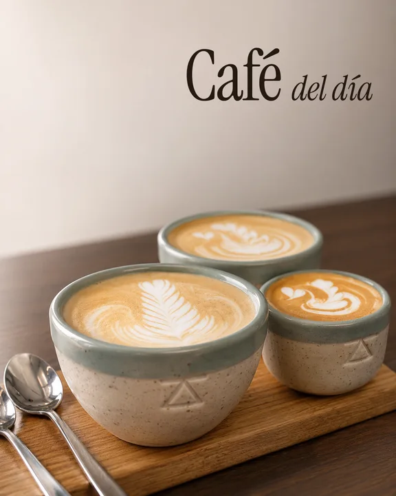
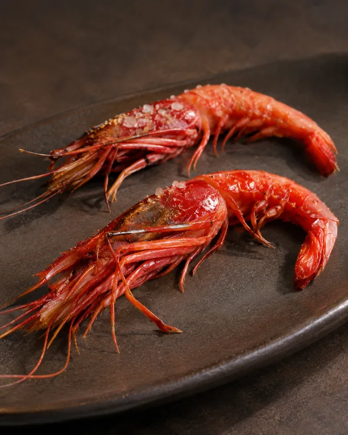

# Prueba de puesta en estudio y título sobre foto

El punto de partida fueron dos devoluciones del usuario. En el café, las tazas funcionaban y fallaban la letra y su posición. En la gamba, la segunda foto repetía el ángulo y una vajilla poco apetitosa. En ambos encargos se confirmó qué pertenece al producto y qué puede modificar el estudio. La calibración cambia cómo se toman y comprueban esas decisiones en el taller. Los pesos del generador de imágenes se mantienen.

## Café del día

El taller pidió una fotografía limpia con las tres tazas bicolor sobre la madera, sus tamaños relativos y sus dibujos de espuma. Recibió las tres tazas con aire en la pared. En la primera composición situó el título arriba a la izquierda. La segunda versión llevó el bloque a la derecha y alineó «Café», en Instrument Serif, con «del día», de menor cuerpo y en cursiva. El bloque mide 507 × 145 px en un lienzo de 1080 × 1350, termina a 64 px del borde derecho y queda por encima de las tres espumas. A 360 px el remate de la «f» puede confundirse con el acento. Apple Vision leyó «Caté del día». El texto de la capa es «Café del día» y la revisión conserva ambas lecturas.

También se probó Archivo de peso alto, con los dos renglones a la izquierda. El café conservó exactamente los mismos píxeles en ambas versiones fuera de las letras. Se puede comparar el efecto del cambio de peso y posición sobre la misma imagen. [Alternativa en Archivo](cafe-archivo.webp)

## Gamba roja a la brasa

La persona describió dos gambas enteras con sal gruesa y pidió sustituir la vajilla. La sesión partió de la misma foto que la muestra rechazada. Se pidió bajar la cámara, cambiar de flanco y separar los cuerpos sobre gres mate. En la candidata se siguen dos cabezas hasta dos abdómenes y dos colas. La sal clara se distingue del brillo localizado del caparazón y del gres. Algunas antenas salen por el borde izquierdo. Esta vista deja más superficie dorsal visible de la que sugerían los 10° de la comanda. El giro y la inclinación registrados son instrucciones de cámara. Su cumplimiento se juzga viendo los solapes y el perfil.

## Cómo se produjo y cómo repetir el cotejo

Los dos encargos se crearon mediante la API HTTP del Pase en modo simulado. Tras ajustar la toma y confirmar la comanda se descargó el ZIP. ImageGen recibió literalmente el archivo de dirección y únicamente el JPEG de producto de cada paquete. Las imágenes devueltas, de 1122 × 1402, entraron por la importación normal 4:5. El Pase las normalizó a 1080 × 1350. El título se trazó con archivos OFL del catálogo del proyecto. Las tres vistas WebP de esta carpeta son copias reducidas de candidatas marcadas para prueba de composición. El registro relaciona las huellas del producto, la comanda, el ZIP, el adjunto, el raster generado y los PNG del taller. [Registro por pieza](ensayo.json) · [Dirección del café](cafe-direccion.txt) · [Dirección de la gamba](gamba-direccion.txt)

Para repetir la prueba tipográfica, importa una foto limpia o usa el encuadre original bajo **Fotografía con un título**. En revisión abre **Recomponer el título sobre esta misma foto**. Cambia familia o ubicación y coteja la nueva versión a tamaño móvil. La receta mide la caja de los glifos, el contraste de dos tintas y el detalle de esa zona. Un fondo inadecuado puede llevar el texto al pie de papel. La revisión humana comprueba también si el bloque invade una taza o pesa más que la foto. Cada versión conserva caja, familia, tinta, contraste y huella de la foto base. Las correcciones de un encargo permanecen en su historial.

Para repetir el cotejo de la gamba, usa la fuente indicada en el registro, confirma el número de piezas y ajusta la cámara frente a la foto de origen. Contrasta en cada candidata las uniones entre cabeza, abdomen y cola, el color de cocción, el brillo y el apoyo. Un soporte de estudio sirve a un bodegón. En sala o en un retrato del equipo el taller conserva lo que identifica el lugar y a las personas. La disposición final, la anatomía y el apetito requieren revisar la imagen.

La distinción entre observación de la fuente y decisión aprobada procede del método de dirección visual de Society. El caso Da Tonino documentó la reserva de espacio desde cámara y el cotejo de la letra sobre la foto terminada. La decisión sobre el recipiente en este ensayo incorpora el permiso del usuario para estos bodegones. [Método visual](https://github.com/Paagola/society/blob/6802237/informes/Society_metodo_direccion_visual.md) · [Ensayo Da Tonino](https://github.com/Paagola/society/blob/6802237/pruebas/carrusel-da-tonino-2026-09-25/README.md)
