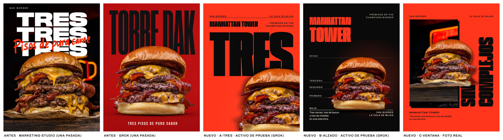
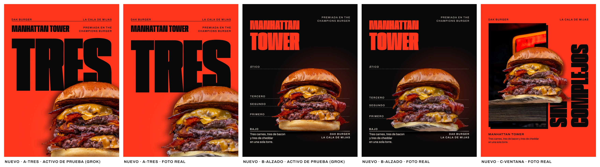

# F1 · Compositor gráfico (DAK Burger)

> **Histórico (09/11/2026).** Este informe describe una fase cerrada y ya no manda. El estado vigente, las decisiones y lo que queda están en [`diseno/f1_6/ESTADO.md`](../f1_6/ESTADO.md). Lo que aquí se contradiga con ESTADO.md, vale lo de ESTADO.md.

**Fecha:** 6 de noviembre de 2026
**Estado:** terminado y pendiente de tu revisión. No se ha empezado la F2 ni el director automático.
**Gasto:** 0 €. No se ha llamado a Gemini ni a Higgsfield.



Por orden: las dos piezas que generó el flujo antiguo de una pasada y los tres diseños nuevos. A y B aparecen aquí con el activo de prueba y C con la foto real.

---

## 1. Qué hay

| | Diseño | Familia y mecanismo | Activos con los que se compone |
|---|---|---|---|
| **A** | «TRES» | Color plano a sangre. La palabra monumental queda detrás del producto y la torre se sale por abajo y por la derecha | Grok (composición) y foto real (fidelidad) |
| **B** | «Alzado» | Low-key editorial. El plato se dibuja como un edificio en alzado: líneas de nivel por detrás, nombres de planta y suelo con sombra de contacto | Grok (composición) y foto real (fidelidad) |
| **C** | «Sin complejos» | Fotografía integrada. La escena real (neón, barra y papel de DAK) va en una ventana vertical; la torre se sale del marco por delante de una palabra girada | Solo la foto real: la ventana necesita la escena del local |

Las tres usan el **mismo motor** y la **misma marca**: rojo, negro, el neutro «papel» y las fuentes Anybody y Archivo. Lo que cambia entre ellas son las decisiones de la intención: capas, retícula, relaciones y textos. No hay ningún diseño programado a mano.



## 2. Entregables y dónde están

Todo lo generado está en `datos/disenos/f1/`. La carpeta no entra en git porque contiene la foto real; se regenera con `npm run f1`.

| Entregable | Ruta |
|---|---|
| Diseños finales (PNG 1080 × 1440) | `datos/disenos/f1/<diseño>/<variante>/v001/diseno.png` |
| Exportaciones 3:4 y 4:5 | `…/v001/exportadas/3x4.jpg` (1080 × 1440) y `4x5.jpg` (1080 × 1350) |
| Archivos editables | `…/v001/diseno.svg`: texto como `<text>` y capas incrustadas, para Figma o Illustrator con las fuentes de `recursos/tipografias/` instaladas |
| SVG exacto | `…/v001/diseno-trazos.svg`: texto como trazos, idéntico al PNG (diferencia media de 2–3/255) |
| Capas sueltas | `…/v001/capas/NN-id.png` (cada una del tamaño del lienzo, con transparencia) y `…/v001/hoja-capas.jpg` |
| Intención escrita a mano | `diseno/f1/intenciones/{a-tres,b-alzado,c-ventana}.json` (versionadas en git) y la copia de cada versión en `…/v001/intencion.json` |
| Documento resuelto | `…/v001/resuelto.json`: píxeles, cuerpos, ejes de las fuentes, medidas y problemas |
| Prueba de edición | `datos/disenos/f1/a-tres/composicion/v002/`: solo cambia el titular («TORRE»); se repinta 1 capa de 11 |
| Hojas de revisión | `datos/disenos/f1/hoja-disenos.jpg` y `comparativa-antes-despues.jpg` (copias en `diseno/f1/img/`) |
| Fotos usadas y su procedencia | `datos/locales/dak-burger/activos/<id>/activo.json` (los originales no se tocan) |

### Fotos usadas

| Activo | Tipo | Uso | Procedencia | Alteraciones |
|---|---|---|---|---|
| `dak-real-manhattan` | REAL | **PUBLICABLE** | Copia idéntica (sha256) de `datos/piezas/2026-11-03-la-manhattan-tower-tres-carnes/fotos/01-plato.jpg`. 1120 × 700 | Ninguna |
| `dak-grok-torre` | GENERADO | **SOLO_PRUEBA_COMPOSICION** | Copia de la imagen de grok del 03/11 (`datos/piezas/2026-11-03-manhattan-tower-la-torre-de/generadas/d1_v1.png`). 1776 × 2368 | Pan inferior distinto (más alto, redondeado y dorado); falta el papel con el logo; bacon y cheddar algo recolocados; fondo y texto generados |

Las máscaras son de Apple Vision (local, macOS) y se guardan en `mascara.png`. Las alturas de cada piso («niveles») se anotaron a mano mirando cada foto. El sistema avisa en cada render que usa `dak-grok-torre` de que no se puede publicar y de por qué.

## 3. Cómo se llegó a cada diseño (iteraciones)

No he dado por bueno nada solo por pintarse bien. Esto es lo que vi en cada vuelta y cómo lo corregí:

- **A, 1.ª vuelta:** «TRES» no se leía («TPES»). La cobertura media era del 30 %, pero la torre tapaba el 60 % de la R y la E, y además la palabra se cortaba por los lados.
  - **Cambio en el motor:** la relación «detrás» mide ahora la **peor franja** de la palabra, no la media.
- **A, 2.ª vuelta:** «Pisos de pura carne» encima de «TRES» se leía al revés y competía en peso con el titular. Lo cambié por el nombre del plato («Manhattan Tower · TRES»).
- **A, 3.ª vuelta:** el plato centrado era el esquema típico de plantilla. Lo desplacé a la derecha, sangrando por dos bordes: deja la T y la R limpias y da tensión.
- **A, 4.ª vuelta:** el pan tapaba el brazo inferior de la E y se leía «TRFS». Bajé la cobertura máxima al 20 %: ahora la cúpula solo toca la S.
- **B:**
  - el premio se salía de la zona segura y la frase pisaba la torre;
  - «DAK Burger» chocaba con el titular;
  - la línea de suelo cruzaba el pan (añadí el nivel «suelo» a cada activo);
  - la frase acababa en «…en una / sola torre». Era un fallo del motor: la regla contra viudas deshacía la de palabras cortas. Está corregido y tiene test.
- **C:** la primera versión (ventana apaisada y titular debajo) no funcionaba: el plato era pequeño y lo que se salía del marco parecía un error. La rehice con una ventana vertical a 1,4× (la foto real lo aguanta), la torre saliéndose por la derecha y el titular girado a toda la altura.
- **Recorte de la foto real:** la máscara arrastraba un filo rojo del neón. Añadí `contraerBorde`, que encoge la máscara 2,5 px antes de suavizarla.

## 4. Evaluación por criterios

Es mi valoración (1 = flojo, 5 = nivel de estudio) y hay que contrastarla con la tuya y con la prueba a ciegas. Las medidas son las del `resuelto.json`.

| Diseño (variante) | Composición | Tipografía | Fotografía | Fidelidad | Personalización |
|---|---|---|---|---|---|
| **A · grok** | 4: palabra monumental y asimetría; la estructura (palabra detrás) es conocida | 4: eje de anchura ajustado al ancho útil, jerarquía en tres niveles, versalitas precisas | 5: el activo tiene resolución de sobra (0,6×) | **No publicable**: producto alterado | 4: rojo a sangre y condensada negra muy DAK |
| **A · real** | 4: la misma | 4: la misma | **2**: la foto se amplía 1,91× y se ve blanda (el sistema lo avisa) | Fiel | 4 |
| **B · grok** | 5: idea propia, jerarquía asimétrica y el negro como espacio | 4: escala TOWER > MANHATTAN; frase sin viudas ni palabras cortas al final | 5 | **No publicable** | 4: negro y rojo, neón sugerido |
| **B · real** | 5 | 4 | 3: ampliación de 1,58×, justo por debajo del aviso (1,6×) y algo blanda | Fiel, y además sale el papel real de DAK | 5 |
| **C · real** | 4: asimétrica; el producto se sale del marco y pasa delante del texto | 4: titular girado a toda la altura; cartela limpia | 4: 1,4×; la escena real da autenticidad (neón y papel) | Fiel | 5: el local de verdad, su neón, su papel y su lema («sin complejos» sale de su descripción) |

**Lo que mide el sistema en todos:**
- Contraste de 5,5:1 (negro sobre rojo) y de 15,4–15,9:1 (crema sobre negro).
- Ningún texto pequeño tapa el plato.
- Todo el texto dentro de la zona segura 4:5.
- Mayúsculas de al menos 16 px.

**Qué se puede publicar hoy:** **C** y **B con la foto real**. A con la foto real necesita una foto con más resolución, y las variantes con grok no se pueden publicar.

## 5. Capas independientes (comprobado)

- **Cambiar el titular** (`conTexto`) crea la versión 2 con `padre: 1`. Se repinta **solo** `titular` y las otras 10 capas se reutilizan sin tocar. Tarda unos 1,4 s; casi todo es medir el contraste.
- **Cambiar la foto** (`conActivo`) repinta solo la capa del plato y lo que depende de ella. Hay test de las dos cosas.
- **Componer un diseño entero** tarda de 1,1 a 1,9 s a 1080 × 1440.

## 6. Arquitectura y archivos

Se respeta la estructura de puertos y adaptadores. **El generador antiguo no se ha tocado**: `git status` solo muestra modificados `package.json` y `package-lock.json`.

**Nuevos:**

```text
src/dominio/diseno/{intencion,resuelto,reticula,operaciones}.ts   esquemas, retícula y cambios (puros)
src/dominio/activos.ts                                            activo con procedencia, máscara y niveles
src/puertos/{Compositor,AlmacenActivos,AlmacenDisenos}.ts
src/adaptadores/compositor/{tipografias,MotorTexto,resolutor,raster,CompositorSharp}.ts
src/adaptadores/ficheros/{AlmacenActivosFicheros,AlmacenDisenosFicheros}.ts
src/aplicacion/diseno/componerDiseno.ts
src/herramientas/{prepararActivo.ts, mascara.swift, f1.ts}
src/tipos/fontkit.d.ts                                            tipos mínimos (fontkit no trae los suyos)
recursos/tipografias/{catalogo.json, anybody/, archivo/}          fuentes OFL con su licencia
diseno/f1/{plan.json, marcas/dak-burger.json, intenciones/*.json, img/, INFORME-F1.md}
test/compositor.test.ts
```

**Dependencia nueva:** `fontkit` (MIT, JavaScript puro). Se usa para medir y convertir el texto en trazos sin depender de las fuentes del sistema.

**Comandos nuevos:**
- `npm run activo` prepara un activo.
- `npm run f1` compone los diseños de la F1.

**Pruebas:** 71 de 71 (16 nuevas del compositor):
- retícula y zona segura;
- ajustes de texto (ancho, eje de anchura y partición sin viudas ni palabras cortas al final);
- glifos del español en las dos fuentes;
- «detrás» por franjas;
- detección de solapes, zona segura, tamaño mínimo y ampliación;
- «alineadoCon»;
- render a 1080 × 1440 determinista;
- caché por capa al cambiar texto o foto;
- SVG editable y exacto;
- contraste medido;
- guardado inmutable con exportaciones 3:4 y 4:5 y aviso del activo de prueba.

## 7. Limitaciones encontradas

1. **La resolución de la foto real decide qué diseños son posibles.** A con un plato enorme necesita 1,9× de una foto de 1120 × 700. El motor lo detecta y avisa, pero no lo arregla: hace falta una foto mejor (guía de foto) o un activo generado y aprobado.
2. **La medida de «detrás» por franjas no garantiza la forma de cada letra.** El caso de la E que parecía una F lo resolví bajando la cobertura a mano. Una comprobación por glifo queda pendiente.
3. **Las máscaras son de Apple Vision y solo funcionan en macOS.** Con esta hamburguesa salen bien, pero con un plato emplatado (el salmón) se queda solo con la pieza. Está detrás de un activo y no de un puerto de segmentación (eso es la F2).
4. **Las sombras son aproximadas:** silueta difuminada (proyectada) o elipse (contacto). No son una simulación física. Sobre color plano el plato podría flotar, y en A se evita sangrando por el borde.
5. **SVG editable:**
   - necesita las fuentes instaladas;
   - los ejes variables van con `font-variation-settings` y no he comprobado cómo los importa Figma;
   - las capas de foto, sombra, luz y grano van como imagen, no como vectores editables.
6. **Los textos de las intenciones son míos:**
   - «Ático / Tercero / Segundo / Primero / Bajo» es copia creativa;
   - «Sin complejos» sale de la descripción del local.
   - Aún no pasan la regla de cifras del brief (llegará con el director, en la F3). No hay ninguna cifra.
7. **El grano y la luz son sutiles a propósito.** En pantallas de móvil muy brillantes la luz radial de A apenas se ve.
8. **La prueba anti-plantilla con Asador Etxebarri** (otro lenguaje con el mismo motor) está pendiente. Es lo primero que propongo validar después de tu revisión.

## 8. Cómo reproducirlo

```bash
npm run activo -- --local dak-burger --id dak-real-manhattan --desde <foto> --tipo REAL --uso PUBLICABLE --descripcion "…"
npm run f1            # compone A, B y C (con cada activo) y la prueba de edición en datos/disenos/f1/
npm test              # 71 pruebas, sin claves ni gasto
```
