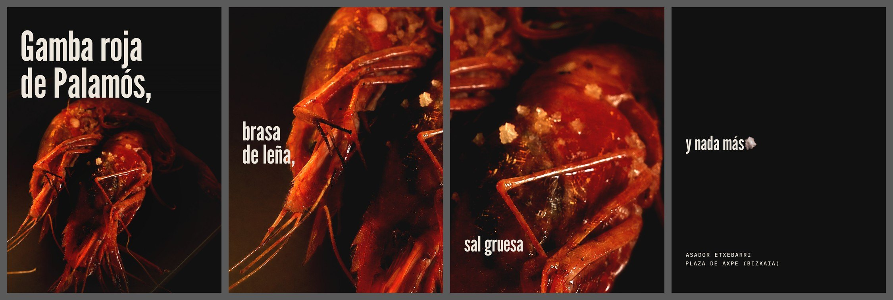
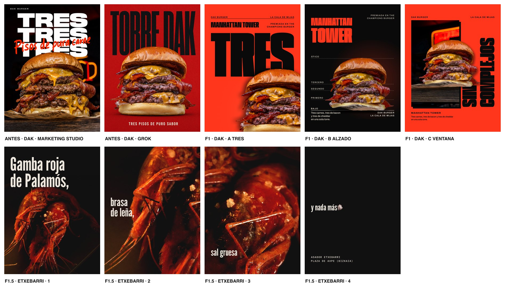

# Informe F1.5 · Dirección artística con la metodología de design-agent y primer carrusel profesional

2026-11-07. La F2 no se ha empezado, el director automático no se ha tocado y no se ha publicado nada.

## Resumen

- **El orden de trabajo cambia a primero la idea y después la composición**, con oficios, principios, rúbrica y aprendizaje adaptados de design-agent. Todo está en `conocimiento/` y `marcas/` y el director lo recupera por fases.
- **El carrusel de Asador Etxebarri es «Y nada más»:** una sola frase repartida en cuatro diapositivas («Gamba roja de Palamós, brasa de leña, sal gruesa y nada más»). La cámara se acerca hasta un grano de sal real que hace de único punto final.
- **La fotografía se produjo con la API de Higgsfield**, volviendo a iluminar la foto real con luz de brasa. Se comprobó la fidelidad de cada imagen y se descartaron 3 de 6.
- **Gasto: 1,977 USD** (tope de 5).
- **86 tests de 86** y typecheck limpio. Los diseños de la F1 salen idénticos píxel a píxel.

## A. Investigación de design-agent

[`INVESTIGACION-DESIGN-AGENT.md`](INVESTIGACION-DESIGN-AGENT.md) recoge:
- la arquitectura: agente principal y ayudantes, el entorno aislado, 36 skills, la wiki, el paquete de marca, las comprobaciones, `look`, las observaciones y las evaluaciones;
- su evolución: de 115 componentes que hacían piezas repetidas a principios sin reglas fijas, con las cifras del reglamento de vídeo;
- qué hace interesantes sus resultados sin perder la marca;
- qué encaja con nuestro proyecto y qué no;
- lo que hemos añadido nosotros;
- las fuentes, con el commit estudiado.

## B. Evolución del sistema creativo

| Qué | Dónde |
|---|---|
| Oficios (skills agrupadas) con proceso y ejemplos de buenas y malas decisiones: dirección de arte, fotografía gastronómica, composición y tipografía, texto publicitario, revisión visual | `conocimiento/oficios/` |
| Biblioteca de principios (regla con fuente o criterio que se pondera), antipatrones y rúbrica (dos filtros y siete criterios explicados) | `conocimiento/principios.md`, `antipatrones.md`, `rubrica.md` |
| Fichas de referencia (qué aporta, qué recurso se extrae y qué no se copia): Think Small, Powers of Ten, bodegones de Penn, tipos de madera y la biblioteca del usuario | `conocimiento/referencias/` |
| Recuperación por fase y formato (cabecera en cada documento; `seleccionar`, `indice`) | `src/dominio/conocimiento.ts`, `src/puertos/FuenteConocimiento.ts`, `src/adaptadores/ficheros/ConocimientoFicheros.ts` |
| Perfil de marca v2 (constantes y variables, restricciones, material, pendientes, fuente de cada dato) y lo que se saca hoy del `marca.json` de la web | `src/dominio/marca/perfil.ts`, `marcas/asador-etxebarri/perfil.json`, `marcas/README.md` |
| Aprendizaje: evidencias HUMANA, CRITICO, DETERMINISTA y AUTOMATICA; autor dueño o estudio; estados hipótesis, observada, confirmada o en duda; motivos estructurados en las valoraciones | `src/dominio/aprendizaje.ts`, `Valoracion.motivos` en `src/dominio/modelos.ts` |
| Tu valoración de la F1, guardada como criterio del estudio (confirmado, explícito) | `conocimiento/observaciones/estudio.json` |
| Compositor: `trasTexto` (una capa colocada tras la última letra de un texto, a escala de su mayúscula) y `retoque.puntoNegro` (el negro de la foto es el de la marca) | `src/dominio/diseno/intencion.ts`, `src/adaptadores/compositor/resolutor.ts`, `CompositorSharp.ts` |
| Activos: procedencia de generación (receta, prompt, `request_id`, referencias y coste), derivación determinista, veredicto de fidelidad y máscara por umbral | `src/dominio/activos.ts` |
| Herramientas de producción: generar con estimación y tope, comprobar la fidelidad, combinar la luz, extraer un detalle real y componer el carrusel con sus hojas | `src/herramientas/generarActivo.ts`, `fidelidad.ts`, `combinarLuz.ts`, `extraerDetalle.ts`, `carrusel.ts` |
| Tipografías OFL nuevas: League Gothic e IBM Plex Mono | `recursos/tipografias/` |

**Por qué solo dos capacidades nuevas en el compositor.** El compositor ya tenía libertad suficiente para esta idea. Le faltaban dos cosas que la idea pedía:
- colocar el grano de sal como signo de puntuación;
- que foto y fondo compartieran el negro, cuando la revisión encontró un escalón.

Siguiendo la lección de design-agent, no se ha añadido ningún recurso por adelantado. Las capacidades con valor real para la siguiente idea están en `conocimiento/oficios/composicion-y-tipografia.md`:
- texto sobre cualquier trazo;
- giros libres;
- máscaras de forma libre;
- una capa vectorial libre con los colores de la marca.

## C. Carrusel de Asador Etxebarri

| Entregable | Dónde |
|---|---|
| 4 imágenes finales (PNG 1080 × 1440 y JPG 3:4 y 4:5) y el pie | `datos/disenos/etxebarri-gamba-carrusel/final/` |
| Brief con registro de afirmaciones | `proyectos/etxebarri-gamba-carrusel/BRIEF.md` |
| Concepto y dirección de arte (v2) | `proyectos/etxebarri-gamba-carrusel/CONCEPTO.md` |
| Modelo, prompts, recetas, activos, procedencia y costes | `proyectos/etxebarri-gamba-carrusel/PRODUCCION.md`, `produccion/prompts/`, `produccion/recetas/` |
| Intenciones de diseño | `proyectos/etxebarri-gamba-carrusel/intenciones/` |
| Documentos resueltos, capas, SVG editable y exacto, exportaciones de cada versión | `datos/disenos/etxebarri-gamba-carrusel/<diapositiva>/vNNN/` |
| Hojas de revisión (serie, móvil, capas) de v1, v2 y final | `datos/disenos/etxebarri-gamba-carrusel/revision/` |
| Pie de publicación | `proyectos/etxebarri-gamba-carrusel/PIE.txt` |
| Activos con procedencia y comprobaciones de fidelidad | `datos/locales/asador-etxebarri/activos/` |

**Modelo elegido:** Marketing Studio Image 2.0 Alpha, por la API. Fue el único que conservó el plato y tiene 4K con precio cerrado.
- **Descartados:** Qwen Edit y Grok, porque alteran el producto. Flare y Sunburst cobran por tokens sin importe cerrado.
- **La foto de campaña** combina la luz de una generación 2K con el detalle de una 4K. Las dos conservan el producto y la combinación no costó nada.

## D. Evaluación

La revisión completa está en [`REVISION.md`](../../proyectos/etxebarri-gamba-carrusel/REVISION.md). Incluye los siete criterios por diapositiva, el carrusel entero, las notas por impacto, los aciertos que hay que proteger, el historial de iteraciones y la comparación con DAK.

**Veredicto del crítico: corregir y publicar.** No hay nada por debajo de 3. La más fuerte es la 4 (la idea) y la más débil, la 3 (macro a 1,5× sobre detalle generado).

**Mejora frente a DAK (F1):**
- la idea decide la escala, el texto y el ritmo;
- no es una plantilla de DAK;
- hay dirección fotográfica con IA y fidelidad demostrada;
- el texto es exacto y editable.

**Sigue siendo insuficiente:**
- **Tiene menos energía que los posts antiguos de DAK.** En parte es buscado (el local es sobrio) y en parte un límite real: hay una sola foto, un plano de mesa con luz de día.
- **La diapositiva 3 está blanda.**
- **La 2 y la 3 se parecen en el móvil.**
- **Las intenciones las escribí yo:** el director automático todavía no sabe hacerlo (F2).

## E. Estado técnico

**Archivos nuevos:**
- **Código:**
  - `src/dominio/aprendizaje.ts`, `src/dominio/conocimiento.ts`, `src/dominio/marca/perfil.ts`;
  - `src/puertos/FuenteConocimiento.ts`, `src/adaptadores/ficheros/ConocimientoFicheros.ts`;
  - `src/herramientas/{generarActivo,fidelidad,combinarLuz,extraerDetalle,carrusel}.ts`.
- **Tests:** `test/compositor-f15.test.ts`, `test/conocimiento.test.ts`.
- **Conocimiento, marcas y proyecto:**
  - `conocimiento/` (15 documentos y las observaciones);
  - `marcas/` (README, perfil y tokens de Etxebarri, tokens de DAK);
  - `proyectos/etxebarri-gamba-carrusel/` (brief, concepto, producción, revisión, pie, plan, intenciones, prompts, recetas e imágenes de revisión).
- **Fuentes y documentos:**
  - `recursos/tipografias/{league-gothic,ibm-plex-mono}/` (con su OFL);
  - `diseno/f1_5/` (este informe y la investigación).

**Archivos modificados:**
- **Dominio:** `src/dominio/activos.ts` (procedencia de generación, derivación, fidelidad, máscara UMBRAL), `src/dominio/diseno/intencion.ts` (`trasTexto`, `puntoNegro`), `src/dominio/diseno/resuelto.ts` (`fin` de cada línea), `src/dominio/modelos.ts` (`motivos` opcionales).
- **Compositor:** `src/adaptadores/compositor/resolutor.ts` y `CompositorSharp.ts`. El retoque ahora es asíncrono, con el punto negro en una segunda pasada.
- **Cliente de Higgsfield:** `src/adaptadores/higgsfield/ClienteHiggsfield.ts` gana `estimar` y `consultar`; lo que ya hacía no cambia.
- **Proyecto:** `recursos/tipografias/catalogo.json`, `package.json` (scripts) y `README.md`.

**Pruebas:**
- `npm run typecheck`: limpio.
- `npm test`: **86/86**: los 71 de antes, 5 del compositor F1.5 y 10 de conocimiento, perfil y aprendizaje.
- El test del punto negro con contraste reproduce el fallo que encontré durante la revisión: el contraste llevaba el negro por debajo de 0 antes de aplicar el punto negro.

**Renders:**
- **Diapositivas:** 0,15–0,75 s cada una.
- **F1:** recompuesta en una carpeta temporal, los 6 PNG son idénticos a los de `datos/disenos/f1/`. No se ha tocado ningún diseño de la F1.

**Costes:**
- **Total:** 1,977 USD en 6 imágenes, sin recargas ni contrataciones.
- **Registro:** `datos/gasto/higgsfield.jsonl`.
- **Importe:** el de `/estimate` para modelos de precio cerrado. La API no devuelve el coste final ni tiene un endpoint de saldo documentado; el saldo se puede cotejar en la consola.

**Limitaciones:**
- Una sola foto real. La 3 se ve blanda.
- Las máscaras de Apple Vision no sirven para las gambas: pierden las antenas.
- La medida de fidelidad se confunde con cambios de luz (Grok y Qwen dieron cifras parecidas a imágenes muy distintas), así que el veredicto exige mirar los recortes.
- Fuentes y firma propuestas sin confirmar con el local. No hay logotipo.
- La vista de móvil y la miniatura borrosa las monté a mano en esta fase; la serie, el móvil y las capas ya salen de `carrusel.ts`.

**Riesgos:**
- **Etxebarri es un restaurante real** y la pieza es una propuesta no encargada: no se puede publicar sin su permiso.
- **El modelo de Higgsfield** puede alterar el producto con la misma receta a otra resolución, así que cada imagen se comprueba siempre.
- **El catálogo y los precios de la API cambian:** se vuelven a mirar antes de cada producción.
- **El conocimiento puede crecer hasta ser un reglamento.** Las reglas solo cambian con una prueba y con aprobación.

**Git:**
- La F1 está confirmada y etiquetada como referencia recuperable: commit `4a57f81`, etiqueta `f1`.
- La F1.5 está **sin confirmar**, pendiente de tu revisión.
- `datos/` (activos, diseños y gasto) queda fuera de git, como siempre.
- Sin remoto y sin subir nada.
