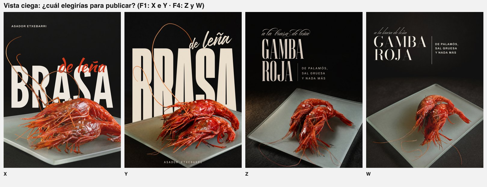
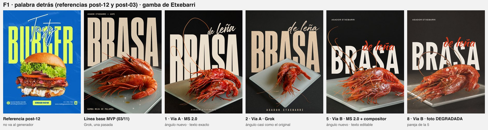
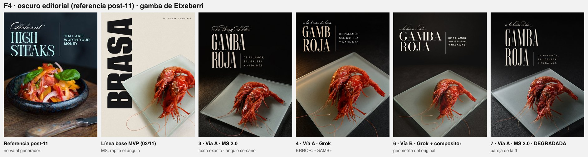
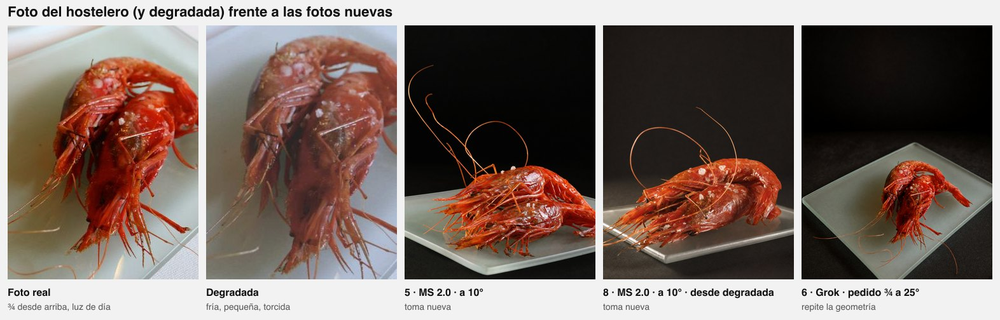

# F1.6 · Benchmark de foto nueva: vía A (integrada) frente a vía B (por capas)

> **Histórico (09/11/2026).** Este informe describe una fase cerrada y ya no manda. El estado vigente, las decisiones y lo que queda están en [`diseno/f1_6/ESTADO.md`](ESTADO.md). Lo que aquí se contradiga con ESTADO.md, vale lo de ESTADO.md.

2026-11-07. Lanzado con tu «adelante».
- **Gasto:** **2,012 USD en 8 imágenes**, de un tope de 2,70. No falló ninguna, no hubo reintentos y queda sin usar la reserva de 0,69 USD.
- **Acumulado de Higgsfield:** 3,989 USD (registro en `datos/gasto/higgsfield.jsonl`).
- **Vía B:** se compuso con el compositor, sin coste.

**Antes de leer las conclusiones, mira la vista ciega y elige** (la clave está al final):

## Resumen

1. **El manual de foto nueva funciona, pero solo si la cámara pedida está lejos de la original.**
   - **A ras de mesa (10°):** con 100 mm, Marketing Studio hizo **tomas nuevas de verdad** (1, 5 y 8), también **partiendo de la foto degradada**.
   - **En ¾ a 25°:** cerca del ¾ a 45° del hostelero, los dos modelos volvieron a la geometría original (3, 4, 6 y 7).
2. **Marketing Studio 2.0 es el modelo para la foto nueva. Grok no.**
   - Grok **conserva la pose y el ángulo de la foto subida** en sus tres imágenes (2, 4 y 6).
   - Además escribió «GAMB» en lugar de «GAMBA» (4).
3. **F1, palabra detrás: la vía B iguala a la A.** La imagen 5 compuesta tiene:
   - «BRASA» detrás y las antenas cruzando por delante de las letras;
   - «de leña» en pincel;
   - el texto exacto y editable.

   Necesitó dos correcciones gratuitas: colocar la script sobre la palabra y cambiarla de color porque se fundía (contraste 1:1). Para esta familia recomiendo la **vía B**.
4. **F4, oscuro editorial: no hay conclusión todavía**, porque ninguna imagen consiguió un ángulo nuevo.
   - **Tipografía:** la vía A con Marketing Studio (3) imita mejor la didona condensada del post-11 que nuestra Bodoni Moda (6), que no es condensada.
   - **Comparación desigual:** la 6 es de Grok, así que A y B no son comparables en F4.
5. **Una foto mala de partida no estropea el resultado.** Las parejas 5/8 y 3/7 salen con calidad parecida.
6. **La máscara sobre carbón liso resuelve las antenas:** Apple Vision más luminosidad, combinadas.

## Imagen a imagen (comprobación de componentes; el veredicto es tuyo)

Componentes que tienen que estar:
- dos gambas enteras con cabeza, antenas largas y patas;
- sal gruesa;
- puntas tostadas;
- el plato cuadrado de cristal esmerilado;
- nada añadido.

| # | Vía · modelo · partida | Componentes | Ángulo nuevo | Texto | Mi propuesta |
|---|---|---|---|---|---|
| 1 | A · MS 2.0 · original | Todos. **Añade manchas negras de tostado sobre el caparazón** (textura, no un componente) | **Sí** (lateral a ras de mesa) | «BRASA», «de leña», «ASADOR ETXEBARRI»: exactos, con ñ | CONSERVA, salvo que las manchas te parezcan un añadido |
| 2 | A · Grok · original | Todos | **No** (casi cenital, como el original) | Exacto | Descartar: no es una foto nueva y el producto queda pequeño |
| 3 | A · MS 2.0 · original | Todos | Parcial (¾ parecido) | Exacto con acentos (PALAMÓS, MÁS) | CONSERVA; el ángulo se queda corto |
| 4 | A · Grok · original | Todos | No | **«GAMB»** | Descartar (texto) |
| 5 | B · MS 2.0 · original | Todos, con **menos sal** que la foto real | **Sí** | Lo pone el compositor | CONSERVA |
| 6 | B · Grok · original | Todos | No (la geometría del original) | Lo pone el compositor | Descartar: no es una foto nueva |
| 7 | A · MS 2.0 · **degradada** | Todos | Parcial | Exacto con acentos | CONSERVA; el ángulo se queda corto |
| 8 | B · MS 2.0 · **degradada** | Todos. **El plato sale más transparente** (cristal claro con el canto esmerilado) | **Sí** | Lo pone el compositor | Tú decides si el plato sigue siendo «el mismo» |

**Frente a la línea base del MVP:**
- **La pieza A del MVP** (Grok, «BRASA» detrás) ya tenía la idea.
- **Las 1 y 5 la mejoran:**
  - las gambas están más grandes y en una toma lateral de verdad;
  - las antenas atraviesan la palabra;
  - la jerarquía tiene tres niveles.
  - En la 5, además, el texto es editable.
- **La pieza B del MVP** (que repite el ángulo) es justo el error que se quería corregir.

## Lo que dejo cambiado (sin coste)

- **`src/herramientas/crearMascara.ts`** hace máscaras por luminosidad, por Apple Vision o **combinadas**, para fotos nuevas sobre carbón liso.
  - **Visto en la imagen 5:** Vision guarda las antenas pero deja fuera el plato; la de luminosidad guarda el plato pero se agujerea en las manchas oscuras. Juntas no pierden nada (`img/mascaras-vision-y-luminancia.jpg`).
- **Intenciones de la vía B:** `proyectos/benchmark-f1-6/intenciones/`, con versiones v1 y v2 en `datos/disenos/benchmark-f1-6/`.
- **Script de «de leña»:** va en el **rojo de la gamba** (#D2391C, medido sobre la foto). Es un acento que propongo yo, porque la marca solo tiene hueso y carbón. **Confírmalo o recházalo.**

## Lo que propongo para las fases siguientes

1. **Foto nueva:**
   - Marketing Studio 2.0;
   - cámara **claramente distinta** del original: si la foto es de ¾ desde arriba, pedir a ras de mesa (10–15°) o cenital (90°), nunca otro ¾;
   - el plan de toma de la FASE 2 avisará cuando el ángulo pedido esté a menos de unos 30° del de la foto subida.
2. **F1 y sus parientes (palabra detrás, patrón, girada):** vía B. Lo que el compositor sabe hacer, mejor por capas.
3. **Vía A solo para integraciones físicas** que el compositor no puede hacer: letras que gotean, se deshacen en burbujas o se enroscan por delante y por detrás (ejemplos 04, 05 y 06). Siempre con lectura del texto y como mucho dos palabras grandes.
4. **F4:** repetir **una** imagen con cámara a ras de mesa (Marketing Studio, unos 0,35 USD) para decidir A o B con un ángulo nuevo. **No lo he hecho sin preguntarte:** la reserva era para reintentos por texto o componentes, no para cambiar el protocolo.
5. **Rúbrica (FASE 3):** añadir «¿la cámara está lejos de la original?».

## Dudas para ti

1. Tu elección en la vista ciega (X o Y en F1; Z o W en F4).
2. ¿Las **manchas de tostado** añadidas en la 1 y el **plato más transparente** de la 8 descartan esas imágenes?
3. ¿Aceptas el **rojo de la gamba** como acento de la script?
4. ¿Autorizas **una** imagen más (unos 0,35 USD) para el F4 a ras de mesa, o pasamos ya a la FASE 2 con lo que hay?

---

**Clave de la vista ciega:**
- X = vía B (5, compuesta);
- Y = vía A (1);
- Z = vía A (3);
- W = vía B (6, foto de Grok).
