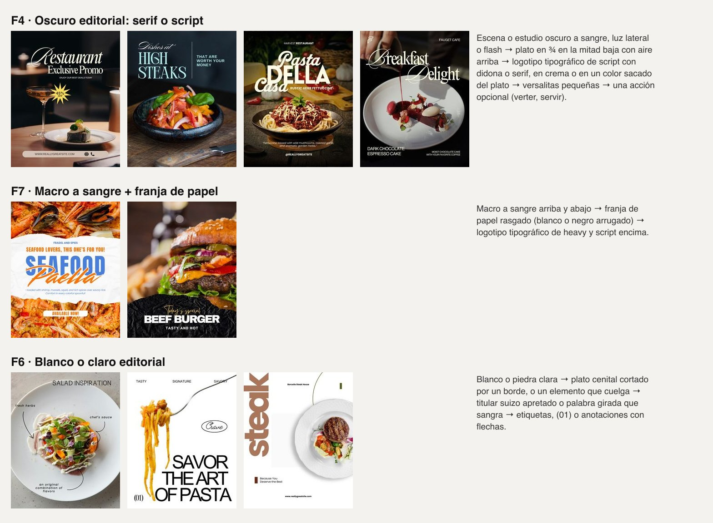
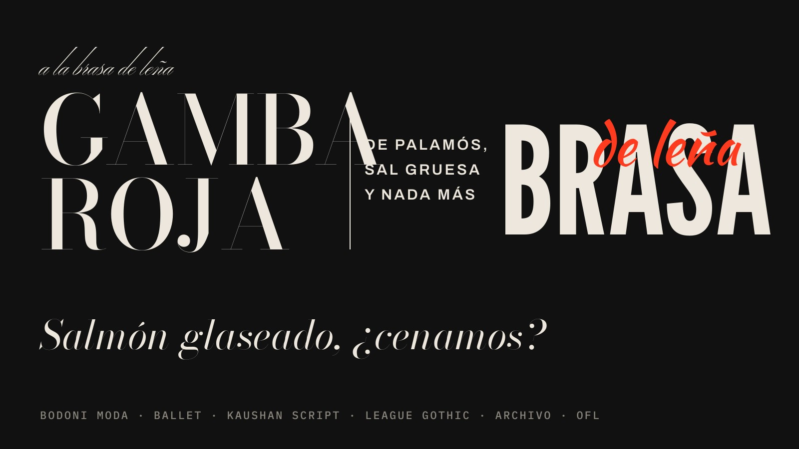
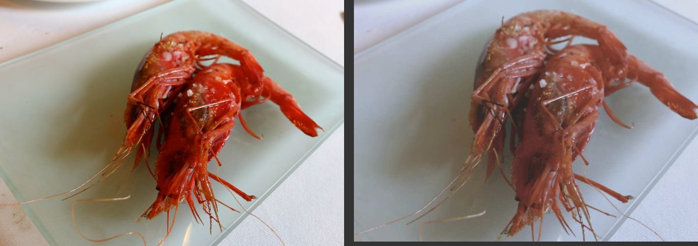

# F1.6 · FASE 1: referencia obligatoria y conocimiento

> **Histórico (09/11/2026).** Este informe describe una fase cerrada y ya no manda. El estado vigente, las decisiones y lo que queda están en [`diseno/f1_6/ESTADO.md`](ESTADO.md). Lo que aquí se contradiga con ESTADO.md, vale lo de ESTADO.md.

2026-11-07. **Sin gasto.** La F1.5 quedó confirmada antes de empezar (commit `3bbfe33`, etiqueta `f1_5`). Lo de esta fase está **sin confirmar**, pendiente de tu revisión.

## Resumen

- **Regla en el dominio, con tests:** mientras un local tenga menos de **5** piezas creadas en modo real (umbral configurable), una pieza no pasa de brief a concepto sin una referencia **elegida y analizada**.
  - Funciona desde la línea de comandos: `npm run referencia`.
  - La web **no** la aplica todavía; queda anotado en `ARQUITECTURA.md` §11.
- **Entrada de referencias:** imagen o captura, enlace de Canva o Pinterest, o un post de la biblioteca. Probado contra los sitios reales:
  - **Canva** responde 403 o 400 a cualquier lector automático, así que con Canva casi siempre se pide captura.
  - **Pinterest**, sin un pin válido, devolvía su logotipo genérico. Lo detecté, lo corregí y lo cubre un test.
- **Las 29 fichas** son datos validables, con las **10 familias**. Sin referencia, el sistema propone tres familias con su ficha visual.
- **Conocimiento corregido:**
  - entran los ejemplos y el manual de foto nueva;
  - la fidelidad pasa a FLEXIBLE en cámara, luz y fondo y estricta en elementos;
  - se retiran las prohibiciones de mecanismos que aprobaste.
- **Nuevas fuentes OFL:** Bodoni Moda (didona), Ballet (script de florituras) y Kaushan Script (pincel).
- **Tests:** **105 de 105** (los 86 de antes y 19 nuevos). Typecheck limpio.
- **Benchmark preparado y sin lanzar:** 8 recetas y prompts, con un precio exacto de **2,012 USD** (sección 6). **Espero tu «adelante».**

## 1. La regla de la referencia obligatoria

`src/dominio/referencia.ts`:
- **`UMBRAL_REFERENCIA_OBLIGATORIA = 5`.**
- **`piezasRealesDelLocal`:** cuenta las piezas del almacén real de ese local y descarta las que solo tienen generaciones simuladas.
- **`comprobarPasoAConcepto`** responde *puede* o *no puede*, y en el segundo caso dice qué falta:
  - REFERENCIA;
  - FICHA (no se analiza sin la imagen);
  - CAPTURA (el enlace no se pudo leer).
- **`UsoDeReferencia`:** el concepto tiene que declarar qué toma y qué no copia de la referencia.
- **`proponerFamilias`:** primero las familias que encajan con los tonos del local y luego variedad de fondo (color, oscuro, claro). El orden es estable.

Casos de uso (`src/aplicacion/referencias/`):
- `registrarReferencia`;
- `anadirCaptura`;
- `guardarFicha`;
- `comprobarReferencia`, que es lo que tendrá que llamar la web antes de `proponerConceptos`.

Están detrás de tres puertos nuevos: `AlmacenReferencias`, `ObtenedorEnlaces` y `BibliotecaDeReferencias`. Las referencias se guardan en `datos/locales/<slug>/referencias/<id>/`.

**Prueba real:** Etxebarri y DAK tienen 2 piezas reales cada uno.

```text
$ npm run referencia -- comprobar --local asador-etxebarri
✖ Este local lleva 2 pieza(s); hasta la 5.ª cada pieza parte de una referencia (quedan 3). Sube una imagen o pega un enlace de Canva o Pinterest, o elige una de las familias propuestas.
  Familias propuestas: F4 Oscuro editorial · F7 Macro a sangre + papel · F6 Blanco editorial
```

Ficha visual para Etxebarri (tonos sobrio, artesano y fuego):



Para DAK (canalla, nocturno y urbano) propone F1, F4 y F7: [`img/propuestas-dak.jpg`](img/propuestas-dak.jpg).

## 2. Enlaces: lo que pasa de verdad

`src/adaptadores/enlaces/ObtenedorEnlacesHttp.ts` lee la página, su `og:image` o un enlace directo a una imagen. No inicia sesión, no usa la API y no busca en las plataformas.

Prueba contra los sitios reales del 07/11:

| Enlace | Resultado |
|---|---|
| `canva.com/templates/` | HTTP 403 → **pide captura** |
| `canva.com/design/…/view` (id inventado) | HTTP 400 → pide captura |
| `pinterest.com/` y `pin.it/abc123` | Devolvían `s.pinimg.com/images/facebook_share_image.png`, **el logotipo genérico de Pinterest**. Corregido: se rechazan las imágenes genéricas y, en Pinterest, solo se aceptan imágenes de `i.pinimg.com` → pide captura |
| `pinterest.es/pin/1/` | La página no publica la imagen → pide captura |

**Lo que no he podido comprobar:** un pin o un diseño de Canva reales y públicos, porque no tengo ningún enlace tuyo. Cuando se lea uno, la herramienta pide que confirmes que la imagen guardada es el post. Lo que no se ha visto no se analiza.

También encontré y corregí que el proceso no terminaba: los cuerpos de las respuestas con error quedaban abiertos.

## 3. Fichas y familias como datos

- `conocimiento/referencias/fichas/post-NN.json` (29): esquema `referencia/ficha@1`, con los campos de la FASE 0 y los HEX medidos.
- `conocimiento/referencias/familias.json`: las 10 familias, con su receta, lo que le falta al compositor y los tonos con los que encaja.
- **Test:** las 29 son válidas, cada post está en una sola familia, la familia de su ficha coincide y existe su imagen.

## 4. Conocimiento corregido (con su prueba)

| Cambio | Dónde | Prueba |
|---|---|---|
| Foto nueva, no foto mejorada; **manual de foto nueva** de 8 pasos | `oficios/fotografia-gastronomica.md`, principio 16b | `ejemplos/01`; pieza A frente a B del MVP; tu valoración del 07/11 |
| Fidelidad FLEXIBLE por defecto; ESTRICTA si el local lo pide | `oficios/fotografia-gastronomica.md`, principio 16, `perfil.ts` → `fidelidad`, perfil de Etxebarri | Tu decisión del 07/11, que sustituye a la del 06/11 |
| Los mecanismos aprobados se adaptan, no se descartan | Principio 16c, `antipatrones.md`, `direccion-de-arte.md`, `composicion-y-tipografia.md`, observación `palabra-detras-no-por-defecto` | Ejemplos 02, 03, 05 y 07; tu valoración del 07/11 |
| «Tres niveles» vuelve a ser la norma (antes era «una frase y la firma») | `composicion-y-tipografia.md`, `texto-publicitario.md`, `antipatrones.md`, principio 21 | Casi todos los 29 posts de referencia |
| El director recibe `ejemplos/` y las familias por fase | `conocimiento/ejemplos.md`, `conocimiento/referencias/familias.md` (sustituye a `biblioteca-usuario.md`) | Test de recuperación por fase |
| El concepto de la F1.5 lleva una nota de corrección (se conserva por trazabilidad) | `proyectos/etxebarri-gamba-carrusel/CONCEPTO.md` | FASE 0 §3 |
| Tres observaciones nuevas del estudio, confirmadas: `foto-nueva-no-mejorada`, `fidelidad-flexible-por-defecto`, `partir-de-referencia` | `observaciones/estudio.json` | Tu mensaje del 07/11 |

## 5. Fuentes nuevas (OFL)



**Las tres fuentes nuevas son:**
- Bodoni Moda (didona variable de alto contraste, con cursiva), para F4;
- Ballet (script formal con florituras), para los logotipos tipográficos de F4;
- Kaushan Script (pincel), para F1 y F7.

**Comprobado:** se pintan con nuestro motor, con acentos, eñe y ¿¡.

**Ojo:** Bodoni Moda con el tamaño óptico al máximo (96) tiene trazos finos casi invisibles. Para el móvil hay que usar un tamaño óptico de unos 24–40 (es un ajuste del estilo, no un problema).

## 6. Plan final del benchmark (espera tu «adelante»)

**Foto de partida:** la foto real y su versión **degradada**: reducida a 1000 px, torcida 6°, con luz fría, poco contraste, algo movida y JPEG al 55 %. Es determinista y queda registrada como activo derivado (`src/herramientas/degradarFoto.ts`).



**Referencias en palabras:**
- F1: post-12 y post-03, adaptados a Etxebarri como **carbón liso** con «BRASA» detrás y «de leña» en script;
- F4: post-11, «GAMBA / ROJA» en didona y «a la brasa de leña» en script.

Todos los textos están documentados. El post de referencia no va al generador.

**Prompts** (`proyectos/benchmark-f1-6/prompts/*.final.txt`):
- llevan el bloque común de elementos del manual: «use it only as the list of elements», «exactly two», «correct anatomy», «nothing else added» y lo que no se reproduce (mantel, mancha, el otro plato);
- piden una **cámara distinta del original**: a ras de mesa a 10° con 100 mm en F1, ¾ a 25° con 85 mm en F4.

| # | Receta | Vía | Familia | Modelo | Foto de partida | Precio (`/estimate`) |
|---|---|---|---|---|---|---|
| 1 | `b1-a-f1-ms2` | A (foto y texto) | F1 | Marketing Studio 2.0 2K | original | 0,350 |
| 2 | `b2-a-f1-grok` | A | F1 | Grok 2.0 2K | original | 0,090 |
| 3 | `b3-a-f4-ms2` | A | F4 | Marketing Studio 2.0 2K | original | 0,349 |
| 4 | `b4-a-f4-grok` | A | F4 | Grok 2.0 2K | original | 0,090 |
| 5 | `b5-b-f1-ms2` | B (sin texto, carbón liso) | F1 | Marketing Studio 2.0 2K | original | 0,347 |
| 6 | `b6-b-f4-grok` | B (sin texto, aire arriba) | F4 | Grok 2.0 2K | original | 0,090 |
| 7 | `b7-a-f4-…-degradada` | A | F4 | **El ganador de 3 y 4** (si gana Grok, 0,09) | **degradada** | ≤ 0,349 |
| 8 | `b8-b-f1-ms2-degradada` | B | F1 | Marketing Studio 2.0 2K | **degradada** (pareja de la 5) | 0,347 |
| | | | | | **Total** | **2,012 USD** |

**Margen hasta tu tope de 2,70 USD:** 0,69 USD para como mucho un reintento de Marketing Studio y uno de Grok, solo si una imagen añade un componente o falla el texto.

**Cómo se lanza:**
- En dos tandas: primero 1–6, y la 7 cuando sepa qué modelo gana en F4.
- El tope de la herramienta es acumulado (incluye los 1,977 USD de la F1.5), así que se lanza con `--tope 4.68` (1,977 + 2,70).

**Vía B sin coste extra:** la foto sobre carbón liso permite una máscara por luminosidad (los rojos y el cristal claro sobre #111). Probaré esa máscara y Apple Vision sobre la misma imagen, y compondré las piezas de la vía B con el compositor.

**Qué te enseño después:**
- **Una hoja por familia** con:
  - la referencia;
  - la línea base del MVP (`img/mvp-via-integrada.jpg`);
  - la vía A con los dos modelos;
  - la vía B ya compuesta;
  - las parejas original y degradada.
- **Para cada imagen:**
  - la lista de componentes (dos gambas, cabezas, antenas, patas, sal, plato de cristal esmerilado y nada añadido) con recortes lado a lado;
  - si el ángulo es nuevo;
  - si el texto y los acentos son exactos;
  - si podría estar entre las referencias;
  - cómo se ve a 390 px;
  - el coste.
- **Una vista ciega** (sin decir qué vía es cada una) para que elijas.

Antes de enseñártelo lo miro y lo critico yo.

## 7. Estado técnico

**Archivos nuevos:**
- **Dominio y puertos:**
  - `src/dominio/referencia.ts`;
  - `src/puertos/{AlmacenReferencias,ObtenedorEnlaces,BibliotecaDeReferencias}.ts`.
- **Adaptadores:**
  - `src/adaptadores/ficheros/{AlmacenReferenciasFicheros,BibliotecaDeReferenciasFicheros}.ts`;
  - `src/adaptadores/enlaces/ObtenedorEnlacesHttp.ts`.
- **Casos de uso:** `src/aplicacion/referencias/{dependencias,registrarReferencia,anadirCaptura,guardarFicha,comprobarReferencia}.ts`.
- **Herramientas:** `src/herramientas/{referencia,degradarFoto}.ts`.
- **Tests:** `test/referencias.test.ts` (19).
- **Conocimiento:**
  - `conocimiento/ejemplos.md`;
  - `conocimiento/referencias/{familias.md,familias.json}`;
  - `conocimiento/referencias/fichas/` (29).
- **Fuentes:** `recursos/tipografias/{bodoni-moda,ballet,kaushan-script}/`, con su OFL.
- **Benchmark:** `proyectos/benchmark-f1-6/` (prompts y recetas).
- **Documentos:** `diseno/f1_6/` (FASE-0, FASE-1 e img/).

**Archivos modificados:**
- **Código:** `src/dominio/marca/perfil.ts` (campo `fidelidad`).
- **Datos de marca y fuentes:** `marcas/asador-etxebarri/perfil.json`, `recursos/tipografias/catalogo.json`.
- **Conocimiento:** `conocimiento/{README,principios,antipatrones}.md`, `conocimiento/oficios/{direccion-de-arte,fotografia-gastronomica,composicion-y-tipografia,texto-publicitario}.md`, `conocimiento/observaciones/estudio.json`.
- **Tests:** `test/conocimiento.test.ts`.
- **Proyecto y documentación:** `package.json` (`npm run referencia`), `README.md`, `diseno/ARQUITECTURA.md` §11, `proyectos/etxebarri-gamba-carrusel/CONCEPTO.md` (nota de corrección).

**Borrado:** `conocimiento/referencias/biblioteca-usuario.md`, que sustituye `familias.md`.

**Datos fuera de git:**
- `datos/locales/{asador-etxebarri,dak-burger}/referencias/propuestas.jpg`;
- `datos/locales/asador-etxebarri/activos/etx-real-gamba-degradada/`.

**Sin tocar:**
- el generador antiguo y la web;
- los diseños de la F1 y la F1.5.

**Ajenos a mí:** `biblioteca/ejemplos.zip` y `biblioteca/referencias.zip` aparecieron hoy. Son copias de esas carpetas, sin imágenes nuevas. No los toco ni los añado a git.

**Gemini:** no se ha usado. El análisis de las referencias de esta fase lo hice yo a mano.

**Git:** sin confirmar, esperando tu aprobación.
