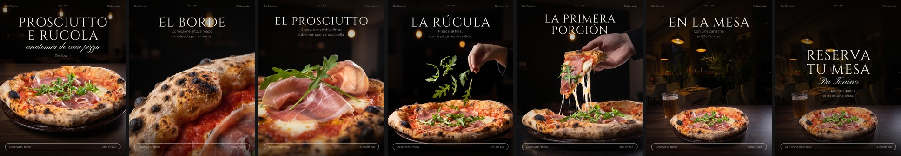
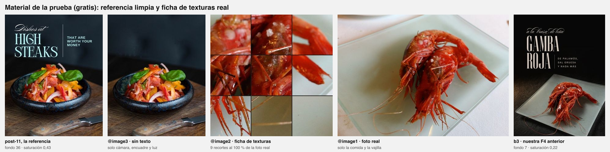
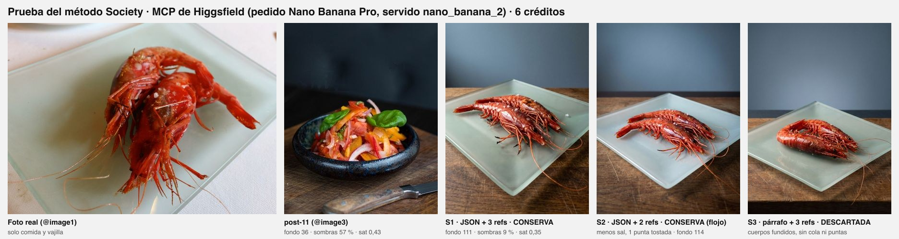
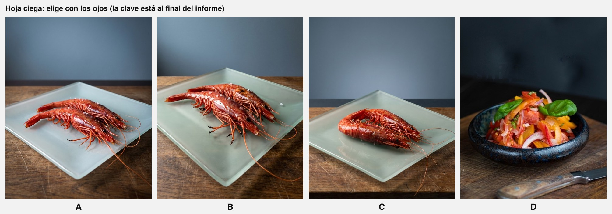
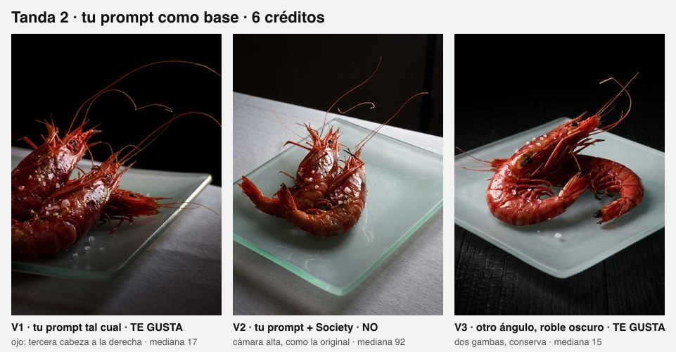
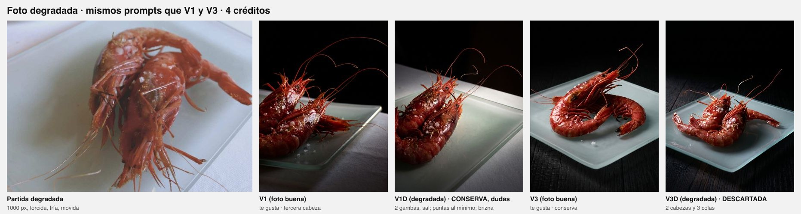

# F1.6 · Lo que aprendí del repositorio Society, y la prueba que propongo

> **Histórico (09/11/2026).** Este informe describe una fase cerrada y ya no manda. El estado vigente, las decisiones y lo que queda están en [`diseno/f1_6/ESTADO.md`](ESTADO.md). Lo que aquí se contradiga con ESTADO.md, vale lo de ESTADO.md.

07/11/2026. Leído en `github.com/Paagola/society`:
- **skill `directoria`:** el método PromptDirector, las correcciones de hostelería 00–08 y la plantilla de prompt;
- **skill `director-reels`:** el compilador de prompts y el perfil de Da Tonino;
- **el carrusel de Da Tonino**, el registro de errores del 22/09 y el método de dirección visual.

**Sin gasto.** Todo lo preparado está en `proyectos/prueba-metodo-society/`.

## Resumen

1. **Society descompone la foto de la referencia, no solo su maqueta.**
   - Cada referencia se traduce a un *JSON Decoded Brief* de unos doce campos: qué es el sujeto, el entorno con distancias, la luz con su fuente, la cámara (mm, f/, distancias, temperatura) **con el resultado visible en palabras**, la composición, las imperfecciones con ubicación, la paleta y los negativos.
   - Nuestra ficha de post-11 guardaba la foto en una línea: «Low-key con luz lateral, plato con aire arriba». **Ese es el hueco principal.**
2. **Medido, nuestras fotos no se parecen a la referencia** (protocolo de luz de Society, `hosteleria/02`):

   | | Fondo (tercio superior) | Saturación |
   |---|---|---|
   | **post-11** | **36**: pared oscura que se lee | **0,43** |
   | b3, nuestra F4 | **7**: vacío negro | **0,22** |
   | Da Tonino (aprobadas por ti) | 4–9 | **0,49–0,56** |

   - Pedimos «seamless flat charcoal backdrop #111111» y el modelo lo cumplió: un plato en el vacío, con la mitad de color.
   - La referencia tiene pared, tabla de madera, un objeto en primer plano y profundidad.
3. **Las referencias entran con rol y con exclusión.** Cada imagen se nombra (`@image1`…) y se dice qué gobierna y qué no se copia de ella. Va un máximo de 3–4. El reparto habitual en comida es:
   - **la foto real del plato:** identidad;
   - **una ficha de texturas 3×3** con recortes reales;
   - **el fotograma de referencia sin texto,** «solo para ángulo de cámara, encuadre y dirección de la luz».

   Nosotros mandamos solo la foto real y describimos la referencia en palabras.
4. **Foto y tipografía van por separado.** El carrusel de Da Tonino, el que aprobaste, generó fotos sin texto y maquetó con código un sistema tipográfico copiado de su referencia. Es nuestra vía B.
5. **El modelo que usa Society para comida con referencias es Nano Banana Pro.**
   - No está en la API de Higgsfield, pero **sí en nuestra API de Gemini** (`gemini-3-pro-image`, comprobado hoy).
   - Cuesta 0,134 USD por imagen 2K. Con entrada y razonamiento, **≤ 0,166 USD por prueba**, frente a los 0,389 de Marketing Studio con el mismo brief.

## 1. Cómo extrae Society la información visual de un post

1. **Primero la referencia aprobada, después el gasto.** Es la regla 6 de sus «errores a no repetir»: se gastaron unos 480 créditos sin una pieza que el cliente considerase buena. Nosotros ya la tenemos (post-11 y post-20).
2. **Decodificar la foto a JSON (modo DECODE).** Estos son los campos que hice a mano para post-11 (`decodificado/post-11.json`):
   - **sujeto:** «ensalada en un cuenco de gres negro moteado de unos 20 cm»;
   - **entorno:** «tabla de roble oscuro gastada con marcas de cuchillo; cuchillo en diagonal cortado por el borde; pared pizarra mate a 1,5 m»;
   - **luz:** «una ventana grande y suave detrás a la izquierda, a las 10, que da brillos en la albahaca y en el borde izquierdo del cuenco; el lado derecho en sombra; sin relleno»;
   - **cámara:** «90 mm, f/4, a 0,9 m, unos 20° sobre la mesa; todo el cuenco nítido y la pared en degradado»;
   - **composición:** «el cuenco en el 55 % inferior y el 40 % superior libre para el titular»;
   - **paleta:** «colores vivos de la comida contra una pared fría y desaturada».
3. **Medir la luz:** mediana, p5, p95, % de sombras, rojo/azul, saturación y, sobre todo, **el fondo**. Es la medida que dice si dos imágenes comparten estilo.
4. **Decidir qué se toma y qué no se copia.** Se toma la cámara, el encuadre, la luz y el mecanismo. No se toman el producto, el local ni los textos.
   - **Adaptación propia:** la diagonal del cuchillo la hacen **las antenas de la gamba**. Así no se añade ningún objeto (tu regla de elementos).
5. **Quitar el texto de la referencia** antes de usarla como imagen: el texto de una referencia acaba saliendo en la generación.
   - **post-11:** limpia.
   - **post-20:** **no lo consigo limpio**; el titular cruza la mano y el plato y deja rastro. Va solo en palabras.

## 2. Cómo escribe los prompts

- **Dos partes:** el JSON, que va al modelo, y un párrafo que incorpora cada campo para revisarlo de un vistazo. Termina siempre en «Photographic realism, no text.».
- **Escribir lo visible:** nada de «cinematic» ni «delicious». Se dice qué brilla, dónde y por qué.
- **Toda luz tiene fuente:** «una ventana detrás a la izquierda», no «warm light like embers».
- **El color se asigna en positivo y con condición de fallo:** «los tonos cálidos solo están en los caparazones y la madera; si el cristal se vuelve naranja, el fotograma está mal». Las listas de «no naranja» no funcionaron en sus pruebas.
- **Escala en cm y recuento exacto:** «plato de unos 26 cm, cada gamba de unos 18 cm, exactamente dos».
  - **Ojo:** las dos medidas las he estimado a partir de la foto; habría que confirmarlas con el restaurante.
- **Imperfecciones con sitio:** «un grano de sal suelto en el cristal, a la derecha de la gamba delantera».
- **Lo que el modelo haría por defecto se escribe dos veces:** en la descripción y en los negativos («no knife, no bowl, no tablecloth»).
- **Ni códigos hex ni palabras de render** (8k, hyperrealistic…). Un hex en un prompt de foto la vuelve gráfica.

## 3. Qué hicimos distinto (y es probablemente por qué no te gustaron)

| Society | Nuestro benchmark |
|---|---|
| Foto de la referencia descompuesta en ~12 campos | Una línea de foto en la ficha |
| Entorno real: superficie, pared a una distancia, objeto en primer plano | «Fondo carbón liso #111111, sin nada»: un vacío |
| Una luz con fuente, dirección y lo que hace en cada material | «Luz cálida lateral como de brasas»: sin fuente |
| Referencia de encuadre sin texto, con rol limitado | La referencia no iba al modelo |
| Ficha de texturas real en cada imagen | Solo la foto real |
| Colocación de estilista: las dos gambas paralelas y legibles | Las gambas amontonadas como en la foto del hostelero |
| Nano Banana Pro | Marketing Studio 2.0 y Grok |

## 4. Lo que dejo preparado (gratis)

- **`proyectos/prueba-metodo-society/`:**
  - las dos referencias descompuestas;
  - la ficha de texturas (9 recortes al 100 %: sal, caparazón, cabeza, patas tostadas, antenas, cola, segmentos, ojo y cristal; sin mantel, porque el mantel es libre);
  - post-11 sin texto;
  - los briefs S1, S2 y S3 y sus recetas.
- **`src/adaptadores/gemini/imagenGemini.ts`** y **`src/herramientas/generarGeminiImagen.ts`:** Nano Banana Pro con el mismo contrato que `generarActivo`:
  - recuento gratuito de tokens;
  - tope acumulado (1 USD por defecto) y registro en `datos/gasto/gemini.jsonl`;
  - **el coste real, calculado con los tokens que devuelve la respuesta**;
  - activo `SOLO_PRUEBA_COMPOSICION` con procedencia;
  - sin reintentos, porque Gemini no tiene clave de idempotencia y un reintento podría cobrar dos veces.
- **`test/gemini-imagen.test.ts`:** 9 pruebas. La suite pasa **114/114** y el typecheck está limpio.
- **No he tocado** `conocimiento/`, la web, los esquemas ni el generador antiguo.

## 5. La prueba que propongo (necesita tu autorización)

Una sola idea: **la portada de la gamba con el estilo de post-11**. Cambia una variable cada vez, para saber qué funciona:

| # | Modelo | Prompt | Referencias | Qué mide | Precio |
|---|---|---|---|---|---|
| S1 | Nano Banana Pro 2K | JSON | foto real + ficha de texturas + post-11 sin texto | El método completo | ≤ 0,166 |
| S2 | Nano Banana Pro 2K | JSON | foto real + ficha de texturas | Qué aporta la imagen de encuadre | ≤ 0,164 |
| S3 | Nano Banana Pro 2K | párrafo | las tres | Si el JSON ayuda | ≤ 0,165 |
| S4 *(opcional)* | Marketing Studio 2.0 2K | JSON de S1 | las tres | Si el cambio es del método o del modelo | 0,389 |
| — | reserva: repetir la mejor una vez | | | | ≤ 0,166 |

- **Total:** **≤ 0,66 USD** sin S4 (todo en Gemini) o **≤ 1,05 USD** con S4.
- **Gasto acumulado hasta hoy:** 3,989 USD en Higgsfield.
- **Antes de enseñarte nada, lo compruebo:**
  - los componentes: dos gambas, sal, puntas tostadas, el plato de cristal esmerilado y nada añadido; si aparecen el cuchillo o el cuenco de la referencia, la imagen se descarta;
  - que la cámara esté lejos de la original;
  - el fondo y la saturación frente a post-11 (objetivo: fondo de 30 a 40, saturación de 0,35 o más).
- **Después, sin coste:** maqueto la mejor con el compositor y el sistema tipográfico de post-11 (script, didona condensada, filete y versalitas) y te la enseño junto a la referencia.

## 6. Lo que cambiaría después, si la prueba funciona (sin hacer)

1. **Ficha de referencia v2:** el campo `foto` deja de ser una frase y pasa a ser el brief descompuesto. Con su prueba, como pediste para `conocimiento/`.
2. **Carrusel «anatomía» (FASE 4):** como Da Tonino, una toma distinta por lámina: la gamba entera, el macro de la sal, la cabeza y las antenas, el plato en la mesa. Todas con una sola luz y el fondo medido en el mismo rango.
3. **Gesto con sentido:** si apruebas manos, que hagan algo al producto, como dejar caer la sal; nunca una pose. Es la regla R-GESTO-01 de Society.

## Dudas para ti

1. **¿Autorizas la prueba?** Elige S1–S3 (≤ 0,66 USD) o S1–S4 (≤ 1,05 USD).
   - Tu «Gemini autorizado hasta 1 USD» del 07/11 lo entendí para el análisis. No lo uso para generar imágenes sin que me lo confirmes.
2. **¿Puedo poner las dos gambas paralelas,** en lugar de amontonadas como en la foto real? Tu regla de colocación lo permite si se mantienen las dos, pero el cambio se ve mucho.
3. **post-20 (acción con mano):** ¿probamos una mano que deja caer sal gruesa sobre las gambas? Añade un elemento, la mano, así que necesita tu permiso.

---

## Actualización (07/11): S1–S3 autorizadas sin S4, solo con el tier gratuito

1. **Recuento de S1 (gratis):** 2.025 tokens de entrada. En pago serían ≤ 0,166 USD; en el tier gratuito cuenta 0.
2. **Una llamada real a `gemini-3-pro-image`:** **HTTP 429**, «You exceeded your current quota, please check your plan and billing details».
   - No se reintentó.
   - Queda apuntada en `datos/gasto/gemini.jsonl` como `FALLIDO`, tier `GRATUITO`, 0 USD.
   - Mi herramienta cortó el mensaje antes del nombre de la métrica de cuota. Ya guarda el error completo.
3. **Por qué:** la página oficial de precios dice que **ningún modelo de imagen de Gemini tiene tier gratuito en la API**: ni Nano Banana Pro, ni 2, ni 2.1, ni 2.5 Flash Image. Esperar a mañana no lo arregla.
   - La opción de validar gratis con Flash Image por la API **no es posible** por el mismo motivo.
4. **Paquete para la app de Gemini:** `proyectos/prueba-metodo-society/manual/` (S1, S2 y S3; empieza por `LEEME.md`). Al subir los resultados, `src/herramientas/importarManual.ts` los registra con su procedencia.
5. **Condiciones aplicadas:**
   - exactamente dos gambas, paralelas;
   - sin la mano con sal en esta tanda;
   - medidas marcadas como **estimadas** en recetas, paquete y procedencia;
   - S1 se queda si las diferencias no son claras.
6. **Prueba con la foto degradada (tu punto 8): 1 imagen manual más, 0 USD.** Sería S1 con la foto degradada como `@image1` y una ficha de texturas recortada **de la foto degradada**, porque en el producto no habría otra. La preparo cuando digas «adelante».

---

## Resultados (07/11): S1–S3 por el MCP de Higgsfield

- **Cómo:** por el MCP de Higgsfield, a petición tuya, en lugar del paquete manual.
- **Coste:** 6 créditos (2 por imagen, comprobado con `get_cost` antes de lanzar). El saldo pasó de 54,81 a **48,81**.
  - Son unos 0,375 USD con la relación crédito/dólar de nuestro registro.
  - Higgsfield acumulado, API + MCP: 4,364 USD tras esta tanda; **4,739 USD con la tanda 2** (12 créditos por el MCP en total).
- **Mismas referencias que el paquete**, con la misma huella. **Mismos briefs**: el JSON compactado en una línea y el párrafo. Los textos exactos están en `proyectos/prueba-metodo-society/prompts/mcp/`.
- **Modelo:** pedí `nano_banana_pro`, pero Higgsfield **sirvió `nano_banana_2` en las tres**. Lo mismo le pasó a Society con Da Tonino. Así que esta prueba **no demuestra nada sobre Nano Banana Pro**: el resultado es de Nano Banana 2.
- **Las tres están importadas** como activos `SOLO_PRUEBA_COMPOSICION`, con el modelo pedido y el servido, el trabajo, los créditos, el prompt y la huella de cada referencia: `etx-soc-s{1,2,3}-…-mcp-1`.

### Revisión de componentes (vista a tamaño completo y ampliada)

| | Dos gambas, anatomía | Sal gruesa | Puntas tostadas | Plato esmerilado | Nada añadido | Paralelas | Veredicto |
|---|---|---|---|---|---|---|---|
| **S1** | Sí | Sí, granos claros | Sí, en varias patas, y una zona tostada en la cabeza | Sí | Sí (ni cuchillo ni cuenco de @image3) | Sí | **CONSERVA** |
| **S2** | Sí | Poca, granos pequeños | Una sola y apenas se ve | Sí, algo más blanco | Sí | Sí | **CONSERVA, más flojo** |
| **S3** | **No:** los cuerpos se funden en una curva y a la delantera no se le ve la cola | Apenas | No | Sí | Sí | No | **DESCARTADA por fidelidad** |

### Medidas (solo de apoyo; decides tú)

| | Fondo (tercio superior) | Sombras < 40 | Saturación |
|---|---|---|---|
| post-11 | 36 | 57 % | 0,43 |
| S1 | 111 | 9 % | 0,35 |
| S2 | 114 | 8 % | 0,36 |
| S3 | 104 | 9 % | 0,34 |
| b3 (F4 anterior) | 7 | 64 % | 0,22 |

### Qué se puede decir y qué no

1. **Ha funcionado por primera vez:**
   - una cámara de verdad nueva, a unos 20°, lejos del ¾ alto de la foto real;
   - las gambas paralelas y legibles;
   - una superficie y una pared reales;
   - el 40 % superior libre para el titular;
   - ningún objeto de la referencia (ni el cuchillo ni el cuenco).
2. **La luz ha fallado en las tres.** El fondo sale unas tres veces más claro que el de post-11 y casi sin sombras: un ambiente de clave media, no el oscuro editorial de la referencia.
   - Como falla siempre igual, el fallo está en mi prompt: pedí «oscuro pero legible, no negro» y no di la exposición.
   - Según el método de Society, el arreglo es cambiar **una sola variable**: el bloque de luz, con el texto de «estudio de fotografía» (fondo dos pasos por debajo del producto). Hay dos formas:
     - repetir S1 con ese bloque;
     - pasar S1 como `@image1` con «THE ONE CHANGE: the wall falls to a very dark slate-blue…».
   - Cualquiera de las dos cuesta 2 créditos. **No lo he hecho sin tu permiso.**
3. **S1 frente a S2: la diferencia no es clara.** S1 tiene más sal y más puntas tostadas, y la pared de S2 tiene un halo con manchas. Pero es una imagen por variante. **Me quedo con S1** (tu regla 7).
4. **S3 frente a S1: no saco conclusiones.** S3 falló en la anatomía, y con una sola imagen eso puede ser azar. No demuestra que el párrafo sea peor que el JSON.

### Pendiente de tu revisión

1. **Hoja ciega** (abajo): elige con los ojos.
2. **¿Corrijo la luz de S1?** 2 créditos, una de las dos formas de arriba.
3. **Prueba con la foto degradada (tu punto 8): 2 créditos.** Sería S1 con la foto degradada como `@image1` y una ficha de texturas recortada de esa foto degradada. La preparo cuando digas «adelante». Si antes se corrige la luz, la haría ya con el bloque de luz corregido.
4. **El paquete manual** (`manual/`) ya no hace falta para S1–S3. Lo dejo por si quieres repetirlas con Nano Banana Pro de verdad en la app de Gemini.

**Clave de la hoja ciega:** A = S2 · B = S1 · C = S3 · D = post-11 (sin texto).

---

## Tanda 2 (07/11): tu prompt como base

**Tu veredicto sobre S1–S3:** no te gustó ninguna.

**Mi error:** el prompt bueno ya existía. Estaba en `biblioteca/ejemplos/`: el 01 corregido, el 02 «FUEGO» y el 03 «Palamós». Los tres te gustaron y los tres son de clave baja: fondo casi negro, una sola luz estrecha y el rojo como único color fuerte. Yo tomé como estilo la pared pizarra de post-11 y no usé tus ejemplos.

**Variantes:** autorizaste tres, a 6 créditos (saldo de 48,81 a **42,81**). Las tres las sirvió `nano_banana_2`.
- **V1:** tu prompt tal cual.
- **V2:** tu prompt con el método Society (ficha de texturas, luz con fuente, color asignado y regla de anatomía), ajustado a tu imagen de octubre.
- **V3:** la misma estética con otro ángulo: ¾ a 25° sobre roble oscuro.

| | Tu veredicto | Mi revisión de fidelidad | Mediana | Sombras < 40 |
|---|---|---|---|---|
| **V1** | **Te gusta mucho** | **Tercera cabeza a la derecha** (ojo, rostro y antenas): tres gambas. Tu imagen de octubre parece tener lo mismo en esa zona | 17 | 69 % |
| **V2** | No te gusta | Conserva los componentes, pero la cámara salió alta (unos 40°), cerca de la foto original, y la luz más plana | 92 | 35 % |
| **V3** | **Te gusta mucho** | **CONSERVA**: dos gambas, dos colas, puntas tostadas, sal gruesa y el plato esmerilado | 15 | 65 % |

### Lo que aprendo (sin pasarlo aún a `conocimiento/`)

1. **Antes que cualquier referencia externa, mando tus ejemplos que gustaron del mismo local y del mismo plato.** La referencia externa solo debe añadir lo que esos ejemplos no tienen.
2. **Observación, no regla (corregida el 07/11, tras tu revisión): la oscuridad no basta.**
   - **Tu corrección:** b3 tenía un 64 % de sombras y el fondo a 7, casi igual que V3, y no te gustó.
   - **Medidas:** las **ocho** imágenes del benchmark son oscuras (b1–b8: entre 46 y 71 % de sombras, fondo de 5 a 33) y no te gustó ninguna. Eran gambas sobre un fondo carbón liso, sin superficie («seamless flat charcoal backdrop»).
   - **Lo que parece distinguir a V1 y V3** es la clave baja **junto con un entorno real**:
     - una superficie que se lee: el mantel en V1, el roble quemado con veta en V3;
     - una luz con una fuente clara: el contraluz estrecho en V1, el foco lateral rasante en V3;
     - una cámara baja y cercana: macro a ras de mesa en V1, ¾ cerrado a 25° en V3.
   - **Con qué imágenes se apoya (muy pocas):**
     - 2 que te gustan: V1 y V3, además de tu imagen de octubre, que no he podido medir;
     - 12 que no: las 8 oscuras sin entorno del benchmark y 4 claras (S1–S3 y V2).
   - **La saturación no separa** unas de otras: el objetivo de «0,35 o más» que propuse no sirve.
3. **V2 no es una prueba del método Society.** Reescribí el prompt entero y cambié varias cosas a la vez: luz, cámara, distancia, campos y referencias. **Esa reescritura perdió la cámara**: pedía un macro a ras de mesa y salió desde unos 40°.
   - No sé cuál de los cambios lo provocó.
   - Para probar algo del método habría que añadirlo **de uno en uno** sobre tu prompt. Por ejemplo, solo la ficha de texturas.
4. **El recuento sigue fallando en el macro:** la tercera cabeza de V1. Tu prompt pide «Exactly two prawns», pero en el macro una cabeza del fondo se cuela.

### Lo que propongo (nada hecho sin tu «adelante»)

1. **V1 y la tercera cabeza.** Elige una de tres:
   - aceptarla como está, solo para pruebas;
   - corregirla con un solo cambio: V1 como `@image1` y «THE ONE CHANGE: remove the third prawn head on the right; exactly two prawns» (**2 créditos**);
   - recortarla: **no sirve**. Para dejar fuera la tercera cabeza habría que quedarse con menos de la mitad izquierda de la imagen, y se perderían los arcos de las antenas.
2. **La prueba con la foto degradada (tu punto 8):** **4 créditos**, con los prompts de V1 y V3 y la foto degradada. Primero preparo la ficha de texturas recortada de la foto degradada.
3. **Pasarlo a `conocimiento/`, con su prueba:**
   - «empezar por los ejemplos que gustaron del local»;
   - la observación del punto 2 (clave baja **con** entorno real), con el número de imágenes que la respaldan y marcada como **observación, no regla**.

---

## Prueba con la foto degradada (07/11, tu «adelante»)

- **Cómo:** los mismos prompts que V1 y V3. Solo cambian las referencias:
  - la foto degradada (1000 px, torcida −6°, fría, movida, JPEG 55);
  - en V3, una ficha de texturas recortada **de la foto degradada**: los mismos nueve motivos, en recortes de 105 px.
- **Coste:** 4 créditos (saldo de 42,81 a **38,81**). Higgsfield acumulado, API + MCP: **4,989 USD** (16 créditos por el MCP).

| | Recuento | Sal | Puntas tostadas | Otros | Veredicto |
|---|---|---|---|---|---|
| **V1D** (prompt de V1) | Dos gambas, dos cabezas | Sí, granos grandes | **Al mínimo:** la punta oscura de un rostro y un trocito negro; las patas casi no se ven | Una brizna amarilla sobre la gamba delantera, que puede leerse como hierba añadida. El plato y el mantel salen muy claros (mediana 47, 46 % de sombras, frente a 17 y 69 % de V1) | **CONSERVA, con dudas.** Decides tú |
| **V3D** (prompt de V3) | **Dos cabezas y tres colas:** un cuerpo de más hacia la derecha | Sí | Sí | La misma brizna amarilla | **DESCARTADA:** cambia el número de gambas o la anatomía |

**Qué dice (una imagen por variante, así que es poco):**
- Con la foto degradada, el prompt de V1 mantiene el plano macro y las dos gambas, pero pierde clave baja y puntas tostadas.
- El de V3 rompió el recuento.
- Ninguna de las dos está al nivel de su versión con la foto buena.
- **La brizna amarilla sale en las dos degradadas y en ninguna de las buenas.** Puede venir de la ficha degradada, donde los recortes borrosos convierten trozos de antena en manchas amarillas; pero V1D no llevaba ficha. No lo sé.

---

## Ensayo del director con el salmón (sin gasto)

- **Qué recibe:** el marco de siempre (`instruccionesBase`) y **tu biblioteca tal como la carga la app**: principios, 12 ejemplos y 1 valoración, sin posts de referencia ni `conocimiento/`. Además, la foto del salmón con la nota del dueño y una sola tarea: el prompt de la foto nueva, sin texto.
- **Sin reglas mías:** a propósito, no le añado ninguna, ni siquiera el bloque CAMERA que usa al planificar.
- **Coste:** una llamada de texto a `gemini-3.8-flash`, del tier gratuito: 0 USD.
- **Archivos:** `src/herramientas/ensayoDirectorFoto.ts` y el resultado en `proyectos/prueba-metodo-society/director/salmon.json`.
- **La foto real:** un ¾ alto (unos 45°) del lomo de salmón sobre arroz negro con espinacas, quenelle de puré naranja, brotes, aceite verde, escamas negras y pimienta, en un plato hondo blanco sobre madera, con fondo oscuro.

**Prompt del director (486 caracteres):**
> A professional editorial food photo of the exact dish in Image 1: glazed golden-brown salmon fillet resting on black rice, orange purée quenelle, bright green oil pool, and microgreens in a wide white bowl on a dark table. Low camera angle at 25 degrees, close-up. Direct hard flash lighting with crisp short shadows, specular highlights on the glaze and oil, deep dark background. Focus on the flaking edge of the salmon. 35mm grain, true textures, realistic food photography. No text.

**Las decisiones que el director dice haber tomado de la biblioteca:**
- **Ángulo bajo:** del «NO GUSTÓ: la misma foto», para no copiar la toma original.
- **Flash directo:** de la diapositiva 3 aprobada del Mesón de Cervantes.
- **Fidelidad:** del principio 1.

| | Tu prompt (gamba, ~950 caracteres) | Director (salmón) |
|---|---|---|
| Papel de la foto | «Use it only as the list of elements, not as a layout to copy» | «the exact dish in Image 1»: **falta la frase**, y con ella el riesgo de que copie la geometría |
| Lista de elementos | Completa y con su estado: cabezas, antenas, patas, sal, marcas de parrilla, plato, mantel | Buena pero incompleta: faltan las espinacas, las escamas negras, la pimienta y el borde tostado. Dice «dark table» y es madera |
| Recuento y «nada añadido» | «Exactly two prawns, correct anatomy. Nothing else added.» | **No lo dice** |
| Cámara | 10°, 100 mm macro, f/4: muy lejos del ¾ alto original | «Low camera angle at 25 degrees, close-up», sin objetivo ni apertura. **25° está a unos 20° del ¾ original**: es el caso que en el benchmark volvió a la foto original |
| Lectura de la foto | — | Dice que la original es **cenital**. Es un ¾ a unos 45°: **la lee mal** |
| Idea de composición | Las cabezas grandes abajo a la izquierda, las antenas como líneas rojas sobre el negro, el canto del plato como una línea de luz | **Ninguna:** «close-up» y el foco en el borde del salmón |
| Luz y color | Clave baja, una luz estrecha a contraluz arriba a la derecha, el resto casi negro, el rojo como único color fuerte | Flash directo duro y fondo oscuro. **Sin dirección y sin color dominante** |
| Cierre | «Photographic realism, no text.» | «realistic food photography. No text.» |

**Qué saco, con una sola respuesta del director (no es concluyente):**
- **Lo que sí aprende de tu biblioteca:** que hace falta otro ángulo, no inventar, una luz con carácter y nada de texto.
- **Lo que no aprende:** el oficio que tiene tu prompt. Son los cinco puntos que diferencian tu prompt del suyo en la tabla:
  - la frase «solo lista de elementos»;
  - el recuento y «nada añadido»;
  - una cámara con objetivo y altura lejos de la original;
  - una idea gráfica con sitio para cada cosa;
  - la luz con fuente, dirección y un color dominante.
- **Además, lee mal el ángulo de la foto subida.**
- **Causa probable:** tu prompt bueno está dentro de un ejemplo, mezclado con otros prompts de pieza completa con tipografía, y el director coge piezas sueltas (el flash de DAK y del Mesón), no la estructura.
- **Un choque de reglas:** su regla base dice «foto y texto en una sola imagen». Para fotos sin texto, como la vía B, choca con la tarea.

**Lo que propondría (sin hacer):**
1. Dar al director la estructura de tu prompt como **plantilla de foto nueva**, con huecos: papel de la foto, lista y recuento, cámara lejos de la original, idea gráfica, luz con fuente y color dominante.
2. Que primero **describa la foto subida**: ángulo, luz y elementos. Así el sistema puede comprobar que la cámara nueva está lejos de la original.
3. Repetir el ensayo con el salmón y con DAK. Cada uno, gratis con el tier gratuito de Gemini, o generando la foto por el MCP de Higgsfield a 2 créditos.

### Tu veredicto sobre la foto degradada (07/11)

- **V3D:** descartada (dos cabezas y tres colas).
- **V1D:** **no válida**. Pierde la clave baja y tiene la brizna.
- **Observación, no regla:** con la foto degradada, ninguna de las dos variantes ha salido bien. Es **una sola imagen por variante**.
- **Contexto:**
  - la degradación fue **muy dura** (1000 px, torcida, fría, movida, JPEG 55);
  - **tu foto original, de calidad normal de móvil, ya funcionó** con V1 y V3.
- **Lo que no se puede concluir:** que el método falle con fotos de móvil normales.
