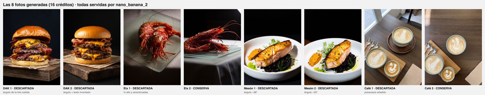
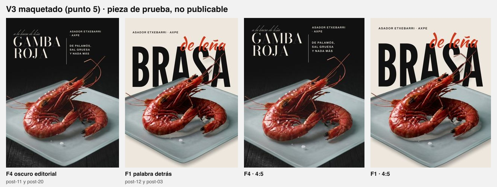
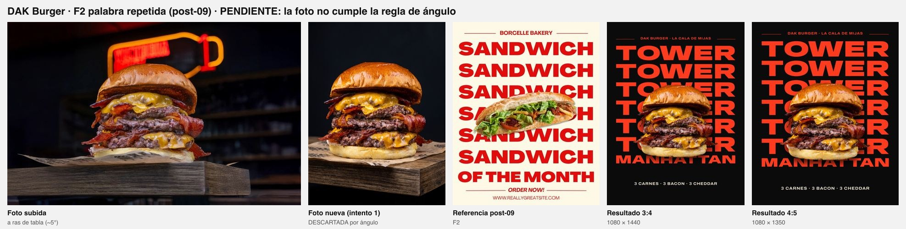
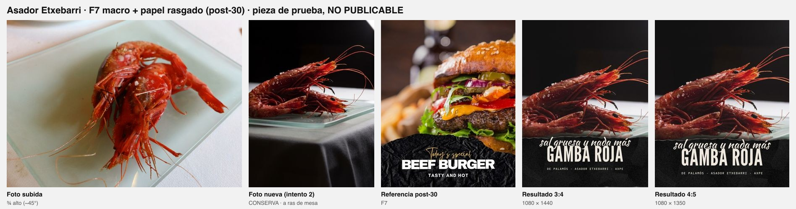
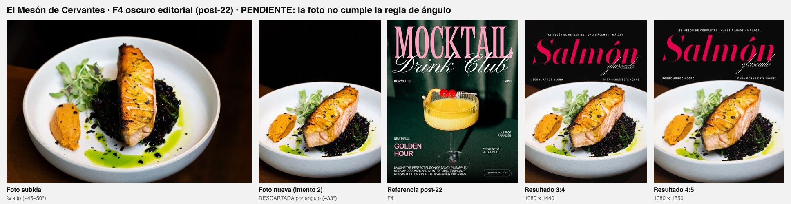
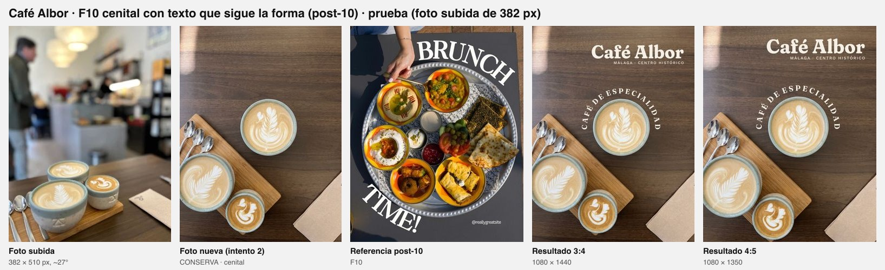
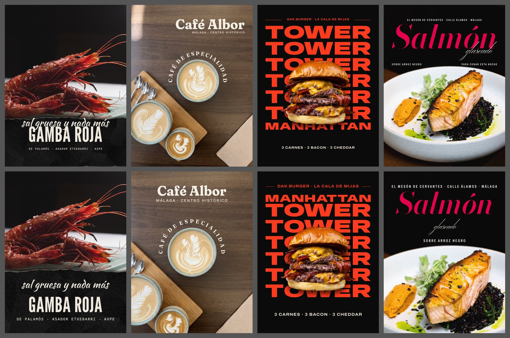

# F1.6 · Cuatro posts de principio a fin, plantilla de foto nueva y puerta de calidad

07/11/2026. Sin commit; espera tu revisión.

## Resumen

- **De los cuatro posts, uno cumple todo: Etxebarri.** Además, por contrato es pieza de prueba y no es publicable.
- **Café Albor** también cumple, pero es el más flojo frente a las referencias.
- **DAK y Mesón están compuestos con una foto que no pasa la regla de ángulo.** Fallaron dos veces seguidas: paro y te pregunto, como pediste.
- **Gasto:** 16 créditos de los 24 del tope (8 fotos, 2 por foto, comprobado con `get_cost` antes de cada envío).
  - Saldo de Higgsfield: **22,81 créditos**.
  - Acumulado en Higgsfield: unos **5,99 USD** (3,989 de la API y 32 créditos del MCP).
  - Gemini se ha usado solo en el tier gratuito, para texto y visión.
- **Modelo:** las 8 fotos se pidieron a `nano_banana_pro` y las sirvió `nano_banana_2`. Está anotado en la procedencia de cada una.
- **Lo nuevo y probado (126/126 pruebas):**
  - la plantilla de foto nueva con la regla de ángulo;
  - las instrucciones de la fase de foto, separadas de las de diseño;
  - el texto en arco parcial (F10);
  - el papel rasgado procedural (F7);
  - el importador de generaciones del MCP;
  - las fuentes de Café Albor.

---

## 1. Foto degradada

Apuntado en `METODO-SOCIETY.md` como **observación, con una sola imagen por variante, no como regla**:
- **V3D:** descartada.
- **V1D:** no válida (pierde la clave baja y tiene la brizna).
- **Contexto:** la degradación fue muy dura (1000 px, movida, JPEG 55), y tu foto original, de móvil normal, ya funcionó con V1 y V3.

## 2. Gasto

| | Créditos | Comprobado |
|---|---|---|
| 4 fotos, intento 1 | 8 | `get_cost` = 2 en cada una; saldo de 38,81 a 30,81 |
| 4 fotos, intento 2 | 8 | `get_cost` = 2 en cada una; saldo de 30,81 a 22,81 |
| **Esta tarea** | **16 de 24** | Registro: `datos/gasto/higgsfield.jsonl`, con `encargo: posts-f1-6` |

DAK y Mesón fallaron dos veces seguidas, así que no he seguido gastando en ellos: quedan 8 créditos sin usar.

## 3. Plantilla de foto nueva

**Archivos:**
- `src/dominio/fotoNueva.ts`: los huecos, el montaje del prompt y la comprobación.
- `src/adaptadores/gemini/instruccionesFoto.ts`: las instrucciones de la fase de foto, **separadas** de las de diseño, sin la regla «foto y texto en una imagen».
- `src/herramientas/fotoNueva.ts`: la herramienta.

**Funciona en cuatro pasos:**
1. **El director describe la foto subida:** ángulo en grados, encuadre, luz, elementos con su estado y recuento, defectos, y si es utilizable. La resolución la mide el código y se la pasa.
2. **Rellena los huecos de tu estructura:**
   - el plato y su origen;
   - los elementos con su estado;
   - el recuento;
   - la cámara (grados, frase, objetivo y apertura);
   - la idea gráfica con sitio para cada cosa;
   - la luz con su fuente y dirección;
   - el color dominante.

   No hay macro, 10° ni clave baja fijados: dependen del plato y de la referencia.
3. **El código comprueba lo que se puede comprobar:**
   - que la cámara nueva quede a **más de 30°** de la original;
   - que haya recuento;
   - que no pida texto en la foto;
   - que una foto de menos de 1000 px lleve el aviso.

   Si algo falla, le devuelve los problemas una vez.
4. **El código monta el prompt** con tu estructura exacta, de «Use it only as the list of elements, not as a layout to copy» a «Photographic realism, no text». Hay una prueba que reconstruye tu prompt de la gamba a partir de sus huecos.

### Ensayo sin gasto: salmón, DAK y café (bebida), solo con la foto y tu biblioteca

**Tu prompt de la gamba:**
> @image1 is a real photo of red prawns from Palamós grilled whole at a Basque wood-fire grill restaurant. Use it only as the list of elements, not as a layout to copy. The new photograph must contain the same real elements: two whole deep red prawns lying one over the other with heads, long antennae and legs, shells glistening with coarse salt and light grill marks, the square pale frosted glass plate, the white tablecloth. Exactly two prawns, correct anatomy. Nothing else added. New composition by a professional food photographer: a near table-level side view at 10 degrees, 100 mm macro at f/4, the two prawn heads large in the lower left, the antennae drawn as fine red lines arching across the dark upper part of the frame, the edge of the frosted glass plate glowing as a thin line of light. Low-key, one narrow back-side light from the upper right, everything else near black, red the only strong colour. Photographic realism, no text.

**Salmón (el director leyó la foto a 50°; propuso 10°):**
> @image1 is a real photo of glazed salmon fillet over black rice with orange purée at a modern Mediterranean bistro. Use it only as the list of elements, not as a layout to copy. The new photograph must contain the same real elements: a seared golden-glazed salmon fillet, glossy black rice bed, one quenelle of orange purée, drops of vibrant green oil, fresh microgreens, matte white shallow ceramic bowl. Exactly one salmon fillet, one purée quenelle, and one bowl. Nothing else added. New composition by a professional food photographer: dramatic low-angle side macro view at 10 degrees just above table surface, 90 mm lens at f/2.8, salmon crust entering tightly from lower-right, bowl edge bleeding out off-frame, leaving upper 40% clean dark backdrop for text layout. Hard directional side flash grazing the salmon crust and oil drops, creating sharp specular highlights, low-key black backdrop with warm amber and emerald green accent highlights. Photographic realism, no text.

**DAK (leyó la foto a 5°; propuso 45°):**
> @image1 is a real photo of triple beef burger with bacon and melted cheddar from a gourmet burger restaurant. Use it only as the list of elements, not as a layout to copy. The new photograph must contain the same real elements: golden brioche bun, three seared beef patties, three slices of melted cheddar, crisp bacon layers, printed parchment paper, dark wooden board. Exactly three beef patties, three cheddar slices, three bacon layers. Nothing else added. New composition by a professional food photographer: dramatic high-angle three-quarter view from 45 degrees, 85 mm lens at f/2.8, burger positioned in the lower-right third, creating clean negative space in the upper-left for bold text overlay. Hard direct flash from the upper-left casting crisp shadows and sharp specular highlights on the cheese and bacon, deep black background with warm orange cheddar as the main vibrant accent. Photographic realism, no text.

**Café (leyó la foto a 35°, yo diría unos 27°; propuso un cenital a 85°):**
> @image1 is a real photo of specialty coffees with latte art from an artisan coffee shop. Use it only as the list of elements, not as a layout to copy. The new photograph must contain the same real elements: three speckled ceramic cups with soft blue rims filled with latte art, three metal spoons, a small light-wood tray. Exactly three ceramic cups, three metal spoons, and one wooden tray. Nothing else added. New composition by a professional food photographer: top-down zenith view directly above the table, 50 mm lens at f/4, tray positioned diagonally across the frame, leaving clean negative dark-wood space for typography. Soft directional side daylight catching the micro-foam glossy texture and ceramic glaze, warm wood neutrals with cream milk foam and subtle blue rim accents. Photographic realism, no text.

| Frente a tu prompt | Salmón | DAK | Café |
|---|---|---|---|
| «Solo lista de elementos», recuento, «nada añadido», cierre | Sí (los pone el código) | Sí | Sí |
| Lista de elementos completa | **Faltan** las espinacas, las escamas negras y la pimienta | Correcta | **Falta** la servilleta y el dibujo de cada latte art |
| Cámara lejos de la original, con objetivo | Sí (10°, a 40° de la original) | Sí (45°, a 40°) | Sí (85°) |
| Idea gráfica con sitio para cada cosa | Correcta, pero sin una línea que guíe la mirada como tus antenas | **Pobre:** solo «abajo a la derecha» | **Pobre:** «bandeja en diagonal» |
| Luz con fuente y dirección | «Side», **sin decir de qué lado** | Sí (flash arriba a la izquierda) | «Side», **sin decir de qué lado** |
| Un color dominante | **Dos acentos** (ámbar y esmeralda) | Sí (el naranja del cheddar) | **No hay un color dominante** |

**Mejora frente al primer ensayo, el de los 486 caracteres:**
- la estructura sale siempre completa;
- el ángulo de la foto subida se lee bien (salmón a 50°; antes dijo «cenital»);
- la regla de más de 30° la cumplen las propuestas.

**Lo que sigue fallando:**
- **La idea gráfica.** Tu prompt de la gamba tiene una, con sitio para cada cosa; el director casi nunca la trae.
- **La dirección de la luz.**
- **Las listas de elementos, que salen incompletas o contaminadas.** Con referencia, el director metió en DAK el papel de cuadros y la salsa blanca de otro ejemplo de tu biblioteca. Por eso hace falta la puerta del punto 4.

## 4. Puerta de calidad (diseño; no implementada)

**Entrada, antes de gastar:**
1. **Paso 1 de la plantilla** (Gemini visión): describe la foto subida (ángulo, luz, elementos con recuento, defectos, resolución) y dice si es «utilizable».
2. **Reglas del código:**
   - con menos de 1000 px, aviso y la opción de pedir otra foto;
   - si no es utilizable, se pide otra foto;
   - si la cámara propuesta queda a 30° o menos, se repregunta.
3. **Pantalla de confirmación** (cuando apruebes pantallas): te enseña la **lista de elementos con su recuento** para que la corrijas o la aceptes. Solo después se gasta.

   Hoy hacía falta: el director inventó el papel de cuadros y la salsa blanca de DAK, olvidó las espinacas del salmón y leyó DAK a 35° en lugar de 5°.

**Salida, antes de enseñarte nada:**
1. **Segunda llamada de visión** con la foto real, la generada y la lista confirmada. Devuelve, elemento a elemento, si está y cuántos hay, si hay algo añadido y el ángulo estimado.
2. **Se descarta automáticamente lo que:**
   - cambie un recuento (V3D, la tercera cabeza de V1);
   - añada un elemento (el posavasos del café, el texto inventado del papel de DAK);
   - deje la cámara a 30° o menos de la original.

   Los casos dudosos se marcan «revisar».
3. **Calibración antes de fiarse:** pasarla por las **26 imágenes que ya he revisado a mano** (b1–b8, S1–S3, V1–V3, V1D, V3D y las 8 de hoy) y medir cuánto coincide con mis veredictos.
   - Lo más difícil serán la tercera cabeza de V1 y las tres colas de V3D: los vi solo con la imagen ampliada.

**Coste:**
- **En el tier gratuito, 0 USD.** Tiene límites de uso, y hoy dio 503 por saturación dos veces: el respaldo de modelos lo resolvió. Además, Google puede usar el contenido.
- **De pago** (con la tarifa de `gemini-3.8-flash` que consta en la propuesta: 0,75 USD por millón de tokens de entrada y 3,75 USD por millón de salida, el doble desde el 01/01/2027), unos **0,005 USD por comprobación**. Con 1 entrada y 2 salidas, unos **0,015 USD por post**.

**Implementación propuesta:** primero dominio, caso de uso, pruebas y la herramienta de línea de órdenes (`ChecklistFoto`, puerto `RevisorVisual`, adaptador de Gemini). La pantalla, solo cuando la apruebes.

**Mientras no exista,** la comprobación la he hecho yo a mano, ampliando cada imagen. Los veredictos y sus motivos están en la procedencia de cada activo.

## 5. V3 maquetado y limitaciones del compositor

- **F4, oscuro editorial (post-11 y post-20):**
  - script fina, didona, filete vertical y versalitas en el aire negro;
  - la foto baja un 12 % para dejar sitio al titular, como el cuenco de post-11.
- **F1, palabra detrás (post-12 y post-03), mi elección para la segunda familia:**
  - **Por qué:** es tu mecanismo aprobado («adaptar, no prohibir»), sobre **color plano**. Es lo contrario de F4 y además la familia más alejada.
  - **Cómo:** hueso de la marca, «BRASA» en carbón tapada por el plato y «de leña» en el rojo de la gamba.
- **Ojo:** V3 se hizo antes de la regla de más de 30°. Está a unos 20° de la original, así que con la regla actual no pasaría. Lo maqueto porque es el que te gustó.

**Limitaciones del compositor encontradas:**

| | Qué pasa | Qué he hecho |
|---|---|---|
| Máscaras | Apple Vision deja fuera el cristal y el papel; la luminancia arrastra la madera y el ruido del fondo | Máscara combinada y **limpieza manual** de las motas de madera de V3 (anotada como `MANUAL`). En DAK, solo Vision: la burger sin tabla ni papel |
| Script | Solo hay dos: Ballet (formal, florituras) y Kaushan (pincel). Falta una manuscrita monolineal | Ballet en Mesón y en F4, Kaushan en Etxebarri y F1 |
| Serif | **No hay una didona condensada** como la de post-11 o post-22. Bodoni Moda no es condensada | Mesón usa la Bodoni Moda Italic a todo lo ancho: cumple con la marca, pero no copia el corte de la referencia |
| Fuentes de marca | Faltaban Fraunces y Work Sans (Café Albor) | **Añadidas** (OFL, con su licencia) |
| Texto en arco | `circulo-texto` solo daba la vuelta entera: la parte de abajo se leía boca abajo | **Añadido `arco`** (grados), con prueba. Café Albor usa 190° por arriba |
| Papel rasgado (F7) | No existía | **Recurso procedural:** `src/herramientas/papelRasgado.ts`, papel negro con arrugas y el borde rasgado con fibra |
| Giro libre | Solo 0° y ±90° | Ningún post lo necesitaba; F3 (sellos, palabra girada) seguiría sin poder hacerse |
| Patrón | No hay capa de patrón | En DAK, un texto de varias líneas, cada una a todo lo ancho |

**Una corrección mía:** creí que el aviso de contraste de Etxebarri era un error del compositor. Era real: el titular pisaba la línea pequeña. El compositor acertó.

## 6. Estado de la FASE 1 (referencia obligatoria en las 5 primeras piezas)

- **Hecho, sin commit:**
  - `dominio/referencia.ts`;
  - la herramienta `npm run referencia` (registrar, captura, ficha, comprobar, listar y familias);
  - 29 fichas en 10 familias y umbral 5;
  - 19 pruebas.
- **Usada hoy de verdad:** he registrado la referencia de cada uno de los cuatro posts y `comprobar` deja pasar los cuatro («Parte de la referencia…»).
- **Pendiente:**
  1. Conectarla al **flujo web**: necesita que apruebes las pantallas.
  2. **Decidir si cuentan** las piezas hechas con estas herramientas. `comprobar` solo cuenta las piezas de la app (`datos/piezas`), así que los cuatro posts de hoy no suman para el umbral de 5.
  3. La **ficha v2**, con la foto descompuesta, sigue propuesta.
  4. El **commit** de todo F1.6, cuando me lo permitas.

---

## 7. Los cuatro posts

**Referencias:** una de una familia distinta en cada post.
- **Textos:** solo datos que constan en `marca.json` o en la idea de la pieza; ningún precio, oferta ni cifra inventados.
- **Exportación:** cada post se exporta a **3:4 (1080 × 1440)** y a **4:5 (1080 × 1350)**, en `datos/disenos/<post>/…/exportadas/`.
- **Contrato:** no consta el contrato de ningún local, así que **los cuatro son piezas de prueba**; Etxebarri, además, **no publicable**.

### DAK Burger · F2, palabra repetida (post-09) · **no lo consigue: la foto falla la regla de ángulo**

- **Por qué post-09:** DAK es «canalla, nocturno, urbano», y la Manhattan Tower es una torre. La palabra apilada en filas hace de pisos y la burger los tapa.
  - **Se toma:** las filas a todo lo ancho, el producto recortado que tapa las del centro, una fila final distinta («MANHATTAN») y la etiqueta entre filetes.
  - **No se copia:** «SANDWICH», Borcelle, «ORDER NOW», la web ni el crema. Los colores son el rojo y el negro de DAK.
- **Foto subida:** casi a la altura de la tabla (unos 5°). Brioche, 3 carnes, bacon, cheddar, papel beige impreso en negro, tabla y neón al fondo.
- **Elementos y recuento:** una burger con tres carnes, tres capas de bacon y tres de cheddar, papel y tabla.
- **Checklist de fidelidad:**
  - **intento 1:** producto correcto, cámara a unos 10–15°: **falla la regla de ángulo**;
  - **intento 2:** cámara otra vez baja, y **texto inventado** de periódico en el papel.
  - **Dos fallos seguidos: paro.**
- **Resultado:** compuesto con el intento 1, que se marca como pendiente.
- **Rúbrica:**
  - **idea, 4:** la palabra se apila como la torre;
  - **composición, 4;**
  - **tipografía, 3:** el patrón va en Anybody **ancha**, porque la ultracondensada de la marca no llenaba la fila; se aparta de la descripción de la marca;
  - **fotografía, 4;**
  - **fidelidad:** elementos bien, pero ángulo fuera de la regla;
  - **personalización, 4.**
- **¿Podría estar en referencias/?** Sí, por la composición. **No pasa** porque la foto es casi tu foto mejorada.

### Asador Etxebarri · F7, macro y franja de papel (post-30) · **lo consigue (pieza de prueba, no publicable)**

- **Por qué post-30:** «sobrio, artesano, fuego», y casa con lo que te gusta (V1 y tu imagen de octubre): el macro a ras de mesa arriba y el papel negro con el rótulo abajo.
  - **Se toma:** el macro a sangre, la franja de papel rasgado y el rótulo en tres niveles (script, palo seco pesado, versalitas).
  - **No se copia:** «Beef Burger», «Today's special», «Tasty and hot» ni el amarillo.
- **Foto subida:** ¾ alto (unos 45°), luz de día, mantel con mancha.
- **Elementos y recuento:** dos gambas con cabeza, antenas y patas, sal gruesa, puntas tostadas, el plato de cristal esmerilado y el mantel.
- **Checklist de fidelidad:**
  - **intento 1:** ¾ alto y amontonadas como en la original: **descartado**. El prompt del director era contradictorio («a ras de mesa» y «gambas en los dos tercios de arriba»).
  - **intento 2 = tu prompt de V1 con la regla de anatomía: CONSERVA.** Unos 10° (a 35° de la original), dos cabezas, sal, puntas tostadas, nada añadido.
- **Rúbrica:**
  - **idea, 4:** «sal gruesa y nada más» sale del producto;
  - **composición, 4:** el 25 % de arriba queda negro vacío; el macro podría ser aún más cerrado;
  - **tipografía, 4;**
  - **fotografía, 5;**
  - **fidelidad, CONSERVA;**
  - **personalización, 4.**
- **¿Podría estar en referencias/?** **Sí.**

### El Mesón de Cervantes · F4, oscuro editorial (post-22) · **no lo consigue: la foto falla la regla de ángulo**

- **Por qué post-22:** la marca es magenta y negro, con didona itálica y versalitas condensadas, y la descripción dice «elegante, nocturno». El titular enorme de serif con una script cruzada es su lenguaje.
  - **Se toma:** el titular a todo lo ancho, la script que lo cruza, la fila de versalitas y el plato abajo con aire oscuro arriba.
  - **No se copia:** «Mocktail», «Drink Club», Borcelle, 2026, el verde ni el rosa. El director **sí copió el verde** como fondo y lo corregí.
- **Foto subida:** ¾ alto (unos 45–50°).
- **Elementos y recuento:** un lomo de salmón glaseado, arroz negro con espinacas, una quenelle de puré naranja, aceite verde, brotes, escamas negras y pimienta, y el bol blanco.
- **Checklist de fidelidad:**
  - **intento 1:** unos 38°;
  - **intento 2:** unos 33°;
  - en los dos, elementos correctos y foto visiblemente nueva, pero a **menos de 30°** de la original. **Dos fallos seguidos: paro.**
- **Rúbrica:**
  - **idea, 3:** el titular es el nombre del plato, y el mecanismo viene de la referencia, no del plato;
  - **composición, 4;**
  - **tipografía, 4;**
  - **fotografía, 4;**
  - **fidelidad:** elementos bien, ángulo fuera de la regla;
  - **personalización, 4.**
- **¿Podría estar en referencias/?** Sí. Le falta una idea que nazca del salmón.

### Café Albor · F10, cenital con texto que sigue la forma (post-10) · **pasa, pero es el más flojo**

- **Foto utilizable con reservas:** la foto subida mide **382 × 510 px**, la única del local y la de menos resolución. El director lo anotó como defecto.
- **Por qué post-10:** «mediterráneo, cercano, compartir». El cenital con el texto girando alrededor de la taza nace del recipiente.
  - **Se toma:** el cenital a sangre y el titular en arco.
  - **No se copia:** «Brunch time», la mano, el plato de raciones ni la web.
- **Elementos y recuento:** tres tazas con latte art (rosetta, tulipán y corazón), tres cucharas, una bandeja y una servilleta.
- **Checklist de fidelidad:**
  - **intento 1:** **posavasos añadido**, provocado por mi frase «a ring of dark wood»: descartado.
  - **intento 2: CONSERVA.** Cenital y nada añadido. La segunda taza lleva una rosetta con corazón en lugar del tulipán: cambia el dibujo, no se añade nada.
- **Rúbrica:**
  - **idea, 3:** el arco sigue la taza, pero «Café de especialidad» es genérico;
  - **composición, 4;**
  - **tipografía, 4:** Fraunces y Work Sans de la marca, y el arco ya se lee derecho;
  - **fotografía, 3:** agradable, pero parece una buena foto de móvil y el reflejo de la ventana arriba a la izquierda distrae;
  - **fidelidad, CONSERVA con nota;**
  - **personalización, 3:** no usa el verde ni el terracota de la marca.
- **¿Podría estar en referencias/?** **Por los pelos.** post-10 es más intenso y más gráfico.

## 8. Lo que no he conseguido

1. **La cámara en DAK y Mesón.** Cuando la foto subida ya es una buena foto de producto, el modelo vuelve a su geometría.
   - Describir el resultado visible funcionó en Etxebarri y en el café, pero no en estos dos.
2. **Una idea gráfica del director a la altura de tu prompt.** La plantilla asegura la estructura, no la idea.
3. **Que el modelo sea Nano Banana Pro.** Por el MCP siempre sirven `nano_banana_2`.

## 9. Decisiones para ti

1. **DAK y Mesón.** Elige una opción para cada uno:
   - **(a) Aceptar la foto descartada** solo para estas pruebas: el producto es correcto, pero no cumple la regla de más de 30°.
   - **(b) Otro intento con una cámara más extrema:** cenital para el salmón; contrapicado o cenital para la burger. 2 créditos por post de los 8 que quedan.
   - **(c) Revisar la regla:** quizá para una torre de burger tenga más sentido otra condición, como «otro lado» u «otra distancia».
2. **¿Paso las observaciones a `conocimiento/`, con su prueba?** Son:
   - empezar por tus ejemplos que gustaron;
   - clave baja con entorno real;
   - la cámara descrita como resultado visible.
3. **¿Las piezas hechas con estas herramientas cuentan para el umbral de 5 de la FASE 1?**
4. **¿Implemento la puerta de calidad?** Empezaría por la comprobación de salida, calibrada con las 26 imágenes revisadas.
5. **¿Commit de F1.6?** No lo he hecho.

## 10. Revisión de María, diseñadora gráfica (08/11/2026)

Arriba, las versiones anteriores. Abajo, las corregidas: Etxebarri v006, Café v007, DAK v006 y Mesón v006. No ha costado nada: no se ha generado ninguna foto.

En 4:5: `img/posts-f1-6-revision-maria-4x5.jpg`.

| Post | Comentario | Causa | Cambio |
|---|---|---|---|
| Gambas | El texto de arriba está muy arriba, el de abajo muy pegado y el último deja vacío abajo; arriba, la foto está muy vacía | La banda de papel era baja y los tres textos se apiñaban contra el borde rasgado | La foto sube un 10 % (menos negro arriba). El papel empieza más arriba y se agranda para llegar al borde. Los tres textos se reparten con aire parecido arriba y abajo. La línea final pasa de 24 a 32 px. **La foto no cambia** («la foto me gusta») |
| Café | La taza no está centrada | La foto se usaba tal cual, con la taza en el 55 % del ancho | Zoom 1,15 y encuadre sobre la taza: queda en el centro exacto, con el arco detrás. El logo también se centra, porque la composición ahora es simétrica. La línea pasa de 25 a 34 px |
| Hamburguesa | No se ve el nombre | La lectura de arriba abajo daba «TOWER… MANHATTAN» y la hamburguesa tapaba media palabra | MANHATTAN pasa arriba: se lee «MANHATTAN TOWER» y debajo sigue el juego de TOWER. Etiqueta de 26 a 34 px y línea final de 30 a 36 px |
| Hamburguesa | No está limpia; borrosa por arriba | **Es la foto:** el pan de arriba está desenfocado en la generada (va reducida al 45 %, no ampliada) | Sin arreglar: hace falta otra foto (punto 1 de abajo) |
| Salmón | Mucho texto y muy apelotonado; las dos líneas de abajo parecen a distinta altura | Cinco textos en el 40 % superior; «glaseado» encima de la línea derecha la hacía parecer más baja | Bloque centrado: marca, «Salmón» algo más estrecho, «glaseado» debajo y una sola línea, «Sobre arroz negro». Sale «Para cenar esta noche». Zoom 1,2 para bajar el plato y ganar aire. Textos de 24 a 34 px |
| Todos | Los textos son demasiado pequeños (otras personas) | El mínimo del compositor era de 16 px de mayúscula, unos 23 px de cuerpo | Mínimo nuevo: 22 px de mayúscula, unos 31 px de cuerpo |

### Lo que se queda para las próximas piezas

**En el compositor** (`resolutor.ts`, con 2 pruebas nuevas: 128/128):

- `ALTURA_MAYUSCULA_MINIMA` sube de 16 a 22 px. Por debajo es un error.
- Aviso nuevo, `SEPARACION`: dos textos apilados en la misma columna necesitan al menos 0,35 cuerpos del más pequeño entre su tinta.
  - Se mide en cuerpo y no en mayúscula: en las manuscritas la mayúscula es enorme y lo que se ve, pequeño.
  - Saltó en el chiringuito (diapositiva 4) y en el primer intento del salmón.

**En `conocimiento/observaciones/estudio.json`**, 6 observaciones del estudio:
- son explícitas porque pediste tenerlas en cuenta, así que están confirmadas y le llegan al director;
- cada una lleva la cita de María y la pieza de la que sale.

| Id | Qué dice |
|---|---|
| `espacio-entre-elementos` | Hueco claro entre bloques y espacio repartido, sin zonas muertas |
| `texto-secundario-legible` | Mayúsculas de al menos 22 px en 1080 |
| `producto-centrado-si-simetrica` | Si la composición es simétrica, el producto va centrado |
| `nombre-del-plato-se-lee` | El juego tipográfico no puede tapar ni desordenar el nombre |
| `recorte-nitido-de-arriba-abajo` | Un plato que se recorta pide profundidad de campo amplia (f/8–f/11) |
| `pares-con-el-mismo-peso` | Dos textos enfrentados necesitan el mismo peso alrededor |

**El carrusel del chiringuito** se ha corregido con las mismas reglas: tres textos de 24–28 px pasan a 34 px y la diapositiva 4 gana aire.

### Decisiones para ti

1. **Foto nueva de la hamburguesa**, para quitar lo borroso de arriba: 2 créditos, o 4 con un reintento.
   - El prompt sería el mismo, con estos añadidos: «deep depth of field, f/11, every layer from the top of the bun to the bottom bun in sharp focus» y «bacon tucked neatly between the patties, no loose strands».
   - Podría aprovechar para probar a la vez el ángulo pendiente del punto 1 de la sección 9.
2. **«Para cenar esta noche»** ha salido del salmón para quitar texto. ¿Lo quieres en el pie de la publicación?
3. **¿Paso las lecciones de María a los oficios** (`composicion-y-tipografia`, `fotografia-gastronomica`)? Ahora son observaciones; un oficio solo cambia con tu visto bueno.
