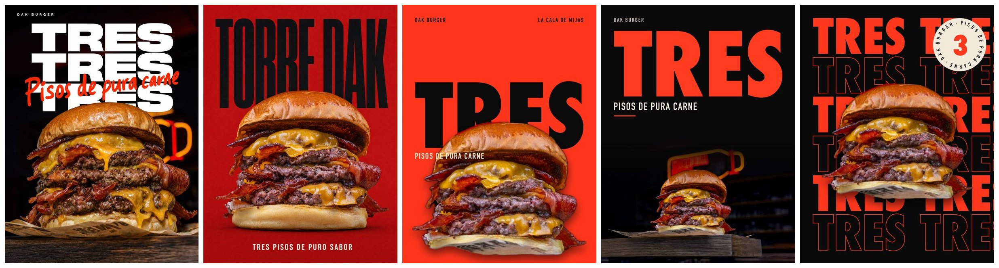
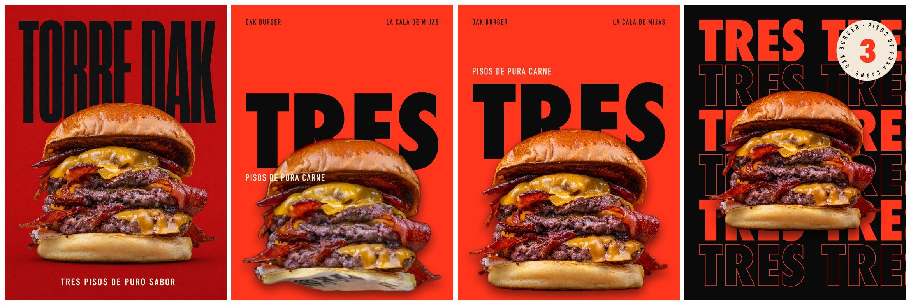
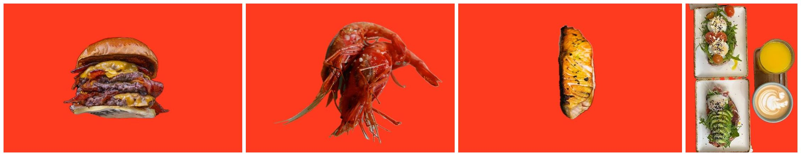
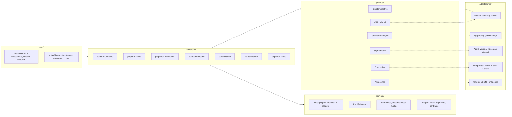
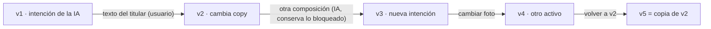
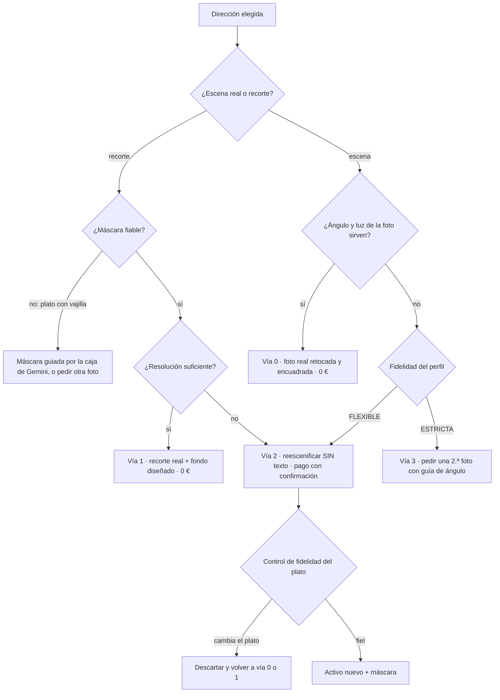
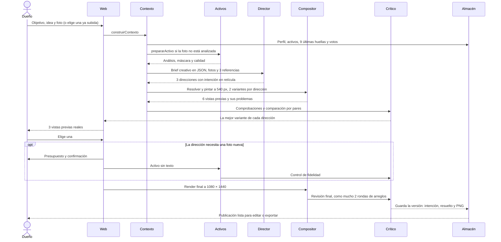
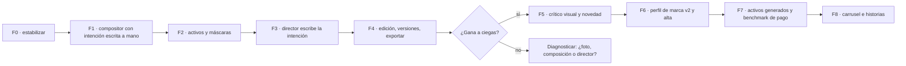

# Estudio de contenido · Propuesta de arquitectura creativa (fase 2)

**Fecha:** 6 de noviembre de 2026
**Base:** el código actual de `estudio-contenido/`, el informe de auditoría `INFORME_REDISENO_ESTUDIO_CONTENIDO.md`, pruebas locales hechas para esta propuesta e investigación de las integraciones.
**Qué no se ha hecho:** no se ha modificado ningún archivo del proyecto (esta carpeta es nueva), no se han usado las claves de Gemini ni de Higgsfield y no se ha gastado nada.

---

## 0. Resumen

**La idea central.** Hoy una sola generación de imagen tiene que resolver a la vez la foto, la tipografía, el texto exacto, la composición y la marca. Propongo separar dos trabajos:

1. **La foto es un activo.** Puede ser la foto real (recortada o retocada) o una foto nueva generada **sin texto**.
2. **El diseño lo ejecuta nuestro código.** Un compositor por capas coloca el texto, la tipografía, el color y los recursos gráficos con precisión.

La IA decide **qué** y **por qué** (concepto, mecanismo, jerarquía y relaciones). El código decide **dónde** y **cómo** (píxeles, tamaños de letra, márgenes, máscaras y contraste).

**Lo he probado sin gastar** (sección 2):
- El compositor (sharp + SVG + fontkit) produce una pieza de 1080 × 1440 en **0,24–0,75 s**, con el texto exacto, la palabra detrás del plato, contornos y texto en círculo.
- Apple Vision recorta el plato en local en **0,2–0,7 s**.
- **La foto es el cuello de botella.** Con la foto real de DAK Burger (1120 × 700 px) el resultado queda blando. Con una foto generada sin texto (reutilizando una de grok ya pagada), el resultado queda al nivel de la generación de una pasada, pero con el texto exacto y editable.

**El diagnóstico se sostiene.** He reproducido con un script los cuatro fallos de lógica y el del límite diario. Del informe externo confirmo casi todo, pero su afirmación de que el ZIP y mi informe describen estados distintos **no se reproduce**: el ZIP es idéntico a la carpeta. Las diferencias venían de dos errores míos (9 imágenes, no 10; 39/40 tests, no 37/38) y de la zona horaria (UTC frente a hora de España).

**Primera implementación vertical:**
- **Restaurante:** DAK Burger, con un post individual.
- **Direcciones:** 3 direcciones con vista previa real y 2 variantes de composición cada una.
- **Edición y salida:** textos editables, versiones y exportación.
- **Fotos:** se usan la foto real y un activo sin texto que ya está pagado, así que no hay que gastar.
- **Prueba de que no es una plantilla:** el mismo motor, con el perfil del Asador Etxebarri y su foto real en alta resolución.

**Lo que no haría:**
- Ocho agentes, uno por rol.
- Canva o Chromium como motor.
- Coordenadas en píxeles escritas por la IA.
- Una colección de estilos nuevos.
- Sustituir el flujo actual antes de que la prueba vertical gane a ciegas.

**Decisiones que te tocan** (sección 15): fidelidad o ángulo nuevo, lienzo 3:4 o 4:5, segmentación solo en macOS y fuentes solo OFL.

---

## 1. Diagnóstico contrastado

### 1.1 Correcciones a mi informe anterior

| Dije | Lo correcto | Cómo lo he comprobado |
|---|---|---|
| 10 imágenes pagadas | **9**: 6 con `marketing-studio/image` y 3 con `xai/grok-imagine-image-2.0` | Recuento de `generaciones` en los 7 `pieza.json` |
| «hechas el 04/11» | 03/11 de 23:04 a 23:49 en **UTC**, que es el 04/11 de 00:04 a 00:49 en hora de España | `creadaEn` en UTC frente a la fecha de los archivos en hora local |
| 37 de 38 tests | **39 de 40** (falla `web.test.ts:127`) | `npm test` |
| — | El ZIP es **idéntico** a la carpeta, sin contar `node_modules` ni `.env` | `diff -rq` del ZIP descomprimido contra la carpeta: sin diferencias |

### 1.2 Hallazgos, contrastados con el código y los datos

Leyenda: **C** = confirmado · **CD** = confirmado pero desactualizado · **NR** = no reproducido · **PF** = propuesta futura · **RI** = requiere investigación.

| # | Hallazgo | Origen | Estado | Evidencia |
|---|---|---|---|---|
| 1 | El modo simulado y el real comparten `datos/`. Una portada simulada cuenta como hecha y se envía a Higgsfield como «portada aprobada» | Mi informe | **C (reproducido)** | Script: en modo real, «Generar» pediría `[2,3]` y la diapositiva 2 llevaría `generadas/d1_v1.png` con la leyenda *«the approved cover… Match its typography…»*. Código: `contenedor.ts:32-34`, `trabajoDeDiapositiva.ts:50` |
| 2 | La caché de subidas de `GeneradorHiggsfield` guarda las promesas rechazadas | Mi informe | **C (reproducido)** | Script: el primer envío falla por red y el segundo, con la red ya bien, **vuelve a fallar**. Solo hay 1 intento de subida (`GeneradorHiggsfield.ts:53-61`) |
| 3 | Un voto hecho mientras corre un trabajo se pierde en `pieza.json` | Mi informe | **C (reproducido)** | Script: el voto está en `pieza.json` justo después de votar y **desaparece** al terminar el trabajo. Sigue en `valoraciones.jsonl` |
| 4 | Las correcciones no pasan las reglas del plan | Mi informe | **C (reproducido)** | Script: el comentario «Pon el precio 9,90 €» produce una imagen COMPLETADA con «9,90» que no está en la idea |
| 5 | El límite diario cuenta por día UTC | Mi informe | **C (reproducido)** | Una imagen del 06/11 a las 00:40 (hora de España) no cuenta el 06/11 a las 10:00: el resultado es 0 y debería ser 1 |
| 6 | Proporciones incoherentes | Ambos | **C, y es más amplio** | El director escribe «proporción 4:5» en el prompt (`proporcionDe`, en `reglas.ts:34`, dentro de `instrucciones.ts`), pero a marketing-studio y grok se les pide **3:4**, y el exportador conserva el 3:4 (1080 × 1440). La interfaz dice «(4:5)» al crear y «1080 × 1350» al exportar |
| 7 | Las exportaciones existentes miden 1080 × 1350 y el código ya da 1440 | Ambos | **CD** | Se exportaron a las 00:52 y `ProcesadorSharp.ts` cambió a las 00:56 |
| 8 | Falta `../creacion-contenido/` y rompe los ejemplos | Ambos | **C** | Rompe el test `web.test.ts:127`, los botones «Cargar ejemplo» y los enlaces de `ejemplos/*.md`. **Matiz:** las fotos de origen siguen copiadas dentro de cada `datos/piezas/*/fotos/`, así que la prueba vertical no depende de esa carpeta |
| 9 | El ZIP contiene `.env` con claves, `node_modules` y `datos/` | Informe externo | **C** | `unzip -l`. Rotar las claves es una recomendación: no puedo saber si el ZIP ha salido de tu equipo |
| 10 | «El informe de Claude y el ZIP no describen el mismo estado» | Informe externo | **NR** | El `diff` sale vacío. Las diferencias eran mis errores de recuento y la zona horaria |
| 11 | Los tests no se pueden ejecutar en Linux | Informe externo | **C** (es una limitación de su entorno) | `node_modules` trae `sharp` para macOS ARM64. Aquí, con Node 26: 39/40 |
| 12 | El ángulo de la foto real se repite | Ambos | **C, con matiz** | Las 3 piezas votadas de marketing-studio (gamba, burger y salmón) repiten encuadre, comprobado mirando las imágenes. De las 3 de grok, **dos sí cambian el ángulo** (gamba y salmón) y la burger mantiene el plano frontal. Pero grok **altera el plato**: en la gamba cambia la colocación, y en la burger cambia el pan de abajo y desaparece el papel |
| 13 | El texto rasterizado no se verifica | Informe externo | **C, con un caso real** | La diapositiva 2 de Café Albor dice **«EL ACOMRAÑANTE»** en lugar de «ACOMPAÑANTE» ([img/04](img/04-cafe-albor-generado.jpg)) |
| 14 | El plato se inventa al recomponer | Nuevo | **C** | La diapositiva 1 de Café Albor **fusiona las dos tostadas** de la foto en una sola, con huevo y aguacate juntos |
| 15 | La tostada «flota» | Informe externo | **C** | Es el voto de Café Albor y se ve en la imagen |
| 16 | Las cinco familias funcionan como plantillas | Informe externo | **C** | `instrucciones.ts` (`textoConceptos`) obliga a usar «cada uno de una familia visual distinta» de una lista cerrada de cinco |
| 17 | La marca está descrita, no modelada | Informe externo | **C** | En `Marca`, las tipografías son texto libre («grotesca ultracondensada muy negra»). No hay archivos de fuente, logotipo ni recursos. Solo Café Albor nombra fuentes reales (Fraunces y Work Sans, ambas OFL) |
| 18 | No hay un documento de diseño | Informe externo | **C** | No existe ninguna estructura de capas. `Plan.diapositivas[].prompt` es texto libre |
| 19 | Las referencias se eligen por etiquetas | Informe externo | **C** | `elegirReferencias.ts` da 3 puntos por palabra, 2 por tipo y no repite tratamiento |
| 20 | Hay pocos votos | Informe externo | **C, y ojo** | De los 4 votos, **3 se escribieron en la misma ráfaga de 30 ms** (23:34:24.331–.359 UTC) con el mismo texto: salieron de un script, no de la web. La «memoria» actual refleja sobre todo un juicio automático, no tu gusto |
| 21 | Las referencias son plantillas tipo Canva | `analisis-posts.md` | **C, con consecuencia** | «Borcelle», «reallygreatsite.com», «123 Anywhere St.». Son **diseños por capas**: producto recortado, tipografía vectorial, sellos y tiras. Es justo lo que hace un compositor, no una generación de una pasada |
| 22 | Las fotos de origen tienen poca resolución | Nuevo | **C** | Tostada 382 × 510 y burger 1120 × 700. Gamba 4043 × 2887 y salmón 1920 × 1279 sí sirven |
| 23 | Compositor con SVG y sharp | Informe externo | **RI → verificado** | Prueba local, sección 2. El riesgo de las fuentes en SVG desaparece al convertir el texto en trazos con fontkit |
| 24 | Marketing Studio Image **Flare** | Informe externo | **C (documentado), sin probar** | `POST /marketing-studio/image/flare`: hasta 16 referencias; proporciones con 3:4 pero **sin 4:5**; 1k/2k/4k; coste estimado por tokens. No lo he probado porque cuesta |
| 25 | Modelos de imagen de Gemini | Informe externo | **CD** | Hoy se recomienda **`gemini-nano-banana-2.1`**. `gemini-3.1-flash-image` queda como generación anterior y `gemini-3-pro-image` como premium. No hay salida con transparencia. Precios en la sección 7 |
| 26 | Canva MCP | Informe externo | **C, con matiz** | Las herramientas MCP de Canva las uso yo (Claude) en una conversación, **no tu app**. Para la app haría falta Canva Connect, y su *autofill* de plantillas exige **Canva Enterprise** |
| 27 | Pinterest | Informe externo | **C** | La API exige una app aprobada (acceso de prueba y luego estándar), revisión con vídeo del flujo OAuth y política de privacidad. Se queda en uso manual para tableros |
| 28 | Segmentación del plato | Nuevo | **C con límite / RI** | Apple Vision acierta con la burger y las gambas, pero con el salmón **se queda con la pieza y deja fuera el plato y el arroz** ([img/03](img/03-recortes-apple-vision.jpg)). Los platos con vajilla necesitan otra vía |
| 29 | Instagram admite 3:4 (1080 × 1440) en el feed | Nuevo | **RI** | Solo hay fuentes secundarias, que coinciden en que la cuadrícula del perfil recorta a 3:4 desde 2025. Hay que confirmarlo con una publicación de prueba |
| 30 | Gramática visual, huella de composición, perfil creativo, crítico visual | Informe externo | **PF** | Estoy de acuerdo con matices. Se desarrollan en las secciones 4–10 |

---

## 2. Lo que demuestran las pruebas locales

Son pruebas de viabilidad hechas en el directorio temporal de la sesión, **no código del proyecto**: foto real, máscara de Apple Vision, texto convertido en trazos con fontkit y capas con sharp. Los textos son los mismos que escribió el plan real de esa pieza: «TRES», «Pisos de pura carne», «DAK BURGER» y la ciudad del perfil.

**Prueba 1 · Foto real de 1120 × 700.** Por orden: generación actual con marketing-studio (NO_GUSTA), generación con grok y tres composiciones con la foto real.



**Prueba 2 · Activo sin texto + compositor.** Por orden: la imagen de grok tal cual, la composición con la foto real, la composición con la burger de grok recortada (su texto queda fuera de la máscara) y el patrón de repetición con ese mismo activo.



**Recortes de Apple Vision** (burger, gamba, salmón y tostada):



**Conclusiones:**

1. **El compositor resuelve lo que hoy falla.** El texto es exacto por construcción y la relación texto-plato es precisa: el titular queda tapado lo justo y el texto de apoyo nunca pisa el plato. Además, un cambio cuesta medio segundo y nada de dinero.
2. **Pero no arregla la foto.** Con la foto real de baja resolución, la composición pierde frente a la imagen generada: queda blanda y la burger parece pegada. **La mejora evidente sale de combinar un buen activo fotográfico con la composición determinista.**
3. **La revisión automática funciona.** Con un cálculo de píxeles sobre la máscara, el texto de apoyo pasó de tapar el **68 %** del sujeto (v1) al **0 %** (v2) al aplicar la regla «no solapar».
4. **Tiempos medidos:** máscara de 0,2 a 0,7 s y composición de 0,24 a 0,75 s a 1080 × 1440. Hoy, una imagen por la API tarda de 40 a 222 s (`pieza.json`) y una llamada al director una media de unos 38 s (`duraciones.json`).
5. **Límites:**
   - La máscara automática no sirve para platos con vajilla (el salmón).
   - El activo de grok cambia el pan de abajo y quita el papel de la burger, así que necesita un control de fidelidad.
   - La pieza sobre color plano todavía «flota» un poco: hacen falta mejores sombras de contacto o una superficie.

---

## 3. Principio rector y arquitectura objetivo

### 3.1 Tres reglas

1. **La IA decide qué y por qué; el código decide dónde y cómo.** Gemini habla en una **retícula** (columnas y filas) y en **relaciones** («detrás de», «no solapar»). El código las convierte en píxeles, ajusta el texto y comprueba.
2. **La foto es un activo con procedencia.** Cada activo lleva su origen (real, recorte, generado), su máscara, su análisis y su nivel de fidelidad. La publicación nunca depende de que el modelo de imagen escriba bien.
3. **Todo cambio es una operación sobre un documento con versiones.** No hay regeneraciones a ciegas: cambiar un titular no toca la foto, y cambiar la foto no toca el texto.

### 3.2 ¿Un agente por rol? No: cuatro funciones y tres llamadas a la IA

| Rol pedido | Qué es en la propuesta | ¿IA? | Por qué |
|---|---|---|---|
| A. Context Engine | `construirContexto`, que ya existe, ampliado | No | Juntar datos es determinista. Una IA aquí solo añade latencia y errores |
| B. Brand Profile | Datos versionados más **una** llamada al dar de alta el local | Una vez | La identidad no cambia en cada post |
| C. Creative Strategist | Junto con D en **una** llamada: «Direcciones» | Sí | El concepto y la dirección de arte no se pueden separar: «FUEGO detrás del chuletón» es a la vez idea, tipografía y composición. Separarlos obliga a una segunda llamada que contradice a la primera |
| D. Art Director | Igual que C. La IA escribe la intención en retícula | Sí | — |
| E. Copywriter | Titulares dentro de «Direcciones»; pie, hashtags y texto alternativo en una llamada corta aparte | Sí, en paralelo | El pie depende del concepto elegido y se escribe mientras se genera el activo |
| F. Asset Generator | El puerto `GeneradorImagen` (ya existe) más `Segmentador` y `prepararActivo` | Modelos de imagen | Su trabajo es la foto, no el diseño |
| G. Design Composer | `Compositor`: un **resolutor** (de retícula a píxeles) y un **renderizador** (sharp) | No | Tiene que ser exacto y reproducible |
| H. Visual Critic | Comprobaciones deterministas más **una** llamada de visión | Sí, una | Lo medible lo mide el código. La IA juzga apetito, marca, fidelidad y originalidad |

**Por qué no más agentes:** cada llamada a Gemini tarda entre 10 y 150 s en este proyecto, según las mediciones de `duraciones.json` y ARQUITECTURA §10. Ocho agentes en serie serían minutos por post y más incoherencia entre ellos. Con tres llamadas, dos de ellas en paralelo con otros pasos, el flujo queda en unos 1–2 min sin generar foto.

### 3.3 Diagrama general



Se mantienen las reglas de dependencias actuales: `web → aplicacion → (dominio, puertos)` y `adaptadores → (puertos, dominio)`.

### 3.4 Qué se reutiliza

| Pieza actual | Se reutiliza para |
|---|---|
| Puertos y adaptadores, `contenedor.ts`, modo simulado | Los puertos nuevos (`Compositor`, `Segmentador`, `CriticoVisual`) entran igual |
| `ClienteGemini` (respaldo, JSON con zod y reintento con el error) | Direcciones, crítico y análisis de foto |
| `ClienteHiggsfield` (idempotencia, retomar ENVIADA) y `MODELOS_HIGGSFIELD` | Generar activos **sin texto**. Se añade Flare como estrategia |
| `RegistroTrabajos`, `Estimador`, `panelDeTrabajo`, `confirmarGasto` | Igual, para los trabajos nuevos |
| `reglas.ts` (cifras no autorizadas, palabras, titular, `slugificar`) | Validan los textos de la intención, ahora también en las correcciones |
| `BibliotecaFicheros` y `elegirReferencias` | El director sigue mirando 3 referencias afines |
| `ProcesadorSharp` | Pasa a ser la base del renderizador. `reducir` y `medir` se mantienen |
| El flujo actual (`plan`, `generar`, `corregir`) | **Se conserva intacto** como vía «generación integrada» y como punto de comparación |

---

## 4. Sistema de identidad visual (perfil de marca)

### 4.1 Constantes y variables

Las identidades flexibles de referencia separan lo que **siempre** se reconoce de lo que **cambia con el contenido**:

- **Casa da Música** (Sagmeister, 2007): la forma del logotipo es constante y su color se extrae de la imagen de cada evento.
- **MIT Media Lab**: en 2011 tenía un logo algorítmico con unas 40 000 variantes, que la crítica vio como «todas iguales en esencia». Pentagram lo sustituyó en 2014 por un sistema en el que cada variante significa algo: un glifo por grupo de investigación.

**Lección:** la variedad sin significado parece repetición. Cada variación tiene que salir del plato, del objetivo o del momento, no del azar.

| Constantes (perfil) | Variables (cada publicación) |
|---|---|
| 2–3 **anclas** reconocibles (p. ej. DAK: «rojo #FF3B1F como campo», «condensada negra gigante», «firma en versalitas arriba») | Concepto y mecanismo texto-plato |
| Fuentes por rol (archivos reales) y sus reglas (caja, tracking) | Escala, posición y sangrado del producto |
| Paletas permitidas (fondo, tinta, acento) y proporción máxima del acento | Paleta concreta de entre las permitidas, o un acento sacado del plato |
| Recursos gráficos propios con su propósito | Qué recurso usar o ninguno |
| Dirección fotográfica (luz, superficies reales del local, qué evitar) | Plano, luz y fondo de esta foto |
| Voz (registro, palabras sí y no) | El titular y el pie |

### 4.2 Fuentes: de una descripción a un archivo

Un compositor necesita archivos de fuente. Propongo un **catálogo curado de fuentes OFL** (Google Fonts) en `recursos/tipografias/`, cada una con etiquetas de clasificación, y que el perfil apunte a familias del catálogo:

- **DAK Burger** («grotesca ultracondensada muy negra»): candidatas Anton, Bebas Neue o Big Shoulders Display.
- **El Mesón de Cervantes** («didona itálica de alto contraste»): Bodoni Moda Italic o Playfair Display Italic.
- **Café Albor**: ya usa Fraunces y Work Sans.

La elección se confirma viendo una **lámina de marca** generada por el propio compositor (gratis). Las fuentes propias del cliente entran solo con licencia documentada.

### 4.3 Estructura

```ts
// dominio/marca/perfil.ts (esquema zod; se muestra como tipo)
interface PerfilDeMarca {
  slug: string;
  version: number;                       // cada pieza guarda con qué versión se hizo
  base: { nombre: string; ciudad: string; descripcion: string; tonos: string[]; instagram?: string; web?: string }; // = Marca v1
  anclas: string[];                      // 2–3, en lenguaje claro
  color: {
    tokens: Record<'fondo' | 'tinta' | 'acento' | 'claro' | 'oscuro', string>;
    paletas: Array<{ fondo: string; tinta: string; acento?: string }>;   // combinaciones permitidas
    reglas: { maxTintas: 3; acentoMaxArea: number };                     // p. ej. 0.15
  };
  tipografia: {
    display: RefFuente; texto: RefFuente; rotulo?: RefFuente;            // RefFuente = { familia, archivo, peso, ejes? }
    reglas: { cajaDisplay: 'mayusculas' | 'tal-cual'; trackingDisplay: number; trackingVersal: number };
  };
  recursos: Array<{ id: 'sello-circular' | 'tira-cuadros' | 'papel-rasgado' | 'flecha-mano' | 'marco' | 'subrayado'; proposito: string; parametros?: object }>;
  logo?: { archivo: string; variantes: string[]; anchoMinimo: number };
  fotografia: { luces: string[]; superficiesReales: string[]; evitar: string[]; fidelidad: 'ESTRICTA' | 'FLEXIBLE' };
  pilares: Array<{ id: 'PRODUCTO' | 'PROCESO' | 'LOCAL' | 'GENTE' | 'OCASION' | 'OFERTA'; peso: number }>;
  evitar: string[];                      // soluciones rechazadas (alimentado por los votos)
}
```

**Migración:** `marca.json` (v1) se conserva y `perfil.json` lo amplía. Si un local no tiene perfil, se genera uno mínimo a partir de su `marca.json`. No se pide nada más al dar de alta un local: los huecos se rellenan cuando hacen falta.

**Ejemplo para DAK Burger:**

```json
{
  "slug": "dak-burger", "version": 2,
  "anclas": ["campo rojo #FF3B1F a sangre", "condensada negra gigante", "firma en versalitas arriba"],
  "color": {
    "tokens": { "fondo": "#FF3B1F", "tinta": "#0B0B0B", "acento": "#F3EBDD", "claro": "#F3EBDD", "oscuro": "#0B0B0B" },
    "paletas": [ { "fondo": "#FF3B1F", "tinta": "#0B0B0B" }, { "fondo": "#0B0B0B", "tinta": "#FF3B1F", "acento": "#F3EBDD" } ],
    "reglas": { "maxTintas": 3, "acentoMaxArea": 0.15 }
  },
  "tipografia": {
    "display": { "familia": "Anton", "archivo": "recursos/tipografias/anton/Anton-Regular.ttf", "peso": 400 },
    "texto": { "familia": "Archivo", "archivo": "recursos/tipografias/archivo/Archivo[wdth,wght].ttf", "peso": 700, "ejes": { "wdth": 75 } },
    "reglas": { "cajaDisplay": "mayusculas", "trackingDisplay": -0.01, "trackingVersal": 0.12 }
  },
  "recursos": [ { "id": "sello-circular", "proposito": "firmar o destacar una cifra autorizada" } ],
  "fotografia": { "luces": ["flash duro", "neón del local"], "superficiesReales": ["barra de madera oscura", "papel de la marca"], "evitar": ["mármol blanco"], "fidelidad": "FLEXIBLE" },
  "pilares": [ { "id": "PRODUCTO", "peso": 0.6 }, { "id": "LOCAL", "peso": 0.2 }, { "id": "OFERTA", "peso": 0.2 } ],
  "evitar": []
}
```

---

## 5. Sistema de dirección artística: originalidad sin plantillas

### 5.1 Una gramática de decisiones

Las cinco familias actuales dejan de ser obligatorias y pasan a ser **valores de un eje**. Una dirección es una combinación de valores, y cada valor se justifica por el plato, el objetivo o la marca.

| Eje | Valores (ampliables) | Lo condiciona |
|---|---|---|
| Familia | color plano, low-key, luz de día, flash, macro a sangre, editorial blanco, escena del local | Marca y pilar |
| Cámara | cenital, 45°, a ras de mesa, contrapicado, detalle | **Geometría del plato** (análisis): alto → a ras o contrapicado; plano (pizza, tosta, carpaccio) → cenital; plato hondo o emplatado → 45°; bebida → a ras con contraluz |
| Escala | aire (≤ 35 % del lienzo), protagonista (40–65 %), a sangre (sale por bordes) | Mecanismo y calidad del activo |
| Posición | celda de 3 × 3 o sangrado por un lado | Huella reciente (no repetir) |
| Mecanismo texto-plato | ver 5.2 | Activos disponibles (¿hay máscara?) |
| Tipografía | monumental, apilada, vertical, editorial discreta, patrón, contorno | Perfil (fuentes y reglas) |
| Recurso gráfico | ninguno, sello, tira, papel rasgado, flecha, marco, subrayado | Objetivo: oferta → sello con la cifra autorizada |
| Ritmo | simétrico, asimétrico, diagonal, modular | Huella reciente |
| Color | paleta de marca, o un acento sacado del plato (estilo Casa da Música) | Contraste medido |

### 5.2 Los mecanismos son capacidades del compositor

Cada mecanismo es algo que el código **sabe ejecutar**. El director solo puede elegir los que se pueden hacer con los activos de esta pieza: el código filtra la lista antes de llamarle.

| Mecanismo | Referencia del usuario | Necesita |
|---|---|---|
| Palabra detrás del producto (cobertura 30–45 %) | post 12 («Tasty BURGER»), post 3 | Máscara con borde superior limpio |
| Palabra que pasa a contorno al cruzar el producto | post 19 («BEST COFFEE EVER») | Máscara |
| Palabra repetida como patrón, tapada por el producto | post 9 («SANDWICH»), post 25 («dip») | Máscara |
| Texto que sigue la curva del plato | post 10 («BRUNCH TIME!»), post 2 | Elipse del plato (análisis o máscara) |
| Palabra vertical junto a un elemento vertical | post 16 («FREE») | Caja del sujeto |
| Anotaciones con flechas a mano | post 4 | Puntos de interés (análisis: ingredientes con caja) |
| Marco del que se sale el producto | post 6 (polaroid) | Máscara |
| Franja de papel rasgado con el titular | post 24 | Nada |
| Sello con cifra autorizada | posts 5 y 7 | Una condición del dueño (precio o fecha) |
| Titular monumental con foto a sangre debajo | post 11 | Nada |

Si el director propone algo que no está en el catálogo, la idea **no se ejecuta, pero se guarda** en `ideas-fuera-de-catalogo.jsonl`. Así el equipo sabe qué capacidad añadir después.

### 5.3 Huella y control de repetición

La huella se calcula **en código** a partir del documento resuelto, no a partir de lo que la IA dice que ha hecho:

```text
huella = { familia, mecanismo, camara (del análisis del activo), escalaSujeto (S/M/L/XL),
           celdaSujeto (3×3), celdaTitular (3×3), fondo (plano/foto/textura),
           tonoDominante (12 tonos × 3 luminosidades), recursos (conjunto), densidad (palabras) }

distancia(a, b) = Σ peso_i · [a_i ≠ b_i]   (los conjuntos, con Jaccard). Pesos iniciales: mecanismo 0,25 · familia 0,2 · celdas 0,2 · color 0,15 · escala 0,1 · resto 0,1
```

**Reglas iniciales (a calibrar):**
- Distancia ≥ 0,45 respecto a cada una de las **3 últimas** publicaciones aprobadas del local.
- Distancia ≥ 0,30 respecto a la media de las **9 últimas** (la cuadrícula del perfil).
- Nunca el mismo mecanismo dos veces seguidas.

**Vista de perfil:** el compositor pinta la publicación nueva junto a las 8 anteriores en una cuadrícula de 3 × 3. Un estudio diseña la cuadrícula, no solo el post, y esta vista cuesta 0 €.

### 5.4 Explotar, variar, explorar

Las tres direcciones no son tres tiradas al azar. Cada una tiene un papel distinto:

1. **Explota:** combina lo que más «Me gusta» ha recibido en este local, con otra composición.
2. **Varía:** mantiene la familia, pero cambia el mecanismo y la escala.
3. **Explora:** usa un mecanismo o una familia poco usados en este local. El código elige cuál antes de llamar a Gemini.

Los votos van moviendo los pesos, como un sistema de recomendación sencillo, sin aprendizaje automático. Un mecanismo con dos «No me gusta» seguidos en un local deja de proponerse allí durante 10 piezas.

### 5.5 Generación integrada: la vía de escape

Hay conceptos que necesitan que el texto **viva dentro de la escena**: un rótulo de neón, tiza en una pizarra o una palabra escrita en la espuma. Eso solo lo hace el modelo de imagen. Se permite como excepción:

- Como mucho dos palabras.
- El texto de la imagen se comprueba con Gemini (lectura del texto).
- Si falla, se vuelve a la composición por capas.

Es el flujo actual, que se conserva.

---

## 6. El compositor

### 6.1 Dos niveles de documento

| Nivel | Lo escribe | Contiene | Para qué |
|---|---|---|---|
| **Intención** | La IA y las ediciones del usuario | Retícula (columnas y filas), relaciones, tokens (`@fondo`, `@display`), referencias a activos, textos | Es la fuente de verdad y lo que se edita |
| **Resuelto** | El resolutor (código) | Píxeles, tamaño de letra, líneas partidas, transformaciones de cada activo, problemas detectados | Lo usa el renderizador. Es reproducible: con la misma intención y los mismos activos sale lo mismo |

**Lienzo y coordenadas:**
- Píxeles con origen arriba a la izquierda.
- Feed a 1080 × 1440 (3:4) con una **zona segura 4:5** (1080 × 1350, centrada) donde va todo el texto. Así funciona tanto si Instagram muestra 3:4 como si recorta a 4:5.
- Historias a 1080 × 1920, con el 14 % de arriba y el 20 % de abajo sin texto.
- Retícula de **12 columnas × 16 filas** con margen de 72 px y medianil de 12 px.

**Intención** (DAK, dirección «palabra detrás»):

```json
{
  "esquema": "diseno/intencion@1",
  "pieza": "2026-11-03-la-manhattan-tower-tres-carnes", "diapositiva": 1, "version": 3, "padre": 2,
  "lienzo": { "formato": "FEED_3_4", "zonaSegura": "4:5" },
  "marca": { "slug": "dak-burger", "version": 2 },
  "direccion": { "papel": "VARIA", "familia": "color-plano", "mecanismo": "palabra-detras", "escala": "a-sangre", "ritmo": "simetrico",
                 "porQue": "Tres pisos: la palabra se esconde detrás de la torre y el pan la corta." },
  "texto": { "titular": "TRES", "apoyo": "Pisos de pura carne", "firma": "DAK BURGER", "lugar": "La Cala de Mijas" },
  "paleta": 0,
  "capas": [
    { "id": "fondo", "tipo": "relleno", "color": "@fondo" },
    { "id": "grano", "tipo": "textura", "recurso": "ruido", "fusion": "overlay", "intensidad": 0.1 },
    { "id": "titular", "tipo": "texto", "texto": "@titular", "estilo": "@display", "caja": { "col": [1, 12], "fila": [5, 8] }, "ajuste": "ancho", "color": "@tinta" },
    { "id": "plato", "tipo": "recorte", "activo": "act-burger-grok-01", "escala": { "anchoSujeto": 0.9 },
      "ancla": { "col": [1, 12], "fila": [7, 16], "alinear": "abajo-centro" }, "sombra": "contacto", "bloqueado": true },
    { "id": "apoyo", "tipo": "texto", "texto": "@apoyo", "estilo": "@texto", "caja": { "col": [1, 8], "fila": [3, 3] }, "caso": "mayusculas", "color": "@tinta" },
    { "id": "firma", "tipo": "texto", "texto": "@firma", "estilo": "@texto", "caja": { "col": [1, 6], "fila": [1, 1] }, "color": "@tinta" },
    { "id": "lugar", "tipo": "texto", "texto": "@lugar", "estilo": "@texto", "caja": { "col": [7, 12], "fila": [1, 1] }, "alinear": "derecha", "caso": "mayusculas", "color": "@tinta" }
  ],
  "relaciones": [
    { "tipo": "detras", "capa": "titular", "de": "plato", "cobertura": [0.3, 0.45] },
    { "tipo": "noSolapar", "a": ["apoyo", "firma", "lugar"], "b": "plato" },
    { "tipo": "contrasteMinimo", "capa": "apoyo", "ratio": 4.5 }
  ]
}
```

**Resuelto** (extracto con valores ilustrativos; lo genera el código):

```json
{
  "esquema": "diseno/resuelto@1", "deIntencion": "v003", "lienzo": { "ancho": 1080, "alto": 1440 },
  "capas": [
    { "id": "titular", "z": 20, "caja": { "x": 72, "y": 486, "w": 936, "h": 389 }, "fuente": "Anton-Regular", "tamano": 612.4, "lineas": ["TRES"], "tracking": -0.01 },
    { "id": "plato", "z": 30, "activo": "act-burger-grok-01", "recorteFuente": { "x": 214, "y": 640, "w": 1352, "h": 1210 },
      "destino": { "x": 54, "y": 588, "w": 972, "h": 870 }, "sombra": { "desenfoque": 26, "dy": 26, "opacidad": 0.55 } },
    { "id": "apoyo", "z": 40, "caja": { "x": 72, "y": 349, "w": 520, "h": 35 }, "tamano": 46 }
  ],
  "medidas": { "coberturaTitular": 0.38, "apoyoSobreSujeto": 0, "contraste": { "apoyo": 9.8 } },
  "problemas": [],
  "activos": { "act-burger-grok-01": "sha256:9c1f…" }
}
```

### 6.2 Tipos de capa

| Tipo | Qué hace | Cómo se pinta |
|---|---|---|
| `relleno`, `degradado`, `forma` | Fondo, velos, bloques y filetes | SVG |
| `imagen` | Foto con recorte, encuadre y retoque (curvas, saturación y temperatura en dosis controladas) | sharp (`extract`, `resize`, `modulate`, `linear`, `recomb`) |
| `recorte` | Imagen con máscara | sharp (`joinChannel` con la máscara) |
| `sombra` | Derivada de la máscara: proyectada o de contacto | sharp (`blur` + fusión `multiply`) |
| `texto` | Bloque con ajuste (`ancho`, `caja`, `fijo`), caja, tracking, interlineado y partición de líneas en español | fontkit → trazos SVG |
| `recurso` | Sello circular, tira de cuadros, papel rasgado, flecha, marco o subrayado, con parámetros | SVG generado por código |
| `textura` | Grano, papel o ruido con fusión (`overlay`, `multiply`, `soft-light`) e intensidad | sharp (`create` con ruido) o archivo CC0 |
| `logo` | SVG o PNG con transparencia del perfil | SVG o sharp |

**Restricciones** (relaciones): `detras` / `delante` con un rango de cobertura, `noSolapar`, `contrasteMinimo`, `dentroDe` (zona segura), `alineadoCon`, `mismaPosicionEnSerie` (carruseles), `tamanoMinimo`.

### 6.3 Resolutor (de intención a resuelto)

```text
resolver(intencion, activos, perfil):
  lienzo, reticula = medidas(intencion.lienzo)
  tokens = perfil.color.paletas[intencion.paleta] ⊕ perfil.tipografia
  orden = capas ordenadas por dependencias (el sujeto antes que las relaciones que lo usan)
  para cada capa en orden:
    caja = reticula.aPixeles(capa.caja)
    si capa es imagen/recorte:
      bbox = activos[capa.activo].mascara.bbox            # medido una vez al preparar el activo
      escala = (capa.escala.anchoSujeto * lienzo.ancho) / bbox.ancho
      destino = anclar(bbox * escala, caja, capa.ancla)   # incluye el sangrado
    si capa es texto:
      lineas = partirEspanol(texto, caja.ancho, tokens[capa.estilo])   # sin «de/la/y» a final de línea, sin viudas
      tamano = ajustar(capa.ajuste, lineas, caja)                       # medido con fontkit (sin probar al tanteo)
  para cada relación:
    detras(titular, plato, [min,max]) → bisección sobre y del titular hasta que la cobertura medida con la máscara caiga en el rango
    noSolapar(a, b)                   → mover a la celda libre más cercana de la retícula; si no hay, reducir hasta tamanoMinimo
    contrasteMinimo(capa, r)          → 1º otra tinta de la paleta; 2º velo detrás; 3º marcar problema
  problemas = comprobar(resuelto)     # mismas reglas que la sección 10.1
  devolver resuelto, problemas        # con problemas sin resolver, se le devuelven al director (como ya hace planificarPieza)
```

**Variantes:** el resolutor genera **2 variantes** por dirección, una del ancla pedida y otra de la simétrica u otra escala. El crítico elige la mejor comparando por pares.

### 6.4 Renderizador

```text
render(resuelto, escala = 1):
  base = sharp.create(lienzo × escala, color de fondo)
  capas = []
  para cada grupo de capas consecutivas del mismo tipo (ordenadas por z):
    vectorial (texto, forma, recurso) → un único SVG con los trazos de fontkit → buffer
    imagen/recorte                    → sharp(activo).extract(recorteFuente).resize(destino).retoque → (+ máscara)
    sombra                            → máscara desenfocada y desplazada, fusión multiply
    textura                           → buffer con alfa, fusión indicada
    capas.push({ input, left, top, blend })            # se recorta lo que se sale del lienzo
  return base.composite(capas).jpeg({ quality: 92, chromaSubsampling: '4:4:4' })   # o png
```

- **Vista previa** = la misma función a `escala = 0,5`. Lo que ves es lo que se exporta.
- **El texto como trazos** no depende de las fuentes instaladas ni de fontconfig: es igual en macOS, en Linux y en el futuro backend de SOCIETY. En la prueba, fontkit leyó colecciones TTC y fuentes variables y devolvió trazos con interletraje.
- **Exportar** = `render(escala = 1)` más `pie.txt`. Se puede añadir un **SVG editable** (con `<text>` y nombres de fuente) para que una persona lo retoque en Figma.

### 6.5 Qué tecnología y por qué

| Opción | Control tipográfico | Máscaras y fusiones | Determinismo | Peso y dependencias | Vercel (SOCIETY) | Vista previa = exportación | Decisión |
|---|---|---|---|---|---|---|---|
| **sharp + SVG + fontkit** | Alto: trazos, tracking, variables, contorno, texto en curva | Sí (sharp: 20+ modos de fusión; máscaras por canal) | Total, con trazos en vez de fuentes del sistema | sharp ya está; fontkit es JS puro (MIT) | Sí | Sí (mismo código, otra escala) | **Elegida** |
| @napi-rs/canvas (Skia) | Alto, pero la maquetación del texto se programa a mano | Sí | Alto | Binario nativo nuevo (~30 MB) | Sí | Sí, también en el navegador con `<canvas>` | Plan B si librsvg se queda corto |
| HTML/CSS + Chromium (Playwright) | Máximo (CSS completo, @font-face) | Sí (CSS) | Alto con la versión fijada | Chromium ~150–300 MB y arranque de 1–2 s | Difícil (límites de tamaño) | Sí | Solo si un efecto lo exige |
| Satori + resvg | Medio (subconjunto de CSS con flexbox) | Limitado | Alto | Dos dependencias | Sí | Sí | Pensado para tarjetas OG, no para composición libre |
| Canva Connect (autofill) | El de la plantilla | El de la plantilla | Alto | API externa, OAuth, **Enterprise** | — | No | No: son plantillas |
| Figma (MCP) | Máximo, editado a mano | Sí | — | Herramienta para una persona | — | No | Para retoques de un diseñador, no como motor |

**Cuándo cambiar de opinión:** si hacen falta efectos que librsvg no pinta bien (filtros SVG complejos o fusiones dentro de grupos vectoriales), se cambia el adaptador por @napi-rs/canvas. El puerto `Compositor` no cambia.

### 6.6 Edición: operaciones sobre la intención

| Petición | Operación | ¿IA? | Coste y tiempo | Qué se conserva |
|---|---|---|---|---|
| «Cambia el titular» / editar texto | `copy.titular = …` + validar cifras y palabras + resolver | No | 0 €, < 1 s | Foto, composición y colores |
| «Titular más grande», «más aire» | Cambiar la caja en la retícula o el modo de ajuste | No | 0 €, < 1 s | Todo lo demás |
| «Otro color» | `paleta = n` dentro del perfil + comprobar contraste | No | 0 €, < 1 s | Composición y textos |
| «Otra tipografía» | Otra pareja permitida por el perfil + resolver (las medidas cambian) | No | 0 €, < 1 s | Composición relativa |
| «Otra composición» | El director reescribe la intención con `bloqueado: true` en lo aprobado | Sí, una llamada | Céntimos, 10–40 s | Capas bloqueadas, textos y activo |
| «Cambiar foto» | `capa.activo = otro` + resolver (la máscara y su caja cambian) | No | 0 € (o pago si se genera) | Textos y relaciones |
| «Regenerar esta diapositiva» | Nueva intención solo para la posición `n`, con los tokens de la serie | Sí | Céntimos | El resto del carrusel |
| «Volver a la v2» | Nueva versión copiada de la v2 | No | 0 € | Historial completo |



### 6.7 Versiones y almacenamiento

- **Cada versión es inmutable** (`v003.intencion.json`, `v003.resuelto.json`, `v003.png`), con un puntero `actual.json`. Las ediciones crean archivos nuevos y no reescriben uno compartido: así no puede repetirse el fallo 3.
- Cada versión guarda `padre`, la `operacion` aplicada, el autor (`IA` o `USUARIO`) y el hash de los activos que usa.
- `pieza.json` pasa a escribirse con `AlmacenPiezas.actualizar(id, cambio)`, que lee la última versión y aplica el cambio con un cerrojo por pieza. Es el arreglo del fallo 3, que además sirve para el compositor.

---

## 7. Integraciones y responsabilidades

### 7.1 Quién hace qué

| Herramienta | Sí | No | Estado verificado |
|---|---|---|---|
| **Gemini** (texto y visión, `gemini-3.8-flash` con respaldo) | Análisis de la foto (ingredientes, geometría, ángulo, luz y cajas), direcciones (concepto, mecanismo, titulares, intención en retícula), pie y crítica visual | Píxeles, tamaños de letra, contraste, comprobar cifras | Funciona en el proyecto. Sus cajas `box_2d` y máscaras están documentadas, pero el formato de las máscaras es ambiguo en la propia documentación (**RI**) |
| **Gemini Image** (`gemini-nano-banana-2.1`, `gemini-3-pro-image`) | Activo fotográfico **sin texto**: reescenificar el plato (superficie, luz, fondo) con varias referencias | Componer o escribir textos de la publicación | Documentado. No acepta transparencia. **No probado**: cuesta |
| **Higgsfield** (`marketing-studio/image`, `…/flare`, grok) | Igual que Gemini Image, detrás del mismo puerto. Más adelante, vídeo (reels) | Tipografía y maquetación | marketing-studio y grok probados (9 imágenes). Flare documentado y sin probar |
| **Apple Vision** (local, macOS) | Máscara del sujeto en menos de 1 s, gratis y sin red | Platos con vajilla (se queda con el producto) | **Probado** |
| **sharp** (ya está) | Retoque, máscaras, sombras, fusiones y exportación | — | Probado |
| **fontkit** (nueva, JS puro) | Medir y convertir el texto en trazos (TTC y variables) | — | Probado |
| **Canva** (MCP, solo en conversaciones con Claude) | Explorar referencias, tableros y prototipos para comparar | Ser el motor de la app | Herramientas disponibles en mi sesión. La API de la app exige Enterprise para el *autofill* |
| **Pinterest** | Tableros de referencia manuales que se etiquetan en `biblioteca/` | Integración por API (exige revisión con vídeo de OAuth) | Documentado |
| **Figma** (MCP) | Que un diseñador retoque el SVG exportado | Motor | Disponible en mi sesión |
| **Windsor.ai** (conector disponible) | Más adelante: leer qué publicaciones del local funcionan en Instagram para ajustar los pilares | Por ahora nada | **RI**: hace falta que el local conecte su cuenta |

### 7.2 Qué vía de foto usar



**«Resolución suficiente»:** el sujeto debe medir en la foto al menos el 60 % de los píxeles que ocupará en el lienzo. La burger real de DAK no llega: ocupa unos 600 px y necesita unos 970.

**Guía de foto (vía 3).** Para un ángulo nuevo con fidelidad total, el sistema le dice al dueño cómo hacer la foto con el móvil: ángulo, distancia, luz de ventana, fondo y qué no debe salir, con un esquema pintado por el compositor. Es lo que hace un estudio de verdad: dirigir la toma.

### 7.3 Costes y tiempos

Precios oficiales consultados el 06/11/2026:

| Concepto | Precio | Notas |
|---|---|---|
| `gemini-3.8-flash` | 0,75 $ por M de tokens de entrada y 3,75 $ por M de salida | Hasta el 31/12/2026; **el doble desde el 01/01/2027**. Tiene capa gratuita, pero en ella **Google puede usar el contenido** para mejorar sus productos |
| `gemini-nano-banana-2.1` | 0,034 $ (1K) · 0,050 $ (2K) · 0,113 $ (4K) por imagen | Sin capa gratuita |
| `gemini-3-pro-image` | 0,134 $ (1K/2K) · 0,24 $ (4K) | Sin capa gratuita |
| Higgsfield marketing-studio / grok | Se cobra del saldo en dólares (recarga mínima de 5 $), con un coste estimado por tokens y ajustado al terminar | Una prueba de terceros midió unos 0,066 $ con descuento en marketing-studio y unos 0,07 $ en una edición con grok. **Hay que medirlo con nuestros propios envíos** |

**Estimación por post** (orden de magnitud, a confirmar con mediciones):

| Paso | Llamadas | Coste | Tiempo |
|---|---|---|---|
| Analizar la foto (una vez por activo) | 1 Gemini | ~0,01 $ | 10–30 s |
| Direcciones | 1 Gemini (unos 20 000 tokens de entrada y 5 000–10 000 de salida con razonamiento) | ~0,03–0,06 $ | 30–90 s |
| Vistas previas (3 direcciones × 2 variantes) | 0 | 0 $ | ~3 s |
| Crítico | 1 Gemini | ~0,02 $ | 10–30 s |
| Activo generado (solo vía 2) | 1–2 imágenes | 0,03–0,24 $ cada una | 40–220 s |
| Cada edición de texto, color o tamaño | 0 | 0 $ | < 1 s |

**Comparación:** hoy cada «Pedir cambio» es una imagen nueva de pago y tarda de 40 a 220 s. Con el compositor, la mayoría de los cambios son gratis e inmediatos.

---

## 8. Flujo de producción



**Los 12 pasos:**

1. **Datos que recupera:**
   - Perfil del local (versión actual) y activos del local con su análisis y máscara.
   - Las 9 últimas huellas aprobadas, los votos estructurados recientes y el calendario (fecha y temporada).
   - 3 referencias afines de `biblioteca/`.
2. **Qué pregunta al dueño:**
   - Solo el objetivo (pilar y tipo), la idea en una frase y el producto o la foto.
   - Condiciones si es oferta o evento (como hoy).
   - Una segunda foto solo si la dirección elegida la necesita y la fidelidad es ESTRICTA.
3. **El brief:** el código lo monta en JSON con objetivo, mensaje, producto (activo, ingredientes y geometría), datos autorizados (las únicas cifras permitidas), restricciones (anclas, lista de evitar, huellas recientes), formato y lienzo, y los mecanismos ejecutables con estos activos.
4. **Dirección artística:** una llamada a Gemini devuelve 3 direcciones (explota, varía y explora), cada una con concepto, mecanismo, titulares, intención en retícula y su porqué. Se valida con zod más las reglas (cifras, palabras, mecanismos posibles y distancia de huella) y, si falla, se le devuelven los problemas (hasta 3 intentos, como hoy).
5. **Referencias:** `elegirReferencias`, que ya existe. Se añade la etiqueta del mecanismo al índice para mostrar la referencia del mecanismo que se explora.
6. **Qué foto necesita:** el árbol de 7.2.
7. **Modelo o herramienta:** Gemini para pensar y criticar; Apple Vision para la máscara (Gemini si no hay macOS o si es un plato con vajilla); Higgsfield o Gemini Image solo para el activo sin texto; el compositor para todo lo demás.
8. **El documento de diseño:** el resolutor convierte la intención en el resuelto (sección 6.3).
9. **Render:** sharp, primero a 0,5× para la vista previa y después a 1×.
10. **Comprobación:** reglas deterministas más el crítico (sección 10).
11. **Corrección:** los defectos se traducen en operaciones de la tabla 6.6, como mucho 2 rondas. Si persisten, se avisa en lugar de insistir.
12. **Guardado:** versiones inmutables con su puntero (sección 6.7).

---

## 9. Flujo de edición (lo que ve el dueño)

- **En la vista previa:** texto editable en su sitio (titular, apoyo, firma) y botones con un efecto concreto: «Titular más grande», «Más aire», «Otra paleta», «Otra composición», «Cambiar foto» y «Volver a…».
- **Bloquear:** un candado en el producto o en el titular hace que «Otra composición» los respete.
- **Nada de lienzo libre ni panel de capas.** No es un clon de Canva: no se arrastran capas ni hay 40 controles.
- **Pedir en palabras** («que la burger se vea más grande»): una llamada corta a Gemini traduce la frase a **operaciones de la tabla 6.6**, que el dueño ve antes de aplicarlas. Es el antiguo «Pedir cambio», ahora sobre el documento y no sobre la imagen.

---

## 10. Sistema de evaluación visual

### 10.1 Comprobaciones deterministas (código)

Los valores son iniciales y se calibrarán con la prueba a ciegas.

| Comprobación | Regla | Cómo se mide |
|---|---|---|
| Texto exacto | Por construcción (trazos) | — |
| Cifras | Solo las de la idea o las condiciones (`cifrasNoAutorizadas`), **también en las ediciones** | Ya existe |
| Contraste | Texto grande (altura de mayúscula ≥ 60 px) ≥ 3:1; el resto ≥ 4,5:1 (umbrales WCAG) | Luminancia del fondo bajo cada glifo, en el percentil desfavorable |
| Tamaño mínimo | Altura de mayúscula ≥ 22 px en el apoyo y ≥ 18 px en la firma | Medidas del resuelto |
| Márgenes y zonas seguras | Todo el texto dentro de la zona 4:5 y a ≥ 72 px del borde. En historias, el 14 % de arriba y el 20 % de abajo libres | Cajas del resuelto |
| Solapes | Texto sobre el sujeto ≤ 5 %, salvo relación `delante`. `detras` dentro de su rango | Máscara (como en la prueba: 68 % → 0 %) |
| Sujeto visible | ≥ 70 % de la máscara visible | Máscara contra capas superiores |
| Densidad | ≤ 3 niveles de texto más firma; ≤ 30 palabras (20 en historias); ≤ 2 recursos | Ya existe en parte |
| Resolución | El sujeto en la foto ≥ 60 % de su tamaño final | Caja de la máscara |
| Serie | Mismos tokens y titular en la misma fila en todo el carrusel | Resuelto de cada diapositiva |
| Novedad | Distancias de huella de 5.3 | Huella |

### 10.2 Crítico visual (una llamada a Gemini)

Recibe la vista previa, la foto original, el análisis (lista de ingredientes) y un resumen de la intención. Devuelve un JSON cerrado:

```json
{
  "veredicto": "PASA",
  "defectos": [
    { "tipo": "FLOTA", "gravedad": 2, "capa": "plato", "evidencia": "sin superficie ni sombra de contacto creíble",
      "arreglo": { "op": "sombra", "capa": "plato", "tipo": "contacto-fuerte" } }
  ],
  "fidelidad": [ { "elemento": "pan inferior tostado", "estado": "CAMBIADO" }, { "elemento": "papel de la marca", "estado": "FALTA" } ],
  "puntuacion": { "impacto": 4, "apetito": 4, "marca": 5, "legibilidad": 5 }
}
```

- **Tipos de defecto cerrados:** PRODUCTO_ALTERADO, FLOTA, JERARQUIA, LEGIBILIDAD, SATURACION, FUERA_DE_MARCA, REPETIDO, PEGADO_AL_BORDE, TEXTO_GENERADO_INCORRECTO.
- **Operaciones cerradas:** las de la tabla 6.6. **No puede cambiar textos ni cifras**: solo señalarlos.
- **Elegir entre variantes = comparación por pares** («¿cuál de las dos funciona mejor como post de este local y por qué?»). Es más fiable que pedir una nota absoluta.
- **Calibración:** cada voto del dueño se guarda con la nota del crítico. Si el crítico aprueba lo que el dueño rechaza, se ajusta su rúbrica, que es un archivo editable en `biblioteca/`, no código.

### 10.3 Votos estructurados

```json
{ "fecha": "…", "localSlug": "dak-burger", "piezaId": "…", "diapositiva": 1, "version": 3,
  "veredicto": "NO_GUSTA", "motivos": ["ANGULO_REPETIDO", "FLOTA"], "comentario": "la burger parece pegada",
  "huella": { "familia": "color-plano", "mecanismo": "palabra-detras", "…": "…" }, "intencion": "diseno/d1/v003.intencion.json" }
```

Los motivos son botones: ángulo repetido, producto alterado, flota, texto ilegible, demasiado texto, tipografía genérica, no parece nuestro, fondo falso y otro. El comentario es opcional. Las líneas antiguas de `valoraciones.jsonl` siguen siendo válidas porque los campos nuevos son opcionales.

---

## 11. Estructuras de datos y directorios

```ts
// dominio/activos.ts
interface Activo {
  id: string; localSlug: string; origen: 'REAL' | 'GENERADO' | 'IMPORTADO';
  archivo: string; ancho: number; alto: number; sha256: string;
  procedencia?: { modelo: string; prompt: string; referencias: string[]; requestId?: string };  // si es generado
  analisis?: { plato: string; ingredientes: Array<{ nombre: string; caja?: Caja }>; geometria: 'ALTO' | 'PLANO' | 'HONDO' | 'BEBIDA' | 'VARIOS';
               camara: string; luz: string; fondo: string; problemas: string[] };
  mascara?: { archivo: string; metodo: 'VISION' | 'GEMINI' | 'MANUAL'; bbox: Caja; confianza: number; incluyeVajilla: boolean };
  fidelidad?: { respectoA: string; elementos: Array<{ elemento: string; estado: 'IGUAL' | 'CAMBIADO' | 'FALTA' | 'INVENTADO' }> };
}

// dominio/diseno/especificacion.ts → Intencion (6.1), Resuelto (6.1), Relacion, Capa (unión por tipo)
// dominio/diseno/huella.ts         → Huella, distancia(a, b)
// dominio/diseno/direccion.ts      → Direccion { papel: 'EXPLOTA' | 'VARIA' | 'EXPLORA'; concepto; mecanismo; ejes; textos; intencion; porQue }
// dominio/marca/perfil.ts          → PerfilDeMarca (4.3)
```

**Directorios propuestos.** Lo nuevo va marcado con `+`, y no se borra nada:

```text
recursos/                               + versionado con el código
  tipografias/<familia>/*.ttf · catalogo.json · LICENCIAS.md (solo OFL)
  texturas/ (CC0)
datos/
  locales/<slug>/marca.json             (se conserva)
  locales/<slug>/perfil/v002.json · actual.json      +
  locales/<slug>/activos/<id>/{original.*, analisis.json, mascara.png}   +
  piezas/<id>/pieza.json                (se conserva; escritura con cerrojo)
  piezas/<id>/diseno/d1/v001.intencion.json · v001.resuelto.json · v001.png · actual.json   +
src/
  dominio/diseno/{especificacion,reticula,relaciones,huella,direccion}.ts   +
  dominio/marca/perfil.ts · dominio/activos.ts                            +
  puertos/{Compositor,Segmentador,CriticoVisual,AlmacenDisenos,CatalogoTipografico}.ts   +
  aplicacion/activos/prepararActivo.ts                                   +
  aplicacion/diseno/{proponerDirecciones,componerDiseno,editarDiseno,revisarDiseno,exportarDiseno}.ts   +
  adaptadores/compositor/{resolver,MotorTexto,RenderSharp}.ts · recursos/{sombra,grano,sello,tira,papel,flecha}.ts   +
  adaptadores/segmentacion/{SegmentadorVision.ts, mascara.swift, SegmentadorGemini.ts}   +
  adaptadores/gemini/{CriticoGemini.ts, instruccionesDirecciones.ts, instruccionesCritico.ts}   +
  adaptadores/ficheros/AlmacenDisenosFicheros.ts                         +
  web/rutas/disenos.ts · web/publico/js/vistas/diseno.js                 +
```

**Puertos nuevos:**

```ts
interface Compositor {
  resolver(intencion: Intencion, entorno: { activos: Record<string, Activo>; perfil: PerfilDeMarca }): Promise<Resuelto>;
  render(resuelto: Resuelto, opciones: { escala: number; formato: 'jpeg' | 'png' }): Promise<Buffer>;
}
interface Segmentador { mascara(rutaImagen: string, pista?: { caja?: Caja; incluirVajilla?: boolean }): Promise<Mascara> }
interface CriticoVisual {
  revisar(vista: Buffer, contexto: ContextoRevision): Promise<Revision>;
  comparar(a: Buffer, b: Buffer, contexto: ContextoRevision): Promise<'A' | 'B'>;
}
// DirectorCreativo gana: proponerDirecciones(contexto, restricciones) y analizarFoto(imagen). Sus métodos actuales se mantienen.
```

---

## 12. Primera implementación vertical

### 12.1 Alcance

**Un local (DAK Burger), un post, su perfil persistente, 3 direcciones con 2 variantes cada una, textos editables, versiones y exportación.** Ajusto tu propuesta en dos puntos:

1. **«Fotografía real» con dos vías.** La foto real de DAK tiene poca resolución, y la prueba lo muestra. La vertical acepta la **foto real** (vía 0 y 1) y un **activo sin texto ya pagado** (la burger de grok, vía 2 sin gasto nuevo). Así demostramos la arquitectura completa sin gastar. Una sola generación nueva de pago es opcional y solo con tu autorización.
2. **Prueba anti-plantilla.** Al final, el mismo motor con el perfil del Asador Etxebarri y su foto real de la gamba (4043 × 2887, que sí tiene resolución). Si el resultado no se parece a DAK, el sistema no es una plantilla de DAK. Solo cuesta escribir un perfil.

**Por qué DAK:**
- Tiene la marca más gráfica (rojo y negro, condensada), donde más se nota lo que aporta el compositor.
- Hay dos resultados anteriores para el mismo brief, uno con su voto, para comparar antes y después.
- La burger es el sujeto ideal para máscaras.

### 12.2 Qué entra y qué no

| Entra | No entra (todavía) |
|---|---|
| Arreglos de la fase 0 que afectan a la vertical (fallos 1, 2 y 3) | Carruseles e historias |
| `PerfilDeMarca` v2 de DAK y Etxebarri, escritos a mano y confirmados con la lámina de marca | Asistente de alta de marca |
| `prepararActivo` con Apple Vision y análisis con Gemini | Máscaras de platos con vajilla |
| `Compositor` con 6 mecanismos: palabra detrás, contorno al cruzar, patrón, vertical, titular monumental sobre foto y franja | Texto en curva, anotaciones con flechas |
| `proponerDirecciones` (una llamada a Gemini) | Huella con pesos y vista de perfil (solo «no repetir mecanismo») |
| Vista con 3 vistas previas, edición de textos, «Otra composición», «Otra paleta», versiones y exportación | Crítico visual completo (solo las comprobaciones deterministas) |
| Tests de golden images y del resolutor | Benchmark de pago de modelos |

### 12.3 Criterios de aceptación

1. **Prueba a ciegas en el móvil:** para el mismo brief se comparan las dos piezas antiguas (marketing-studio y grok) contra la mejor nueva, sin decir cuál es cuál. Al menos tres personas (tú y dos más) eligen. **La nueva gana en al menos 2 de cada 3 comparaciones.** Si no gana, la sección 13 dice qué revisar.
2. **Texto:** el 100 % exacto, ninguna cifra sin autorizar y ningún texto sobre el plato salvo relación declarada.
3. **Edición:** cambiar el titular crea una versión nueva en menos de 1 s, sin tocar el activo (mismo hash).
4. **Cambiar foto:** con el mismo texto y la misma intención, se recalcula la composición.
5. **Variedad:** las 3 direcciones difieren en mecanismo y en al menos otros 2 ejes.
6. **Anti-plantilla:** Etxebarri sale con otro aspecto, juzgado por las mismas personas.
7. **Coste:** 0 € sin la generación opcional. Cualquier pago pasa por el modal actual.
8. **Sin regresiones:** el flujo antiguo intacto y los tests verdes (los 40 más los nuevos).

---

## 13. Plan de desarrollo por fases



**La vertical son las fases F0 (en parte), F1, F2, F3 y F4.** El orden tiene un motivo: en la F1 las intenciones las escribo a mano. Si con una intención hecha por una persona el compositor no consigue una pieza profesional, tampoco lo conseguirá la IA. Así se mide el techo de calidad antes de gastar esfuerzo en el director.

### F0 · Estabilizar

- **Objetivo:** que nada mezcle simulación con producción, que no se pierdan votos y que las subidas se puedan reintentar.
- **Resuelve:** los fallos 1–5, las proporciones y los ejemplos rotos.
- **Modificar:**
  - `contenedor.ts` y `web/estudio.ts`: carpeta `datos-simulado/` para el modo simulado.
  - `GeneradorHiggsfield.ts`: borrar la promesa de la caché si falla.
  - `puertos/Almacenes.ts` y `AlmacenPiezasFicheros.ts`: añadir `actualizar(id, cambio)` con cerrojo por pieza.
  - Usar `actualizar` en `ejecutarGeneracion.ts`, `generarDiapositivas.ts`, `valorarDiapositiva.ts`, `importarImagen.ts` y `corregirDiapositiva.ts`.
  - `corregirDiapositiva.ts`: validar cifras y textos.
  - `reglas.ts`: día con `Intl` y `Europe/Madrid`; `proporcionDe` según la decisión sobre el lienzo.
  - `instrucciones.ts`, `nuevaPieza.js`, `pieza.js` y `README.md`: proporciones.
  - `plantillas/*.json`: fotos dentro de `plantillas/fotos/`.
- **Crear:** `test/fallos.test.ts`, el script de reproducción convertido en tests.
- **Contratos:** `AlmacenPiezas.actualizar`. Los demás no cambian.
- **Dependencias:** ninguna.
- **Riesgo:** bajo. El cerrojo es en memoria y basta para un único proceso local.
- **Aceptación:** los 5 casos del script pasan a dar el resultado correcto y los tests salen 41+/41+.

### F1 · Compositor y documento de diseño (intención escrita a mano)

- **Objetivo:** el techo de calidad con 3 intenciones escritas a mano para DAK.
- **Resuelve:** texto exacto, editabilidad y precisión de la composición.
- **Crear:**
  - `dominio/diseno/{especificacion,reticula,relaciones}.ts` y `puertos/Compositor.ts`.
  - `adaptadores/compositor/{MotorTexto,resolver,RenderSharp}.ts` y `adaptadores/compositor/recursos/{sombra,grano,tira,papel}.ts`.
  - `recursos/tipografias/` con 4–6 familias OFL y su catálogo.
  - `test/compositor.test.ts` con golden images: diferencia media ≤ 1 % medida con sharp en modo `difference`.
  - `test/resolutor.test.ts`: cobertura en rango, no solapes, márgenes y partición de líneas.
- **Modificar:** `package.json` (añadir `fontkit`).
- **Contratos:** `Compositor`, `Intencion` y `Resuelto`.
- **Dependencias:** `fontkit` (MIT, JS puro, sin binarios). Se justifica porque es la única forma de tener medidas y trazos exactos sin depender de las fuentes del sistema.
- **Riesgos:**
  - Que librsvg pinte mal algún efecto (plan B: @napi-rs/canvas detrás del mismo puerto).
  - La calidad de la sombra de contacto.
- **Aceptación:** render a 1080 × 1440 en menos de 1 s, golden images estables y, con la foto de grok, una pieza que **tú** consideres claramente mejor que la de una pasada.

### F2 · Activos y máscaras

- **Objetivo:** que cada foto sea un activo con análisis, máscara y nivel de calidad.
- **Resuelve:** saber qué vía de foto usar y tener la máscara para los mecanismos.
- **Crear:**
  - `dominio/activos.ts` y `puertos/Segmentador.ts`.
  - `adaptadores/segmentacion/SegmentadorVision.ts` y `mascara.swift` (se compila con `swiftc` la primera vez y, si no hay macOS, no está disponible).
  - `adaptadores/segmentacion/SegmentadorGemini.ts` (cajas y máscara; **RI** sobre el formato).
  - `aplicacion/activos/prepararActivo.ts` y `test/activos.test.ts` (con un segmentador falso).
- **Modificar:**
  - `DirectorCreativo`: añadir `analizarFoto`.
  - `DirectorGemini`, `DirectorSimulado` e `instrucciones.ts`.
- **Contratos:** `Segmentador` y `Activo`.
- **Riesgos:**
  - Platos con vajilla (se apunta y entra en la F7 o con una máscara guiada por caja).
  - Que el futuro backend de SOCIETY no pueda usar Vision: el puerto lo aísla.
- **Aceptación:** la burger real y la de grok con su máscara, su caja, su análisis y la vía de foto correcta según el árbol de 7.2.

### F3 · El director escribe la intención

- **Objetivo:** 3 direcciones (explota, varía y explora) en retícula, con vista previa real.
- **Resuelve:** la variedad con sentido y que se pueda elegir viendo.
- **Crear:**
  - `dominio/diseno/direccion.ts` y `aplicacion/diseno/{proponerDirecciones,componerDiseno}.ts`.
  - `adaptadores/gemini/instruccionesDirecciones.ts`, que lleva los ejes, los **mecanismos posibles con estos activos** y las celdas de la retícula, sin píxeles.
  - `puertos/AlmacenDisenos.ts`, `adaptadores/ficheros/AlmacenDisenosFicheros.ts`, `web/rutas/disenos.ts` y `web/publico/js/vistas/diseno.js`.
- **Modificar:**
  - `DirectorCreativo`: añadir `proponerDirecciones`.
  - `DirectorGemini`, `DirectorSimulado` (direcciones deterministas), `servidor.ts` (rutas) y `app.js` (ruta `#/pieza/:id/diseno`).
- **Contratos:** `Direccion` y `AlmacenDisenos`.
- **Riesgos:**
  - Que Gemini proponga composiciones sosas en retícula. Se mitiga con las variantes del resolutor, la dirección «explora» y la comparación por pares.
  - Latencia de 30–90 s, mostrada en el panel de trabajos que ya existe.
- **Aceptación:** 3 direcciones que difieren en mecanismo y en 2 ejes más, 6 vistas previas en menos de 5 s tras la respuesta del director y ningún problema determinista sin resolver.

### F4 · Edición, versiones y exportación

- **Objetivo:** las operaciones de 6.6 sin IA, salvo «Otra composición».
- **Resuelve:** cambiar el titular sin regenerar la foto, cambiar la foto sin rehacer la pieza y conservar versiones.
- **Crear:** `aplicacion/diseno/{editarDiseno,exportarDiseno}.ts` y los tests de operaciones.
- **Modificar:**
  - `diseno.js`: textos editables, botones y candado.
  - `rutas/disenos.ts` y `exportarPieza.ts`: la pieza puede venir del compositor.
- **Contratos:** operaciones de edición (unión cerrada).
- **Riesgo:** que la interfaz crezca hacia un clon de Canva. Regla: solo las operaciones de la tabla.
- **Aceptación:** criterios 2, 3, 4 y 7 de 12.3.

**Cierre de la vertical:** la prueba a ciegas (12.3.1) y la anti-plantilla (12.3.6).

### F5 · Crítico visual y novedad

- **Crear:** `puertos/CriticoVisual.ts`, `adaptadores/gemini/{CriticoGemini,instruccionesCritico}.ts`, `dominio/diseno/huella.ts`, `aplicacion/diseno/revisarDiseno.ts` y `biblioteca/rubrica-critico.md`.
- **Modificar:** `valorarDiapositiva.ts` y `Valoracion` (motivos estructurados, opcionales) y `BibliotecaFicheros`.
- **Riesgo:** un crítico complaciente. Se mitiga con la comparación por pares y la calibración con tus votos.
- **Aceptación:** detecta FLOTA y PRODUCTO_ALTERADO en las 9 imágenes existentes, en las que ya sabemos dónde están los fallos.

### F6 · Perfil de marca v2 y alta

- **Crear:** `dominio/marca/perfil.ts`, la migración desde `marca.json`, la lámina de marca (render) y el paso de alta en `local.js`.
- **Riesgo:** pedir demasiado al dueño. Todo es opcional salvo lo que ya se pide hoy.

### F7 · Activos generados y benchmark (de pago, con autorización)

- **Crear:** `aplicacion/activos/generarActivo.ts` (prompt sin texto y control de fidelidad), la estrategia Flare en `modelos.ts` y un adaptador `GeneradorGeminiImagen` (`gemini-nano-banana-2.1`).
- **Benchmark:** 4 platos × 3 modelos × 1 imagen = 12 imágenes, por unos 1–3 $ estimados. Mismo prompt y mismas fotos. Se mide fidelidad, ángulo, contacto y luz con la matriz del informe externo (§13) y el coste real de cada respuesta.
- **Aceptación:** sabemos qué modelo usar por geometría de plato y cuánto cuesta de verdad.

### F8 · Carrusel e historias

- Tokens de serie, `mismaPosicionEnSerie` y regenerar una sola diapositiva.
- Se decide si el flujo antiguo se retira o se queda como «generación integrada».

---

## 14. Riesgos y costes

| Riesgo | Probabilidad | Impacto | Mitigación |
|---|---|---|---|
| El resultado parece «de Canva» | Media | Alto | La diferencia sale de la foto (activo de calidad), de mecanismos que usan la forma del plato (máscara), de fuentes de marca, de la contención y de la novedad medida. Es la prueba a ciegas de la F4 |
| Las fotos de los locales son malas o pequeñas | Alta | Alto | Árbol de 7.2, guía de foto y activo sin texto. La comprobación de resolución avisa antes |
| La IA altera el plato en la vía 2 | Alta (se ve en grok) | Alto | Control de fidelidad, fidelidad ESTRICTA en el perfil y volver a la vía 0 o 1 |
| Máscaras de platos con vajilla | Alta | Medio | Máscara guiada por caja (Gemini), recorte manual o mecanismos que no necesitan máscara |
| Apple Vision solo funciona en macOS | Segura | Medio (para SOCIETY) | Puerto `Segmentador` con alternativa en la nube. **RI**: licencias de BiRefNet y RMBG-2.0 (esta última es CC BY-NC, no comercial) |
| Gemini compone soso en retícula | Media | Medio | Variantes del resolutor, la dirección «explora» y la comparación por pares |
| librsvg se queda corto en algún efecto | Baja | Bajo | Plan B con @napi-rs/canvas detrás del mismo puerto |
| Instagram no admite 3:4 en el feed | Baja | Medio | Zona segura 4:5 dentro del 3:4 y una publicación de prueba antes de decidir |
| Licencias de fuentes | Media | Medio | Solo OFL en el catálogo. Las fuentes del cliente, con licencia escrita |
| Precio de Gemini Flash x2 desde el 01/01/2027 | Segura | Bajo | Son céntimos por post y se miden por llamada |
| Capa gratuita de Gemini: Google puede usar el contenido | Segura | Medio (fotos de clientes) | Usar la capa de pago para trabajo real de clientes |
| Etiquetado de imágenes generadas (art. 50 del Reglamento europeo de IA, aplicable desde el 02/08/2026) | **RI** | Medio | Hay que confirmar si una foto generada de un plato real cuenta como «ultrafalsificación» de un objeto. Mientras tanto, preferir la foto real (vía 0 y 1) y guardar la procedencia de cada activo |
| Publicidad engañosa (un plato que no es así) | Media en la vía 2 | Alto para el cliente | Fidelidad y procedencia. El dueño aprueba siempre lo que se publica |
| Claves en el ZIP | Ya ocurrido | Alto si se compartió | Rotar las claves de Gemini y Higgsfield y excluir `.env`, `node_modules` y `datos/` de cualquier ZIP |

**Coste de desarrollo:** la vertical (F0–F4) es el bloque grande. Calculo unas 2 500–3 500 líneas entre código y tests, con el compositor como pieza principal. **Coste de uso:** céntimos por post sin activo generado y de 0,03 a 0,24 $ por cada activo generado (sección 7.3).

---

## 15. Decisiones que necesito de ti

1. **Fidelidad o ángulo nuevo.** Tus votos piden una toma nueva, pero con una sola foto un ángulo nuevo **reinterpreta** el plato (lo muestra grok). Propongo que el perfil de cada local tenga `fidelidad: ESTRICTA | FLEXIBLE` y que, en ESTRICTA, el sistema pida una segunda foto con guía. **¿Qué valor por defecto quieres?**
2. **Lienzo.** Propongo **1080 × 1440 con zona segura 4:5**. ¿Lo confirmas con una publicación de prueba en una cuenta tuya antes de la F0?
3. **Segmentación solo en macOS** para la herramienta local (Apple Vision). ¿Aceptable mientras SOCIETY no lo necesite?
4. **Fuentes solo OFL** en el catálogo. ¿De acuerdo?
5. **El flujo antiguo** se queda intacto durante la vertical. ¿De acuerdo?
6. **Benchmark de pago (F7):** unas 12 imágenes por unos 1–3 $ estimados. Lo decidimos al llegar.
7. **Los 3 votos automáticos** de `valoraciones.jsonl`: ¿los dejamos, los marcamos como «automáticos» o los quitamos para que el director aprenda solo de tu gusto?

---

## 16. Lo que he cuestionado de mi propia propuesta

- **«El compositor arregla la calidad»: falso, y lo comprobé.** Con la foto real pequeña, pierde. Por eso la vertical incluye el activo sin texto y la comprobación de resolución.
- **«Un agente por rol»:** lo descarté por latencia y coherencia (sección 3.2). Si más adelante el crítico necesita más contexto, se puede separar sin cambiar los puertos.
- **«Que Gemini dé coordenadas»:** lo descarté. Los modelos de lenguaje son imprecisos con los píxeles, y la retícula es un lenguaje discreto en el que razonan bien y el que usan los diseñadores.
- **«Chromium da más»:** es verdad en tipografía, pero pesa y complica el despliegue en Vercel. Lo dejo como alternativa detrás del puerto, no como punto de partida.
- **«La gramática es otra forma de plantilla»:** en parte sí, porque todo sistema que ejecuta código es finito. Por eso hay mecanismos ligados a la forma del plato, una dirección que explora, ideas fuera de catálogo que se apuntan y la generación integrada como vía de escape.
- **«Las referencias son plantillas de Canva y el usuario no quiere plantillas»:** no es una contradicción. Lo que gusta de esas piezas es el **oficio** (jerarquía, contención, relación texto-producto). Lo que no se quiere es la **rigidez** (la misma maqueta cada vez). El compositor coge lo primero y la novedad medida evita lo segundo.

---

## Anexo A · Herramienta de máscara usada en la prueba (Swift, Apple Vision)

```swift
// Uso: mascara <entrada> <salida.png>. Local, sin red. macOS 14 o posterior.
import Foundation
import Vision
import CoreImage

let args = CommandLine.arguments
let handler = VNImageRequestHandler(url: URL(fileURLWithPath: args[1]))
let peticion = VNGenerateForegroundInstanceMaskRequest()
try handler.perform([peticion])
guard let resultado = peticion.results?.first else { exit(2) }
let mascara = try resultado.generateScaledMaskForImage(forInstances: resultado.allInstances, from: handler)
try CIContext().writePNGRepresentation(of: CIImage(cvPixelBuffer: mascara), to: URL(fileURLWithPath: args[2]),
                                       format: .L8, colorSpace: CGColorSpaceCreateDeviceGray(), options: [:])
```

Los scripts de la prueba (`componer.mjs`, `componer2.mjs`, `fallos.mts`) están en el directorio temporal de la sesión y se perderán. Lo que importa de ellos está en las secciones 1 y 2, y en la F0 el de los fallos se convertirá en tests.

## Anexo B · Fuentes

- Gemini, generación de imágenes: <https://aistudio.google.com/docs/image-generation>
- Gemini, precios: <https://aistudio.google.com/docs/pricing>
- Gemini, detección y segmentación: <https://aistudio.google.com/docs/image-understanding>
- Higgsfield, Marketing Studio Image Flare: <https://open.higgsfield.ai/models/marketing-studio/image/flare/api-reference>
- Higgsfield, facturación de la API: <https://higgsfield.ai/blog/higgsfield-api>
- Prueba de terceros de costes de Higgsfield: <https://dev.to/mckennachapman/higgsfield-api-in-practice-prompt-to-editorial-photo-and-the-defaults-that-bite-f0c>
- Canva, guía de autofill (requiere Enterprise): <https://canva.dev/docs/connect/autofill-guide>
- Pinterest, niveles de acceso: <https://developers.pinterest.com/docs/key-concepts/access-tiers/>
- RMBG-2.0, licencia: <https://huggingface.co/briaai/RMBG-2.0>
- Instagram 3:4 (fuentes secundarias): <https://www.inro.social/blog/instagram-post-size> · <https://help.hopperhq.com/en/articles/10907941-instagram-s-vertical-grid>
- MIT Media Lab (Pentagram): <https://www.pentagram.com/news/mit-media-lab> · <https://www.itsnicethat.com/articles/pentagram-mit>
- Casa da Música (Sagmeister): <https://sagmeister.com/work/casa-da-musica/> · <https://www-4.collection.cooperhewitt.org/objects/18794271>
- sharp, composición: <https://sharp.pixelplumbing.com/api-composite/>
- fontkit: <https://github.com/foliojs/fontkit>
- Apple Vision, máscara de sujeto: <https://developer.apple.com/documentation/vision/vngenerateforegroundinstancemaskrequest>
