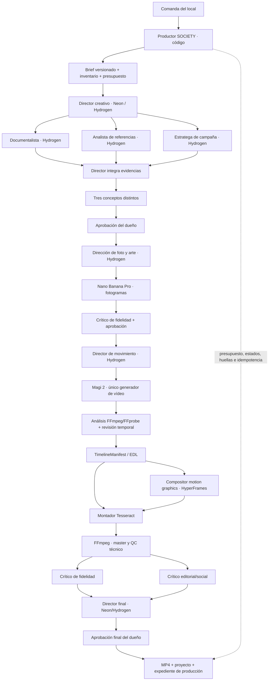

# Propuesta de sistema agéntico de producción audiovisual para SOCIETY

**Documento de diseño · 26 de noviembre de 2026**  
**Base:** `ANALISIS-FLUJO.md`, `ARQUITECTURA-AGENTICA.md` y `catalogo_skills_herramientas_video_IA.md`  
**Primer producto objetivo:** reels 9:16, 1080 × 1920, 12–15 segundos, para locales de hostelería.

---

## 0. Resumen ejecutivo

La propuesta es convertir el flujo actual de producción de reels en un **estudio audiovisual agéntico con un Director que coordina especialistas**, manteniendo al productor de aplicación como responsable exclusivo del estado de la comanda, los presupuestos, las aprobaciones y la persistencia.

La distribución de modelos planteada es:

- **Gemini 4 Neon:** Director creativo/orquestador de alto juicio cuando haya presupuesto. Integra el briefing, decide entre los conceptos, coordina a los especialistas Hydrogen, resuelve discrepancias y hace la última lectura editorial de trabajos importantes.
- **Gemini 4 Hydrogen:** modelo de ejecución habitual para los subagentes. Redacta, analiza referencias, prepara planes, escribe prompts, implementa motion graphics, consulta documentación, inspecciona clips y produce informes estructurados. Es el modelo de coste contenido y dispone de tier gratuito en Gemini API, con límites y condiciones propios.
- **Gemini 4 Argon:** modelo de escalado selectivo para problemas difíciles de ingeniería, razonamiento técnico o conflictos que Neon/Hydrogen no resuelvan. No se mantiene activo en todos los agentes ni se llama por sistema.

No se propone que los agentes generen libremente vídeos, gasten créditos o modifiquen el expediente del cliente. **Los modelos proponen y razonan; el código ejecuta contratos, valida, controla presupuesto y registra cada operación.**

En cuanto a herramientas:

1. Se conservan los elementos ya probados en SOCIETY: brief versionado, inventario confirmado, referencias y evidencias, huellas de revisión, Nano Banana Pro para fotogramas, Magi 2 como único generador de vídeo, Tesseract como proyecto editable probado y FFmpeg/FFprobe para análisis y control técnico.
2. Se añade un catálogo ejecutable de skills, efectos y transiciones. Los agentes seleccionan efectos por intención y compatibilidad; no cargan indiscriminadamente todas las librerías.
3. HyperFrames se incorpora como **motor auxiliar de composición HTML/motion graphics** y como ruta de render de escenas programáticas. Tesseract se mantiene como editor/proyecto maestro del piloto hasta comparar ambas rutas. No se convierten dos timelines independientes en fuentes de verdad.
4. GL Transitions, HyperFrames Shader Transitions, PixiJS Filters, Remotion Effects, Three.js Postprocessing, GSAP, Lottie y tsParticles se integran como familias de efectos con adaptadores concretos.
5. Remotion, OpenFX/Natron, frei0r y G'MIC quedan como runtimes o herramientas opcionales sujetas a necesidad, prueba y revisión de licencia.

La arquitectura está pensada para que un reel sencillo funcione solo con Hydrogen y el material disponible, y que los reels con dirección compleja activen Neon o Argon solo en las decisiones donde puedan aportar una mejora medible.

---

## 1. Decisiones de arquitectura

### 1.1. Separar dirección creativa de control de producción

Hay dos responsabilidades distintas que no deben confundirse:

- **Productor de SOCIETY (código):** controla la máquina de estados de la comanda, presupuesto, autorizaciones de gasto, idempotencia, reanudación de trabajos remotos, versiones, huellas, aprobaciones y entrega. Es el único que puede comprometer gasto, avanzar la comanda y consolidar versiones.
- **Director agéntico (modelo):** interpreta el encargo, escoge el enfoque creativo, delega trabajo especializado, compara resultados y recomienda la siguiente decisión. No puede aprobar gasto ni alterar directamente el estado del dominio.

El Director opera dentro de los límites de la comanda. Si necesita más segundos de Magi, otro lote de imágenes, un activo adicional o un cambio que invalide aprobaciones, devuelve una petición estructurada al Productor. El Productor calcula, comprueba la cobertura y presenta la aprobación necesaria.

### 1.2. Mantener una única fuente de verdad

La fuente de verdad del encargo continúa siendo el expediente versionado de SOCIETY: brief, inventario, plan, fotos aprobadas, trabajos remotos, prompts, mapas temporales, decisiones, revisión y gasto.

Para la edición se añade un **`TimelineManifest` / EDL canónico** (lista de decisiones de montaje) independiente del motor. Este manifiesto identifica clips de origen, intervalos, fotogramas, capas, efectos, audio y textos. Tesseract, HyperFrames o Remotion pueden recibir una representación de ese manifiesto, pero ninguno puede convertirse en una segunda fuente de verdad desconectada.

### 1.3. Especialistas acotados, no agentes autónomos ilimitados

Cada subagente recibe:

- Un objetivo concreto y una definición de terminado.
- La versión del brief y los documentos que necesita.
- Los activos permitidos y su procedencia.
- El contrato de entrada/salida.
- El límite de tokens, tiempo, llamadas y gasto que le corresponde.
- Las herramientas y skills autorizadas para esa tarea.

Cada agente devuelve resultado, artefacto, evidencias, incidencias, confianza y consumo. El Director no acepta un resultado solo porque el agente lo declare terminado: lo contrasta con el contrato y con los críticos.

### 1.4. Selección dinámica de skills y herramientas

El catálogo de herramientas es un inventario, no un paquete que deba ejecutarse completo en cada reel. Un `SkillResolver` identifica el tipo de material y activa solo las skills correspondientes:

- Producto/fotogramas y motion design.
- Grabación real/talking-head.
- Podcast/vídeo largo que se convierte en clips.
- Referencia visual que hay que desarmar.
- Demo de producto/web.
- Composición 2D, shaders, partículas o elementos 3D.

Esto reduce dependencias, tiempo de ejecución y errores por usar una técnica que no encaja con el material.

---

## 2. Modelos: responsabilidades y reglas de enrutamiento

### 2.1. Gemini 4 Hydrogen — modelo de trabajo por defecto

**Identificador API documentado:** `gemini-4-hydrogen`  
**Función en SOCIETY:** ejecución de la mayoría de los subagentes.

Asignaciones:

- Documentalista del local y extracción de hechos.
- Analista de referencias y despiece de reels.
- Guionista y generador de variantes iniciales.
- Dirección de fotografía/arte de primer nivel.
- Redacción de prompts Nano Banana Pro y Magi 2.
- Director de movimiento para planos de dificultad normal.
- Montador y especialista de motion design para implementar un plan ya aprobado.
- Preparación de subtítulos, audio y metadatos.
- Revisión inicial de clips, fotogramas y exportaciones.
- QA de herramientas y generación de informes.

**Por qué:** Google presenta Hydrogen como modelo orientado a ejecución rápida en coding y flujos agénticos cotidianos. Su ficha documenta entrada de texto, imagen, audio y vídeo, además de contexto unificado de hasta 1 millón de tokens. La API dispone de tier gratuito sujeto a límites; el uso de ese tier tiene condiciones de datos diferentes al tier de pago.

Hydrogen no tiene que decidirlo todo. Recibe el objetivo y el contrato de la tarea, usa las skills necesarias, produce un artefacto y lo entrega al Director.

### 2.2. Gemini 4 Neon — Director y supervisor de alto juicio

**Identificador API documentado:** `gemini-4-neon`  
**Función en SOCIETY:** orquestador creativo y supervisor de producción cuando se autorice su coste.

Tareas que conviene asignarle:

- Interpretar briefs con varias restricciones comerciales, visuales y de fidelidad.
- Integrar los informes de investigación, estrategia, fotografía y montaje.
- Formular o revisar los tres conceptos de mecanismo distinto exigidos por el flujo.
- Escoger el concepto final y justificarlo con evidencias del local.
- Delegar en paralelo tareas independientes a subagentes Hydrogen.
- Resolver discrepancias entre críticos.
- Revisar el reel final cuando sea una campaña importante o haya habido varias rondas de corrección.
- Decidir si una incidencia requiere reescribir una escena, reparar un intervalo o aceptar un recorte.

Google describe expresamente Neon como un modelo para flujos complejos de coding, razonamiento analítico y trabajo de producción; además, su anuncio lo presenta como orquestador de alto juicio que dirige subagentes Hydrogen en paralelo dentro de Google Antigravity. En SOCIETY se puede reproducir ese patrón con el orquestador propio y los puertos de agentes; no se presupone que Antigravity gestione automáticamente la aplicación.

**No lo usaría para:** cada subtítulo, cada consulta de FFprobe, cada ajuste de keyframe, cada transcripción o cada efecto sencillo. Esas tareas se delegan en Hydrogen o en código.

### 2.3. Gemini 4 Argon — escalado extraordinario

**Identificador API documentado:** `gemini-4-argon`  
**Función en SOCIETY:** segunda opinión de alta capacidad para casos difíciles, no modelo por defecto.

Activarlo únicamente cuando se cumpla al menos una condición:

- Neon y los especialistas no consiguen resolver una contradicción creativa importante.
- El proyecto requiere una decisión técnica/arquitectónica extensa que haya superado el presupuesto de razonamiento asignado a Neon.
- Una implementación avanzada de shader, composición o render sigue fallando después de los intentos limitados.
- El crítico de fidelidad y el crítico editorial discrepan sobre una decisión con riesgo elevado.
- Una prueba interna demuestra que Argon resuelve mejor esa familia de tareas que Neon y que la mejora justifica el coste.

Argon es un modelo frontier de razonamiento multimodal para ingeniería de software, trabajo de conocimiento y tareas científicas complejas; la ficha oficial también documenta entrada de vídeo, imagen y audio y contexto de hasta 1 millón de tokens.

**Regla:** Argon no se invoca solo porque una tarea sea larga. Se invoca cuando existe un problema identificado, evidencia de que el escalado es útil y presupuesto autorizado.

### 2.4. Router de modelos

La selección del modelo no debe quedar hardcodeada dentro de cada agente. Se propone un `ModelRouter` que recibe `taskType`, criticidad, dificultad estimada, confianza del último resultado, presupuesto disponible y capacidades multimodales necesarias.

| Condición | Modelo preferente | Motivo |
|---|---|---|
| Tarea rutinaria, salida estructurada o ejecución de skill conocida | Hydrogen | Coste contenido y ejecución rápida. |
| Investigación/inspección de clips con entrada nativa de vídeo | Hydrogen; Neon si la decisión afecta a toda la campaña | Ambos admiten vídeo; reservar Neon para sintetizar la decisión. |
| Brief difícil, tres conceptos de calidad, dirección y coordinación de varios agentes | Neon cuando haya presupuesto; Hydrogen en modo sin coste de API | Es una tarea de síntesis y juicio, no de simple ejecución. |
| Implementación de una transición o efecto ya especificado | Hydrogen | El contrato, documentación y pruebas pesan más que el modelo premium. |
| Shader complejo, error de render persistente o conflicto sin resolver | Neon primero; Argon si la prueba de escalado lo justifica | Escalado por evidencia, no por defecto. |
| Validación de dimensiones, códec, duración, audio, FPS o LUFS | Código: FFprobe/FFmpeg | Debe ser determinista y reproducible. |
| Revisión temporal del MP4 y dictamen editorial | Hydrogen como primer crítico; Neon como segundo crítico en entregas relevantes | Separar la inspección y la decisión final. |

Reglas de escalado sugeridas:

1. Hydrogen intenta una vez con el contrato y las skills correctas.
2. Si falla validación, Hydrogen recibe un error preciso y puede corregir una vez.
3. Si vuelve a fallar o la decisión afecta a varias especialidades, Neon recibe el artefacto, el error y las evidencias relevantes.
4. Argon solo se activa si Neon identifica una cuestión de razonamiento/ingeniería sin resolver y el Productor autoriza el coste.
5. El sistema registra qué modelo se utilizó, para qué decisión, con qué configuración y qué resultado obtuvo.

### 2.5. Modo actual sin presupuesto para API premium

El sistema debe poder arrancar sin Neon ni Argon:

- Hydrogen toma provisionalmente el papel de Director y especialista.
- El Productor conserva todo el control de dominio.
- El Director Hydrogen trabaja por etapas y recibe resultados de los subagentes en vez de lanzar todas las tareas de una vez.
- Los críticos pueden ejecutarse como dos pasadas independientes de Hydrogen, con rúbricas y contextos distintos. Para las entregas importantes se recomienda revisión humana hasta disponer de un segundo modelo.
- Las decisiones objetivas se mueven a código: validación de tiempos, inventario, fuentes, marcas de agua, formato, capas y códecs.
- Las skills, plantillas, bibliotecas de efectos, pruebas y previsualizaciones reducen la cantidad de razonamiento que debe repetir el modelo.

Así el salto a Neon consiste en cambiar el modelo del Director/árbitro, no en rehacer los agentes ni la arquitectura.

### 2.6. API, coste y datos

Precios estándar publicados por Google a 26/11/2026, en USD por millón de tokens:

| Modelo | Entrada | Salida | Tier gratuito de API |
|---|---:|---:|---|
| Gemini 4 Hydrogen | $1,50 | $7,50 | Sí, sujeto a límites. |
| Gemini 4 Neon | $3,00 | $15,00 | No. |
| Gemini 4 Argon | $2,00 hasta 30/11/2026; $4,00 desde 01/12/2026 | $10,00 hasta 30/11/2026; $20,00 desde 01/12/2026 | No. |

Los tokens de razonamiento y las instrucciones de herramientas también pueden computar. La tabla no incluye generación de imagen/vídeo, voz, almacenamiento, búsqueda externa, otros servicios ni posibles descuentos Batch/Flex. Revisar la tarifa actual antes de fijar presupuestos de producción.

**Privacidad:** la página de precios diferencia el tier gratuito (los datos pueden utilizarse para mejorar productos) del tier de pago (no se utilizan para ese fin, según las condiciones publicadas). Mientras SOCIETY opere con información real de clientes, marcas, personas o campañas, no se deben enviar datos sensibles al tier gratuito sin revisar primero las condiciones y obtener la autorización correspondiente. Se puede anonimizar el brief, eliminar datos personales y usar activos sintéticos para desarrollo.

---

## 3. Arquitectura propuesta

### 3.1. Vista general



El diagrama muestra responsabilidades lógicas. No obliga a desplegar un proceso independiente por cada agente: varios agentes pueden compartir proceso y modelo, siempre que mantengan contratos y contextos separados.

### 3.2. Componentes de aplicación

| Componente | Estado | Responsabilidad |
|---|---|---|
| `ProductorEditorial` / Productor de comanda | Existe en la arquitectura compartida | Único responsable del avance de comanda, gasto, persistencia, huellas y aprobaciones. |
| `DirectorCreativo` | Existe | Tres conceptos, elección de mecanismo y plan temporal. Adaptar el adaptador Gemini para soportar Hydrogen/Neon/Argon por configuración. |
| `DirectorDeFoto` | Existe | Composición, encuadre, foco, luz, continuidad y prompts de fotograma. |
| `AnalistaDeReferencias` | Existe | Despiece del vídeo de referencia, mecanismo transferible, tiempos y diferencias respecto al material del local. |
| `DirectorDeDiseno` / `DirectorDeArte` | Existen | Lenguaje gráfico, jerarquía visual, tipografía y recetas de composición. |
| `GeneradorFoto` / adaptador Nano | Existe en el diseño funcional | Cotizar, enviar, recuperar, normalizar y registrar fotogramas Nano Banana Pro. |
| `DirectorDeMovimiento` | Por añadir como rol explícito o subrol | Traducir estados inicial/final del plano a una instrucción de movimiento Magi 2. |
| `GeneradorVideo` / adaptador Magi 2 | Puerto propuesto en la documentación | Estimar, enviar, consultar, descargar y registrar clips; respetar concurrencia e idempotencia. |
| `MontadorDeVideo` | Puerto propuesto | Convertir el manifiesto temporal en proyecto editable y previsualización. |
| `CompositorMotionGraphics` | Nuevo adaptador propuesto | Crear títulos, overlays, llamadas, animaciones, máscaras y transiciones mediante HyperFrames/HTML. |
| `CatalogoDeEfectos` | Nuevo servicio propuesto | Buscar efectos disponibles, validar parámetros, runtime, licencia y fallback. |
| `ModelRouter` / `ProveedorDeModelos` | Nuevo puerto/adaptador propuesto | Seleccionar Hydrogen/Neon/Argon y registrar uso, coste, modelo y configuración. |
| `CriticoEditorial` | Existe | Comprensión, atención, progresión, tono de marca y utilidad para el público del local. |
| `RevisorVisual` / crítico de fidelidad | Existe | Fidelidad de producto/local/persona, continuidad, anatomía, mutaciones, texto y calidad visible. |
| Validador técnico | Parcialmente existente / ampliar | FFprobe/FFmpeg para contrato del MP4, audio, FPS, duración, resolución y comprobaciones temporales. |

### 3.3. Puertos nuevos o ampliaciones

**`ProveedorDeModelos`**

- Entrada: nombre lógico del agente, tarea, contexto permitido, esquema de salida, presupuesto y modelo preferido.
- Salida: resultado estructurado, modelo efectivo, tokens, coste estimado/real, duración, errores y trazabilidad.
- Adaptadores: `GeminiHydrogen`, `GeminiNeon`, `GeminiArgon`.
- Doble: `ProveedorModeloSimulado` determinista para pruebas.

**`CatalogoDeEfectos`**

- Buscar efectos por intención, tipo, runtime, complejidad y entradas compatibles.
- Devolver únicamente efectos permitidos para la licencia y runtime de la producción.
- Validar parámetros contra un esquema, sin ejecutar código arbitrario suministrado por el modelo.
- Registrar versión del paquete, licencia, coste de render, preview y fallback.

**`CompositorMotionGraphics`**

- Entrada: segmentos de timeline, guía de marca, fuentes, imágenes aprobadas, receta de efecto y formato de salida.
- Salida: medios renderizados, archivos fuente del proyecto, mapa de capas, preview, metadatos y errores.
- Adaptador inicial: HyperFrames.
- Doble: compositor simulado que genera assets de prueba y un manifiesto determinista.

**`MontadorDeVideo`**

- Entrada: `TimelineManifest`, medios aprobados, fuentes, audio, gráficos, proyecto anterior y revisión vigente.
- Salida: proyecto editable, preview, master, mapa de origen/destino y diagnóstico.
- Adaptador inicial: Tesseract (proyecto principal ya ensayado en el piloto).
- Adaptador complementario a evaluar: importador de assets HyperFrames y, en una futura prueba separada, renderer completo HyperFrames.

**`AnalizadorTemporal`**

- Entrada: referencia o bruto de vídeo.
- Salida: duración, FPS, cortes candidatos, keyframes, tiras de movimiento, regiones, audio, timestamps y métricas.
- Implementación: FFmpeg/FFprobe, scripts Python y herramientas de transcripción/alineación cuando aporten valor.

---

## 4. Organización de agentes y skills

### 4.1. Director principal

**Modelo:** Neon cuando haya presupuesto; Hydrogen en modo económico.  
**Skills:** `video-planning`, `motion-film-skill`, `motion-design-craft`, `hyperframes`, `video-editing-router` como referencias de proceso; las skills concretas se delegan al especialista que corresponda.

Responsabilidades:

- Recibir la comanda consolidada del Productor.
- Asegurar que la historia se apoya en hechos y activos aprobados.
- Exigir exactamente tres conceptos de mecanismos diferentes en la propuesta creativa.
- Elegir o recomendar el concepto con explicación basada en público, evidencia, duración y presupuesto.
- Crear encargos acotados para los especialistas.
- Coordinar paralelismo solo cuando las tareas no dependan de una decisión previa.
- Integrar resultados sin sobrescribir la procedencia.
- Resolver críticas y devolver decisiones localizadas al responsable correcto.

El Director no modifica directamente inventario confirmado, presupuesto, aprobaciones ni trabajos remotos.

### 4.2. Productor de comanda

**Modelo:** no necesita LLM para controlar estado; Hydrogen puede ayudar en la redacción de explicaciones, pero no en la autoridad de dominio.  
**Skills:** `video-planning`, `platform-export`, `ffmpeg-essentials`, `video-qa` como material de apoyo.

Responsabilidades:

- Comprobar local, objetivo, público, formato, derechos, activos y techo de gasto.
- Crear la revisión y brief versionados.
- Abrir investigación e inventario en paralelo.
- Registrar las aprobaciones y su huella.
- Estimar y reservar el gasto solo tras autorización.
- Guardar el ID remoto inmediatamente, consultar antes de repetir y evitar cargos duplicados.
- Invalidar aprobaciones descendientes cuando cambie un activo o una decisión que afecte a su dependencia.
- Empaquetar la entrega y el expediente.

### 4.3. Documentalista del local

**Modelo:** Hydrogen.  
**Skills:** `video-planning`, `website-to-hyperframes` solo si se necesita capturar/interpretar una web; herramientas de extracción de documentos y visión según los conectores existentes.

Entregas:

- Inventario de productos, vajilla, local, personas, procesos, marca y elementos prohibidos/no demostrados.
- Una fuente para cada afirmación y una región/imagen cuando se trate de algo visible.
- Distinción entre hecho confirmado, inferencia y dato que necesita confirmación del dueño.
- Fuentes permitidas para generar y fuentes que solo sirven de inspiración.

Una fotografía de un plato servido solo prueba su apariencia; una receta, cantidad, ingrediente o proceso necesita su propia fuente.

### 4.4. Analista de referencias

**Modelo:** Hydrogen; Neon solo para sintetizar patrones de varias referencias.  
**Skills:** `reverse-any-video` de HyperFrames, `style-sampling`, `motion-film-skill`, `video-shotcraft`, `motionboard`; herramientas FFmpeg/FFprobe.

Entregas:

- Archivo completo, origen, autor si se conoce, fecha, duración y derechos/condiciones.
- Mapa de cortes, escalas, movimientos, transiciones, texto, sonido y ritmo.
- Identificación del mecanismo transferible, sin copiar material protegido.
- Tabla «se conserva / se adapta / se descarta / motivo».
- Capturas y segmentos con tiempo exacto.

No basta con una captura aislada para juzgar el ritmo. El análisis debe utilizar el vídeo completo cuando esté disponible.

### 4.5. Estratega y guionista

**Modelo:** Hydrogen para variantes; Neon para elegir entre rutas complejas.  
**Skills:** `video-planning`, `product-launch-motion`, `motion-film-skill`, `video-agent-skill` cuando la entrada sea una grabación hablada.

Entrega por concepto:

- Objetivo (reconocimiento, consideración, reserva, visita, pedido, etc.).
- Público y ocasión.
- Gancho y pregunta abierta.
- Progresión y revelado.
- Motivo de guardado o reenvío.
- Prueba visible/sonora y fuente.
- Guion, CTA y duración por tramo.
- Riesgos y mecanismo alternativo.

Los tres conceptos deben diferir en mecanismo, no limitarse a cambiar el titular.

### 4.6. Director de fotografía y arte

**Modelo:** Hydrogen.  
**Skills:** `motion-film-skill`, `video-shotcraft`, `motionboard`, `motion-design-skill`; conocimiento de fotografía gastronómica, composición, tipografía y continuidad que ya utiliza SOCIETY.

Entrega:

- Libro de continuidad.
- Contrato por plano: función, estado inicial/final, tamaño, ángulo, cámara, foco, luz, acción y consecuencia.
- Orden y papel de cada referencia.
- Zona reservada para rótulos y safe zones.
- Exclusiones para evitar ingredientes, manos, marcas o elementos inventados.
- Prompts en inglés para Nano Banana Pro y criterios de rechazo.

Construye primero el fotograma ancla compartido y después los planos dependientes.

### 4.7. Operador de imagen y crítico de fidelidad de fotogramas

**Modelo:** Hydrogen para inspección; código para dimensiones, hashes y normalización.  
**Herramientas:** Nano Banana Pro, procesamiento de imagen existente, Vision/segmentación disponible y contact sheets.

Entrega:

- Cotización asociada a referencias efectivas.
- Fotograma ancla y variantes.
- Comparación contra las fuentes reales.
- Hoja de contacto y revisión al 100 %.
- Aprobación o rechazo localizado con evidencia.

La generación se detiene en la puerta de aprobación prevista. El agente no debe animar una imagen que aún no ha sido aprobada.

### 4.8. Director de movimiento y operador Magi 2

**Modelo:** Hydrogen. Neon solo en planos narrativamente complejos o conflictivos.  
**Skills:** `motion-film-skill`, `product-launch-motion`, `video-shotcraft`, `motionboard`, `motion-design-craft`.

Responsabilidades:

- Convertir cada contrato de plano en un encargo de movimiento preciso.
- Elegir entre image-to-video con fotograma inicial o reference-to-video con fotogramas ordenados, según el diseño del plano.
- Identificar el plano de mayor riesgo y solicitar primero un control corto de 4 s.
- Revisar el control antes de solicitar la generación cubierta por la aprobación.
- Medir los cortes y las ventanas realmente utilizables del bruto.
- Registrar prompt, referencias, modo, tiempo pedido, tiempo entregado, ID remoto y consumo.

**Restricción del diseño actual:** Magi 2 sigue siendo el único generador de vídeo del flujo. Las skills y librerías de motion graphics no sustituyen ni amplían la generación de vídeo; se aplican al montaje, overlays, transiciones y efectos después de recibir los brutos.

### 4.9. Montador

**Modelo:** Hydrogen. Neon puede arbitrar si el resultado es técnicamente correcto pero no cuenta la historia.  
**Skills:** `video-editing-router`, `video-planning`, `ffmpeg-essentials`, `vertical-shorts`, `platform-export`, `video-qa`, `reel-editing-skills`; Tesseract skill y referencias del proyecto.

Responsabilidades:

- Desglosar los brutos y mapear tiempos de origen/destino.
- Elegir cortes por acción, mirada, coincidencia de formas o continuidad.
- Ajustar duración y ritmo según la pregunta que plantea cada plano.
- Montar primero una versión limpia sin efectos.
- Colocar texto, subtítulos, firmas y overlays en capas editables.
- Preparar el proyecto Tesseract con medios y fuentes empaquetados.
- Exportar preview para crítica y correcciones locales.

### 4.10. Diseñador de movimiento / especialista de efectos

**Modelo:** Hydrogen para seleccionar e implementar; Neon/Argon solo si la arquitectura o el shader es complejo.  
**Skills:** `hyperframes`, `hyperframes-cli`, `hyperframes-registry`, `motion-design-craft`, `Vidmoat Skills`, `gl-transitions`, `motionboard`, `motion-design-skill`.

Responsabilidades:

- Interpretar el propósito narrativo del efecto.
- Buscar en el catálogo la técnica adecuada y compatible con el runtime.
- Proponer como máximo unas pocas variantes con preview.
- Implementar el efecto en una composición aislada o sobre el timeline.
- Entregar parámetros, duración en frames, versión, licencia, fallback y test visual.

No añade efectos porque estén disponibles; cada efecto debe guiar la mirada, aclarar una relación, enfatizar un cambio o reforzar la identidad de marca.

### 4.11. Diseñador sonoro / editor de voz

**Modelo:** Hydrogen.  
**Skills/herramientas:** `audio-mixing`, `captions-subtitles`, Whisper/faster-whisper, WhisperX, Kokoro/Piper/ElevenLabs según licencia y autorización; FFmpeg para mezcla y validación.

Responsabilidades:

- Mantener continuidad de ambiente cuando varios planos pertenecen al mismo espacio.
- Asociar SFX con contactos, gestos o cortes realmente visibles.
- Alinear subtítulos a la voz final, preferiblemente a nivel de palabra cuando el material lo requiera.
- Hacer ducking de música bajo voz y revisar clipping, silencio y canales.
- Registrar la procedencia y licencia de música, voz y efectos.

### 4.12. Críticos independientes

Se mantienen dos críticas separadas, tal como plantea la arquitectura:

**Crítico de fidelidad y dirección de arte — Hydrogen:** revisa identidad, producto, espacio, cantidades, vajilla, anatomía, continuidad, luz y afirmaciones. Toda incidencia debe apuntar a fuente, intervalo y fotogramas afectados.

**Crítico editorial/social — Hydrogen:** revisa gancho, comprensión, progresión, ritmo, lectura en móvil, retención potencial y especificidad del negocio. No inventa métricas de audiencia si no hay datos publicados.

**Arbitraje — Neon:** se activa ante discrepancias materiales, campaña importante o revisión final de alta exigencia. Argon puede emitir segunda opinión si el conflicto sigue sin resolverse y el Productor autoriza el coste.

El agente que genera el material puede explicar sus decisiones, pero no es el único que lo aprueba.

---

## 5. Sistema de skills: cómo cargarlas sin saturar los agentes

### 5.1. Skills base por proyecto

Cargar en el entorno común un conjunto pequeño:

- `video-planning`: plan, escenas y fotogramas.
- `ffmpeg-essentials`: operaciones y análisis básicos.
- `video-qa`: criterios de validación.
- `platform-export`: formatos de salida.
- `video-editing-router`: decidir qué skill se activa.

El conjunto de `agents-video-editing-skills` sirve como base neutral; su README indica compatibilidad con varios agentes de código, incluido Gemini CLI. Adaptar los ficheros de instrucciones necesarios al formato interno de SOCIETY y mantener versiones fijadas.

### 5.2. Skills de composición y motion design

Cargar según el trabajo:

| Skill/pack | Agente | Uso |
|---|---|---|
| HyperFrames core | Motion designer / compositor | HTML/CSS/JS controlado por tiempo, previsualización y render. |
| `hyperframes-cli` | Compositor / QA | init, lint/check, snapshot, preview, render y diagnóstico. |
| `hyperframes-registry` | Motion designer | Buscar y añadir bloques, transiciones, overlays, gráficos y títulos reutilizables. |
| `media-use` | Compositor | Integrar fuentes, vídeos, música, logos, voz y recursos. |
| `reverse-any-video` | Analista | Convertir las decisiones de una referencia en especificación editable; no copiar material sin derechos. |
| `style-sampling` | Director de arte | Explorar sistemas visuales, estilos y composición. |
| `motionboard` | Motion designer | Recetas de planos, match cuts, logo reveals, kinetic typography y liquid glass. |
| `motion-film-skill` | Director / motion designer | Dirección, prueba de movimiento y elección de técnica por plano. |
| `product-launch-motion` | Motion designer | Movimiento continuo, beats, springs y composición HTML con render Playwright/FFmpeg. |
| `video-shotcraft` | Director de foto / motion designer | Recetas de cámara, shot cards, storyboard, SFX y movimiento. |
| `motion-design-skill` | Motion designer | Tipografía cinética, coreografía de interfaz, HTML y gráficos 3D. |
| Vidmoat Skills | Editor/motion designer | Recetas de speed ramps, beat sync, transiciones y motion design. |
| `gl-transitions` | Motion designer | Buscar y aplicar transiciones shader compatibles. |

### 5.3. Skills especializadas por material

| Tipo de entrada | Skills/herramientas que se activan | Qué aportan |
|---|---|---|
| Reel de producto con animación y llamadas gráficas | `product-launch-motion`, `motionboard`, `video-shotcraft`, HyperFrames | Recetas de movimiento, ritmo, diseño de producto y motion graphics. |
| Producto con movimiento continuo de tipo one-take | `onetake` como referencia de técnica; alternativa de implementación con `product-launch-motion` y HyperFrames | Secuenciación HTML, cámara continua, tipografía cinética, SFX y verificación. **No usar el código/skill de `feitangyuan/onetake` en entregas comerciales bajo su licencia PolyForm Noncommercial sin licencia comercial aparte.** |
| Persona hablando a cámara con varias tomas | `ghost-editor`, `video-agent-skill/reel-editor`, `reel-editing-skills` | Selección de mejores tomas, eliminación de pausas, captions, B-roll, punch-ins y overlays. Comprobar compatibilidad y licencia del repo concreto. |
| Entrevista, podcast o vídeo largo | Shorz, Vedit, `video-agent-skill/youtube-editor`, WhisperX | Detección de segmentos, edición de clips, subtítulos y recortes verticales. |
| Demo de web, SaaS o producto digital | `website-to-hyperframes`, `demo-video-creator`, Playwright, `product-launch-motion` | Captura de interfaz, walkthrough, llamadas de UI y composición. `demo-video-creator` está descrita para vídeo horizontal; adaptar el lenguaje, no asumir que su salida vertical está resuelta. |
| Animación explicativa, datos o mapas | Remotion skills, D3, Manim, Motion Canvas | Charts, mapas, fórmulas, secuencias explicativas y visualizaciones. |
| Efectos 3D | Three.js/Postprocessing o Blender | Solo cuando el plano realmente necesita 3D, cámara, geometría, render o composición espacial. |

**Nota de compatibilidad:** algunas skills se publicaron para Claude Code o un instalador concreto. Una skill es texto, ejemplos y quizá scripts; no implica compatibilidad automática con Gemini ni con el runtime de SOCIETY. Antes de activarla, verificar su formato, comandos, dependencias, agente anfitrión y licencia. Se pueden adaptar instrucciones a una skill interna neutral cuando sus términos lo permitan.

### 5.4. Skills y proyectos que no conviene adoptar como dependencia sin revisión

- **OpenMontage:** estudiar su organización de pipelines y técnicas, pero no acoplar todo su framework al dominio de SOCIETY. El repositorio está bajo AGPLv3; revisar las obligaciones antes de integrarlo, redistribuirlo o ofrecerlo como servicio.
- **`onetake` de feitangyuan:** su licencia PolyForm Noncommercial 1.0.0 no permite asumir uso comercial para reels de clientes. Requiere licencia comercial separada o sustitución por una implementación independiente con componentes compatibles.
- **`ghost-editor`:** el catálogo no confirma licencia explícita y la documentación indica requisitos/compatibilidad específicos. No incorporar su código a producción comercial hasta aclararlo.
- **Remotion:** confirmar la licencia aplicable a SOCIETY y al render automático para clientes. Las exenciones dependen de la entidad y del uso; no asumir que una licencia gratuita personal cubre un SaaS que produce contenido para terceros.
- **G'MIC/OpenFX/frei0r:** revisar cada plugin y build; no todos los filtros tienen necesariamente las mismas condiciones.

---

## 6. Biblioteca de efectos, transiciones y motion graphics

### 6.1. Objetivo: un catálogo de efectos consultable por agentes

No se debe permitir que un LLM escriba nombres de efectos arbitrarios y los pase directamente a una librería. Debe consultar una lista blanca, elegir un efecto disponible y rellenar un esquema de parámetros validado.

Cada entrada del catálogo debería tener estos metadatos:

```json
{
  "id": "gl-transition/ripple",
  "name": "Ripple",
  "category": "transition",
  "purpose": ["reveal", "match-cut", "emphasis"],
  "runtime": ["webgl", "hyperframes"],
  "package": "gl-transitions",
  "version": "PINNED_VERSION",
  "durationFrames": { "min": 8, "default": 16, "max": 30 },
  "paramsSchema": {
    "amplitude": { "type": "number", "min": 0, "max": 1, "default": 0.35 },
    "frequency": { "type": "number", "min": 0.1, "max": 8, "default": 2 }
  },
  "inputs": ["videoA", "videoB"],
  "performance": "medium",
  "license": "CHECK_UPSTREAM_LICENSE",
  "commercialAllowed": "pending-audit",
  "fallback": "cut",
  "previewFixture": "tests/effects/ripple",
  "qc": ["no-black-frame", "no-flash-over-limit", "preserve-subject"]
}
```

Los valores de ejemplo son ilustrativos. En el sistema real, los parámetros deben proceder de la documentación de la versión fijada y cada efecto debe contar con una prueba.

### 6.2. Familias de herramientas y función en el flujo

| Familia | Paquetes / herramienta | Uso en SOCIETY | Runtime / limitaciones |
|---|---|---|---|
| Transiciones shader | GL Transitions + Agent Skill `gl-transitions` | Wipes, masks, distortions, ripple, zoom, displacement, efectos de transición más ricos. | WebGL/GLSL y adaptadores. Verificar licencia individual de cada shader. |
| Transiciones de HyperFrames | `@hyperframes/shader-transitions` + registry | Transiciones WebGL listas para composiciones HTML de HyperFrames. | Específico del paquete/rutina HyperFrames; fijar versión. |
| Transiciones Remotion | `@remotion/transitions` / `TransitionSeries` | Encadenar escenas React con solapes y transiciones controladas por frames. | Solo dentro del camino Remotion; sujeto a licencia Remotion. |
| Transiciones FFmpeg | `xfade`, `xfade-easing` | Fade, wipe y transiciones sencillas en postproceso. | Fácil de automatizar; no sustituye a shaders avanzados. |
| Efectos visuales por capa | `@remotion/effects` | Film burn, iris, glitch, chromatic aberration, halftone, shatter, light leaks y otros efectos documentados. | Solo ruta Remotion. |
| Motion blur | `@remotion/motion-blur`, `tmix` en FFmpeg | Suavizar desplazamientos gráficos y movimientos seleccionados. | Revisar coste de render y ghosting; probar con el sujeto real. |
| Filtros 2D | PixiJS Filters | Bloom, blur, glow, CRT, glitch, RGB split, shockwave, displacement y otros filtros. | Canvas/WebGL 2D; adecuado para overlays, rótulos y elementos gráficos. |
| Postprocesado 3D | Three.js `postprocessing`, `@react-three/postprocessing` | Depth of field, bloom, glitch, aberración y tratamiento de escenas 3D. | Reservar para planos 3D; evitar añadir Three.js si no se necesita. |
| Plugins externos | frei0r, Natron OpenFX, G'MIC | Filtros de posproducción, corrección, looks y efectos fuera del runtime web. | Dependencias nativas y licencias de plugins variables. Revisión manual antes de despliegue comercial. |
| Partículas | tsParticles | Confetti, sparks, dots, particles, ribbons y elementos gráficos. | DOM/canvas; decorar interfaz o celebrar una acción, no inventar propiedades físicas del producto. |
| Animación vectorial | Lottie/dotLottie, `@remotion/lottie`, Rive | Iconos, indicadores, loaders, pictogramas, llamadas y recursos animados ligeros. | Verificar licencia del runtime y del archivo/asset. |
| Animación temporal | GSAP | Timeline de rótulos, overlays, stagger, easing y coreografía de elementos. | Encaja en HTML/HyperFrames; fijar versión y comprobar la licencia del uso. |
| Composición de planos y motion | HyperFrames | HTML/CSS/JS, capas, títulos, subtítulos, llamadas, animación y render. | Runtime principal propuesto para escenas de motion graphics. |
| Animación de código alternativa | Motion Canvas | Diagramas, secuencias técnicas y gráficos animados programáticos. | Proyecto separado; no convertirlo en motor estándar de todos los reels. |

### 6.3. Reglas creativas y técnicas para aplicar efectos

- El **corte directo** es el comportamiento por defecto. Una transición debe comunicar una relación: continuidad, cambio de escala, paso de tiempo, revelado o cambio de idea.
- El Director decide la intención; el diseñador de movimiento propone la implementación; el catálogo selecciona un efecto permitido; el render produce el resultado.
- Un reel de 12–15 s no necesita una transición diferente en cada corte. Limitar el número de efectos llamativos y preservar planos limpios para que el producto/local siga siendo protagonista.
- No animar un rótulo antes de que el detalle al que señala sea legible. El rótulo debe seguir la evidencia visual, no sustituirla.
- No usar glitch, RGB split, bloom, partículas, motion blur o zoom solo para “hacerlo más dinámico”. Cada uso debe tener función escrita en el plan.
- El efecto no debe ocultar deformaciones, duplicaciones, mutaciones o fallos de continuidad del material generado.
- Probar efectos sobre el peor fotograma del intervalo, además de la previsualización a velocidad real y móvil.
- Todo efecto tiene duración en fotogramas, easing, parámetros, región afectada, prioridad de capa, fallback y versión fijada.
- Incluir una prueba de reducción de intensidad o sustitución por corte directo. Si la lectura mejora sin el efecto, se elimina.

### 6.4. Matriz de decisión por tipo de efecto

| Necesidad visual | Primera ruta a evaluar | Alternativa |
|---|---|---|
| Transición rica entre dos planos | GL Transitions integrado en HyperFrames | `xfade` si basta una transición simple. |
| Título cinético, precio o llamada a un detalle | HyperFrames + GSAP | Rive/Lottie si existe un asset vectorial adecuado. |
| Glow, bloom, RGB split o glitch 2D | PixiJS Filters | Shader WebGL específico si se necesita una transición entre dos fuentes. |
| Film burn, iris wipe, halftone o shatter en composición React | Remotion Effects | Implementación shader/Canvas equivalente, revisando coste y licencia. |
| Elemento 3D, profundidad de campo o luz volumétrica | Three.js Postprocessing o Blender | Gráfico 2D si el 3D no aporta información. |
| Confetti o partículas de diseño | tsParticles | Lottie/dotLottie para elemento preanimado. |
| Filtro de posproducción avanzado fuera de HTML | Natron/OpenFX, G'MIC o frei0r | FFmpeg filters / corrección determinista. |
| Gráfico explicativo o datos | D3 / Remotion / Motion Canvas | SVG/HTML simple cuando sea suficiente. |

---

## 7. Motor de composición y montaje

### 7.1. Tesseract como proyecto maestro del piloto

La arquitectura compartida indica que el piloto ya probó Tesseract 0.8.0, con render local, capas editables, medios/fuentes y FFmpeg externo para H.264. Se propone conservarlo como **proyecto editable principal** durante la primera fase, porque ya hay evidencia de funcionamiento y evita cambiar simultáneamente la lógica editorial y el motor.

El montador trabaja sobre `TimelineManifest` y genera el proyecto Tesseract. La previsualización se exporta y se somete a crítica antes de producir el máster.

### 7.2. HyperFrames como compositor auxiliar de motion graphics

HyperFrames ofrece un camino programático HTML/CSS/JS controlado por tiempo, registro de componentes y transiciones shader. Se propone usarlo para:

- Cartelas, titulares, subtítulos cinéticos, firma, lower thirds y llamadas.
- Overlays que necesitan animación temporal compleja.
- Transiciones shader seleccionadas del registry.
- Planos gráficos autónomos: mapas, demostraciones de interfaz, cifras y visualizaciones.
- Previews deterministas de efectos y variantes.

Los renders se incorporan al montaje de Tesseract como capas/medios. La compatibilidad concreta de transparencia, canales, FPS y color debe probarse en un spike técnico antes de prometerla en producción. Si un overlay no puede salir con alpha de forma fiable, se renderiza como escena de composición completa o se implementa directamente como capa Tesseract.

### 7.3. Remotion como alternativa, no como segundo motor obligatorio

Usar Remotion si un proyecto necesita de manera clara componentes React, composición de datos, animaciones reutilizables o un equipo que ya mantenga el ecosistema React.

No hacer que una pieza normal pase por HyperFrames y Remotion a la vez. Elegir un único runtime de código para cada escena, generar un medio verificable e incorporarlo al proyecto maestro. Comprobar la licencia aplicable a render automático para clientes antes de producción.

### 7.4. FFmpeg/FFprobe como capa transversal

FFprobe valida streams, duración, FPS, dimensiones, códecs, sample rate y canales. FFmpeg realiza operaciones deterministas: normalización de escalas, recorte, conversión, concat, filtros, mezcla, subtítulos, extracción de frames, audio y codificación final.

FFmpeg no decide el lenguaje narrativo. Recibe un manifiesto validado y ejecuta el procesamiento indicado.

### 7.5. No usar OpenMontage como orquestador de SOCIETY

OpenMontage es una fuente para estudiar cómo se organizan los pipelines y las skills. Su orquestación completa no debe reemplazar la máquina de estados, puertos, aprobaciones ni bitácora de SOCIETY. Además, su licencia AGPLv3 requiere evaluación antes de reutilizar o desplegar código.

---

## 8. Flujo completo de producción

### Fase 0 — Apertura y preparación sin gasto

**Responsable:** Productor + Documentalista + Analista de referencias.  
**Modelos:** Hydrogen; Neon solo para encargos de estrategia especialmente complejos.

1. Recoger local, objetivo, audiencia, formato, historial, restricciones, derechos y techo de gasto.
2. Recuperar brief/activos/biblioteca y comprobar su versión.
3. Crear inventario propuesto y registrar fuentes.
4. Analizar referencia con FFprobe/FFmpeg: duración, FPS, cortes, movimiento, texto, música, sonido y ritmo.
5. Buscar referencias de mecanismo transferible, no solo por sector.
6. Entregar una comanda clara con hechos, dudas, recursos y presupuesto preliminar.

**Parada:** no avanzar si la historia depende de algo no acreditado o de un cambio no confirmado por el dueño.

### Fase 1 — Dirección creativa y elección de concepto

**Responsable:** Director creativo.  
**Modelo:** Neon cuando disponible; Hydrogen si no hay presupuesto.

El Director recibe el contexto consolidado y produce tres conceptos distintos. Cada concepto incluye:

- Objetivo y público.
- Gancho.
- Pregunta o tensión.
- Progresión y revelado.
- Motivo de guardado/reenvío.
- Prueba visual/sonora y fuente.
- Riesgo de generación y dificultad.
- Escaleta 12–15 s.
- Coste previsto y activos que necesita.

**Parada:** el dueño elige. El Producer registra revisión y huella. Un cambio posterior de idea no puede borrar la elección anterior.

### Fase 2 — Escaleta, fotografía y libro de continuidad

**Responsable:** Director de foto/arte y guionista.  
**Modelo:** Hydrogen; Neon supervisa continuidad entre varios mecanismos o escenas complejas.

1. Convertir la idea elegida en una escaleta temporal.
2. Crear una ficha por plano: intención, acción, estado inicial/final, encuadre, luz, foco, cámara, continuidad y texto.
3. Definir fotograma ancla y orden de referencias Nano Banana Pro.
4. Identificar el plano de mayor riesgo (manos, líquido, reflejos, movimiento de cámara, coincidencia exacta).
5. Definir el tipo de movimiento y el corte al siguiente plano.
6. Preparar mockup temporal con gráficos/activos existentes sin consumir créditos de generación.

### Fase 3 — Fotogramas Nano Banana Pro y aprobación

**Responsable:** Operador de imagen + RevisorVisual.  
**Modelo:** Hydrogen para prompt y revisión.

1. Cotizar con los activos reales y referencias efectivas.
2. Generar primero el ancla común.
3. Normalizar, guardar original, derivado, hash y procedencia.
4. Comparar el fotograma contra el inventario confirmado.
5. Generar el resto manteniendo continuidad.
6. Producir hoja de contacto y revisión al 100 %.
7. Solicitar confirmación de los fotogramas requeridos.

**Parada:** no animar un fotograma no aprobado. Un cambio de sujeto/elemento invalida los derivados que dependan de él.

### Fase 4 — Movimiento Magi 2

**Responsable:** Director de movimiento + adaptador Magi.  
**Modelo:** Hydrogen.

1. Agrupar planos por continuidad y riesgo.
2. Seleccionar image-to-video o reference-to-video según el contrato del plano.
3. Redactar el prompt en inglés con sujeto, acción, cámara, luz, estado final y exclusiones.
4. Solicitar primero el control de 4 s del plano más difícil.
5. Reproducir el control completo y revisar los estados de entrada/contacto/salida.
6. Solo tras validación y autorización, solicitar los segundos presupuestados.
7. Descargar y comprobar huellas, duración, imagen y audio.
8. Extraer cortes y ventanas utilizables; mapear tiempos de origen.

**Parada:** un fallo o gasto no conciliado bloquea nuevos envíos. Ante un timeout se consulta el trabajo remoto antes de cualquier reintento.

### Fase 5 — Primer montaje limpio

**Responsable:** Montador.  
**Modelo:** Hydrogen.

1. Crear `TimelineManifest` a partir de los brutos aprobados.
2. Construir primero el montaje con cortes directos y sin efectos decorativos.
3. Mantener la legibilidad del hook y el tiempo suficiente para reconocer el producto/local.
4. Comprobar empalmes de continuidad y correspondencia con el mecanismo de la referencia.
5. Importar los medios a Tesseract y guardar proyecto.
6. Crear preview vertical a tamaño móvil.

### Fase 6 — Motion graphics, transiciones y sonido

**Responsables:** Diseñador de movimiento + Diseñador sonoro.  
**Modelo:** Hydrogen; Neon revisa solo los planos clave o cuando haya disputa.

1. Consultar el `CatalogoDeEfectos` por intención narrativa y runtime disponible.
2. Elegir la transición o efecto compatible y documentar por qué se usa.
3. Renderizar elementos aislados con HyperFrames/GSAP/GL Transitions/PixiJS según corresponda.
4. Integrarlos como capas/medios editables en Tesseract.
5. Añadir Lottie/tsParticles/Three.js únicamente cuando el plano lo justifique.
6. Colocar el texto después de verificar que el detalle al que apunta es visible.
7. Mezclar voz, música, ambiente y SFX con procedencia registrada.
8. Comprobar lectura en el peor fotograma del intervalo y reproducción móvil.

### Fase 7 — Exportación, crítica y reparación

**Responsables:** Montador + Validador técnico + Críticos independientes.  
**Modelos:** Hydrogen para primera crítica; Neon para arbitraje/entrega importante; Argon solo escalado.

**Validación de código:**

- 9:16 y 1080 × 1920.
- Duración y FPS según la comanda (objetivo inicial de 12–15 s; 25 fps como referencia del piloto salvo decisión documentada distinta).
- H.264/AAC cuando corresponda al perfil de export.
- Audio presente y audible, canales correctos, sample rate y loudness.
- Loudness editorial de referencia usado en el piloto: −14 a −16 LUFS integrados y pico verdadero ≤ −1 dBTP; verificar que encaje con destino y material.
- Cero fotogramas negros accidentales, cortes inesperados, bandas, texto fuera de safe zones o elementos no autorizados.
- Proyecto Tesseract reabrible con medios y fuentes.

**Crítica editorial:** comprensión del hook, claridad, especificidad del local, secuencia, ritmo, lectura en pantalla y cierre.

**Crítica de fidelidad:** producto, espacio, personas, inventario, afirmaciones, anatomía, continuidad, luz y texto.

Cada incidencia incluye `severity`, `timecodeIn`, `timecodeOut`, frame(s), fuente, responsable, arreglo y versión afectada. Las correcciones se realizan localmente siempre que sea posible; volver a generar solo el intervalo o activo que realmente lo requiera.

### Fase 8 — Entrega y aprendizaje

Entregar:

- MP4 vertical final.
- Portada si está incluida en la comanda.
- Proyecto Tesseract editable y medios/fuentes necesarios.
- TimelineManifest/EDL.
- Fotogramas aprobados, brutos y recortes utilizados.
- Mapa de origen/destino de cada plano.
- Prompts efectivos y orden de referencias.
- Recetas/IDs de efectos, versiones y licencias.
- Informe de críticos y aprobación exacta del master.
- Registro de gasto comprometido, debitado, reembolsado y pendiente.
- Huellas y versiones de brief, inventario, plan y proyecto.

Aprendizaje por local: conservar decisiones aprobadas, correcciones y patrones que el cliente prefiere. No convertir una hipótesis de retención en un hecho hasta disponer de métricas reales de publicación.

---

## 9. Contratos de datos entre agentes

Las siguientes estructuras son una propuesta de contratos. Deben transformarse en tipos TypeScript/Zod y validarse antes de ser persistidas.

### 9.1. `AgentTask`

```json
{
  "taskId": "task_01J...",
  "jobId": "reel_01J...",
  "revisionHash": "sha256:...",
  "agentRole": "motion_designer",
  "objective": "Proponer e implementar una transición de revelado entre los planos 2 y 3",
  "inputs": ["timeline:rev_4", "frames:approved_2_3", "brand:version_8"],
  "allowedTools": ["hyperframes", "gl-transitions", "ffmpeg-preview"],
  "allowedEffects": ["gl-transition/ripple", "xfade/dissolve", "cut"],
  "outputSchema": "EffectImplementationReport.v1",
  "modelPolicy": { "preferred": "hydrogen", "maxEscalation": "neon" },
  "budget": { "maxTokens": 12000, "maxToolCalls": 8, "maxRenderSeconds": 60 },
  "deadlineClass": "normal"
}
```

### 9.2. `ShotContract`

```json
{
  "shotId": "shot_03",
  "storyFunction": "revelar el detalle que responde a la pregunta del hook",
  "duration": { "targetFrames": 70, "fps": 25 },
  "sourceAssets": ["asset_frame_03_approved"],
  "subjectIdentity": "dish_pilpil_01",
  "initialState": "cazuela visible en plano tres cuartos",
  "action": "desplazamiento lento de cámara por el borde hacia la guindilla ya presente",
  "finalState": "guindilla en tercio derecho, cámara detenida",
  "camera": { "size": "close-up", "angle": "three-quarter", "movement": "slow-glide" },
  "lighting": { "source": "window-left", "mustPreserve": true },
  "continuity": ["same_dish", "same_chilli", "same_table_side"],
  "textSafeArea": "lower-left",
  "exclusions": ["no new garnish", "no extra hands", "no invented lettering"],
  "acceptanceCriteria": ["subject identity preserved", "no duplicated food", "settled final frame"]
}
```

### 9.3. `TimelineManifest`

El manifiesto es la lista canónica de montaje, independiente del editor. Cada segmento conserva tiempos de origen y destino, capas y relación con su plano editorial.

```json
{
  "timelineId": "timeline_rev_04",
  "format": { "width": 1080, "height": 1920, "fps": 25, "durationFrames": 350 },
  "segments": [
    {
      "segmentId": "seg_03",
      "shotId": "shot_03",
      "sourceAssetId": "magi_clip_03",
      "sourceInFrame": 38,
      "sourceOutFrame": 108,
      "timelineInFrame": 150,
      "timelineOutFrame": 220,
      "speed": 1,
      "transitionIn": { "id": "cut", "durationFrames": 0 },
      "layers": ["overlay_label_03"],
      "approvalRef": "approval_clip_03_v2"
    }
  ],
  "audioTracks": [],
  "graphics": [],
  "renderProfile": "society_reel_1080x1920_h264_aac_v1"
}
```

### 9.4. `VisualReviewReport`

```json
{
  "reviewId": "review_01J...",
  "assetId": "master_v5",
  "reviewerRole": "visual_fidelity",
  "model": "gemini-4-hydrogen",
  "verdict": "needs_correction",
  "score": 7.8,
  "issues": [
    {
      "issueId": "issue_02",
      "severity": "major",
      "timecodeIn": 5.2,
      "timecodeOut": 5.8,
      "evidenceFrames": [130, 142],
      "sourceRefs": ["asset_photo_dish_01"],
      "description": "El rótulo señala una guindilla distinta de la visible en el plano aprobado",
      "repairOwner": "motion_designer",
      "suggestedRepair": "Ajustar posición del callout o retirar la llamada",
      "regeneratingRequired": false
    }
  ]
}
```

No guardar deliberaciones internas como dato de dominio. Persistir decisiones, motivos breves, evidencias, artefactos, consumo y resultado.

---

## 10. Ejemplo de asignación: reel de producto para un restaurante

**Comanda:** reel de 13 segundos de un plato concreto. El local aporta foto del plato, foto de sala y nombre confirmado. No hay grabación de una persona hablando.

| Orden | Agente | Modelo | Skills/herramientas | Entrega |
|---|---|---|---|---|
| 1 | Productor | Código | Brief, almacenes, inventario, hash y presupuesto | Comanda versionada. |
| 2 | Documentalista | Hydrogen | Visión, biblioteca, búsqueda de fuentes | Inventario y hechos confirmados. |
| 3 | Analista de referencia | Hydrogen | `reverse-any-video`, FFmpeg/FFprobe | Ficha temporal y mecanismo transferible. |
| 4 | Director creativo | Neon si disponible; Hydrogen en modo económico | `video-planning`, `motion-film-skill` | Tres conceptos y recomendación. |
| 5 | Director de foto | Hydrogen | `video-shotcraft`, `motionboard`, `motion-design-skill` | Contratos y prompts de fotogramas. |
| 6 | Operador de imagen | Hydrogen + Nano Banana Pro | Adaptador de generación, contact sheet | Fotogramas y aprobación. |
| 7 | Director de movimiento | Hydrogen + Magi 2 | `motion-film-skill`, `product-launch-motion` | Brutos y reporte por intervalo. |
| 8 | Montador | Hydrogen | `video-editing-router`, `ffmpeg-essentials`, Tesseract | Primer corte y proyecto. |
| 9 | Motion designer | Hydrogen | HyperFrames, GSAP, GL Transitions, PixiJS si conviene | Callout, animación y transición justificada. |
| 10 | Sonido | Hydrogen + FFmpeg / Whisper si hay voz | `audio-mixing`, `captions-subtitles` | Mezcla y subtítulos. |
| 11 | Críticos | Hydrogen, luego Neon si es campaña clave | `video-qa`, FFprobe, revisión de vídeo | Incidencias y veredicto. |
| 12 | Productor | Código | Tesseract, FFmpeg, expediente | Master y entrega autorizada. |

Para esta comanda no se activarían `ghost-editor`, Shorz, Vedit, Three.js ni OpenFX: el material no contiene una persona hablando, un podcast, una escena 3D o una necesidad de posproducción nodal. Las skills existen en el catálogo pero no son pertinentes para este caso.

---

## 11. Ejemplo de asignación: talking-head de un trabajador del local

**Comanda:** reel vertical con una persona del negocio explicando un detalle de su producto. Hay varias tomas de voz, pausas y repeticiones.

| Orden | Agente | Modelo | Skills/herramientas | Entrega |
|---|---|---|---|---|
| 1 | Documentalista | Hydrogen | Evidencias/brief | Qué afirmaciones puede hacer la persona. |
| 2 | Editor de voz | Hydrogen | `ghost-editor` (si compatibilidad/licencia lo permiten), `video-agent-skill`, WhisperX | Mejor toma, transcript y timestamps. |
| 3 | Director/guionista | Neon/Hydrogen | `video-planning`, `vertical-shorts` | Hook basado en una frase real, arco y CTA. |
| 4 | Montador | Hydrogen | `reel-editing-skills`, `ffmpeg-essentials` | Selección de tomas, cortes, pausas y punch-ins. |
| 5 | Motion designer | Hydrogen | HyperFrames, GSAP, PixiJS, Lottie | Captions, B-roll, grafismo y overlays. |
| 6 | Crítico editorial | Hydrogen | `video-qa` | Voz clara, subtítulos precisos y cara no tapada. |

En este caso `onetake` no aporta valor: el tipo de material requiere selección editorial de una toma hablada, no una composición continua de producto.

---

## 12. Pruebas, criterios de aceptación y métricas

### 12.1. Pruebas heredadas que se deben conservar

Reproducir en entorno simulado:

- El selector del piloto con las cuatro imágenes.
- El inventario debe detectar un elemento nuevo no confirmado.
- Una descarga HLS truncada no puede acreditar el análisis de la referencia completa.
- Una aprobación antigua debe caducar al sustituir la foto del plato.
- Un envío con respuesta perdida no debe duplicar el cargo ni el trabajo remoto.
- Un cambio de rótulo debe producir un master nuevo sin gastar créditos de generación de imagen/vídeo.
- Un clip AAC con silencio debe detectarse escuchando/analizando el audio, no solo comprobando que hay un stream.

### 12.2. Pruebas nuevas del sistema de skills/efectos

- El agente no puede seleccionar un paquete que no figure en la allowlist.
- Un efecto con licencia `unknown`, `pending-audit` o `non-commercial-only` no puede entrar en la ruta comercial.
- Cada transición debe tener preview, fixture y fallback.
- Cambiar duración, intensidad o posición de un efecto debe actualizar el manifiesto y generar una revisión nueva.
- El render debe ser determinista para los mismos medios, parámetros, fuentes y versiones.
- El sistema debe comprobar que no hay flashes involuntarios, fotogramas negros, overlays fuera de safe zones o texto que cambia de posición sin motivo.
- Reabrir el proyecto editable debe conservar medios, fuentes, capas y timing.
- El Director debe devolver un encargo de reparación acotado, no ordenar regenerar el reel entero ante un fallo localizado.
- El router debe poder ejecutar la misma prueba con Hydrogen, Neon o Argon y guardar modelo/coste/resultados.

### 12.3. Métricas de calidad y operación

Por cada reel registrar:

- Tiempo y coste desde brief hasta aprobación.
- Coste de imagen, vídeo, modelos, voz, audio y render por separado.
- Número de intentos de generación y porcentaje de material utilizable.
- Incidencias de fidelidad por gravedad y por plano.
- Número de reparaciones que no necesitaron regeneración.
- Legibilidad del hook y CTA en móvil.
- Puntuaciones independientes de crítico de fidelidad y crítico editorial.
- Tiempo hasta primera versión aprobable y rondas de corrección.
- Preferencias confirmadas del cliente y rendimiento de publicación cuando existan métricas reales.

La métrica económica principal es **coste por reel aprobado**, no coste por llamada al modelo.

### 12.4. Benchmark interno de Hydrogen, Neon y Argon

Hacer una evaluación A/B sobre las mismas 5–8 tareas reales:

1. Crear tres conceptos diferentes a partir de un brief real anonimizado.
2. Escribir una escaleta de 13 s que respete evidencia e inventario.
3. Convertir el plano más difícil en instrucciones de Nano/Magi precisas.
4. Elegir e implementar una transición/overlay con una skill y parámetros válidos.
5. Diagnosticar un error real de timeline/render.
6. Revisar un vídeo e identificar incidencias con timestamps.
7. Reparar una incidencia sin rehacer los planos que ya son válidos.

Mantener fijas las skills, fuentes, presupuesto, motor, archivos de entrada y rúbrica. Puntuar a ciegas y registrar tokens/coste. No comparar solo calidad de respuesta: medir si el código compila, el render se ve bien y el reel supera los criterios.

---

## 13. Hoja de ruta de implementación

### Etapa 1 — Consolidar contratos y model router

- Definir `AgentTask`, `AgentResult`, `AgentError`, `TimelineManifest`, `EffectRecipe` y `VisualReviewReport` en TypeScript/Zod.
- Crear el puerto `ProveedorDeModelos` con adaptadores Gemini Hydrogen/Neon/Argon.
- Implementar políticas de presupuesto, límite de llamadas y escalado.
- Crear dobles simulados para ejecución sin API y tests deterministas.
- Separar Productor (código) de Director (modelo).

**Criterio de salida:** el flujo existente funciona íntegramente con Hydrogen y `DirectorSimulado`, sin que un modelo pueda comprometer gasto o estado.

### Etapa 2 — Registry de skills y herramientas

- Crear un `skills/registry.json` interno con nombre, versión, agente, runtime, rutas, dependencias, licencia, autorización comercial, inputs/outputs y pruebas.
- Añadir los packs base (`agents-video-editing-skills` adaptado, HyperFrames, Remotion cuando corresponda).
- Activar skills por selector de tipo de material.
- Registrar hashes/versiones de skills cargadas en el expediente de producción.

**Criterio de salida:** cada agente ve solo las skills pertinentes y el sistema bloquea herramientas no autorizadas.

### Etapa 3 — TimelineManifest y Tesseract

- Formalizar la lista de cortes/planos existente en un `TimelineManifest` versionado.
- Conectar `MontadorDeVideo` con Tesseract como ruta principal del piloto.
- Importar brutos, texto y assets en capas.
- Exportar preview, reabrir proyecto y comprobar medios/fuentes.

**Criterio de salida:** un cambio local en un rótulo o corte genera una nueva revisión de proyecto sin regenerar medios remotos.

### Etapa 4 — Catálogo de efectos + HyperFrames

- Crear schemas y allowlist para transiciones, efectos, filtros y overlays.
- Integrar HyperFrames como compositor de títulos, callouts y escenas motion graphics.
- Integrar primero `@hyperframes/shader-transitions` y GL Transitions, con una selección pequeña, no toda la colección de golpe.
- Añadir GSAP para timing y easing.
- Evaluar PixiJS Filters en un prototipo de overlay 2D.
- Mantener Remotion, Three.js, Natron/OpenFX y G'MIC fuera del camino base hasta que un caso de uso lo exija.

**Criterio de salida:** el agente selecciona un efecto del registry, genera un preview, el validador comprueba sus límites, Tesseract lo incorpora y el proyecto se reabre correctamente.

### Etapa 5 — Críticos temporales y reparación localizada

- Crear tiras de fotogramas y muestras temporales de clips.
- Alinear incidencias con timestamps y planos de timeline.
- Hydrogen realiza crítica inicial; Neon arbitra en campañas importantes.
- Implementar reparaciones por segmento o capa.

**Criterio de salida:** un defecto en un intervalo no obliga a volver a generar brutos o el reel entero.

### Etapa 6 — Neon y Argon por presupuesto

- Activar Neon como Director en trabajos complejos o de alta prioridad.
- Activar Argon solo para escalados medidos.
- Registrar resultados comparables por familia de tarea.
- Fijar topes por comanda y reglas de aprobación antes de llamar a modelos de pago.

**Criterio de salida:** se demuestra mejora en calidad o coste por reel aprobado suficiente para justificar el coste de los modelos premium.

---

## 14. Reglas de operación y seguridad del sistema

1. El modelo no puede cambiar inventario confirmado ni afirmaciones autorizadas.
2. La generación de medios siempre pasa por cotización, autorización, registro del envío e idempotencia.
3. No reintentar un envío remoto sin consultar primero su estado.
4. No renderizar un activo cuya procedencia o aprobación no esté vigente.
5. No usar recursos de referencia dentro del vídeo final sin los derechos necesarios.
6. No cargar skills/repositorios con licencia desconocida en un producto comercial sin auditoría.
7. No instalar todos los efectos/plugins por defecto; mantener allowlist y versiones fijadas.
8. No aceptar transiciones/efectos que escondan fallos de fidelidad.
9. Toda crítica debe enlazar incidencia, tiempo, evidencia, fuente y reparación.
10. El dueño conserva las aprobaciones comerciales y las dudas que alteren la historia.
11. El Productor mantiene las huellas de revisión y evita aprobar una versión diferente a la que se entrega.
12. El MP4 final se reproduce completo; comprobar un stream o la existencia de pista de audio no sustituye la escucha real.

---

## 15. Licencias y costes que condicionan la integración

| Herramienta | Condición identificada en el catálogo | Acción para SOCIETY |
|---|---|---|
| HyperFrames | Apache-2.0 según el repositorio catalogado | Puede ser candidato principal para motion graphics; revisar paquetes concretos al fijar versión. |
| GL Transitions | MIT por defecto; algunas transiciones BSD | Registrar licencia de cada shader utilizado. |
| `@hyperframes/shader-transitions` | Asociado al proyecto HyperFrames; validar paquete/versión | Mantener inventario de dependencias y aviso de versión. |
| Remotion | Free License/Company License según entidad y uso | Confirmar por escrito elegibilidad antes de automatizar renders para clientes. |
| `@remotion/effects` / transitions | Condiciones del ecosistema Remotion | No usar fuera de una instalación Remotion autorizada. |
| FFmpeg | LGPL 2.1+ con componentes opcionales GPL | Auditar flags/build y distribución del binario. |
| PixiJS Filters | MIT | Fijar major de PixiJS compatible. |
| Three.js postprocessing | Zlib; wrappers/licencias por separado | Registrar `three`, `postprocessing`, `react-postprocessing` y dependencias. |
| tsParticles | Revisar licencia del repositorio/paquetes | Fijar versión y comprobar contenido externo. |
| Lottie/dotLottie | Runtime y assets con condiciones propias | Registrar licencia de runtime y cada animación. |
| frei0r | GPL-2.0 | Evitar incluirlo en binario/proceso comercial sin análisis de distribución y build. |
| Natron OpenFX | Licencias según plugin/archivo | Auditar plugin concreto antes de desplegar. |
| G'MIC OpenFX | Licencia del wrapper y licencias diversas de filtros | No asumir que todos los filtros están disponibles para uso comercial. |
| OpenMontage | AGPLv3 | Usar como material de estudio, no como dependencia sin análisis legal. |
| `onetake` — feitangyuan | PolyForm Noncommercial 1.0.0 | No usar código/skill en producción comercial sin licencia comercial separada. |
| `product-launch-motion` | MIT | Revisar licencia de medios de ejemplo por separado. |
| `motion-film-skill` | MIT | Revisar recursos y dependencias externas. |
| `motionboard` | MIT | Verificar dependencias y recursos externos. |
| `video-shotcraft` | Apache-2.0 | Revisar Remotion y licencias de medios/SFX. |
| `ghost-editor` | No verificada en el catálogo | No integrar código hasta localizar licencia explícita. |
| `video-agent-skill` | Apache-2.0 | Revisar recursos y fuentes incluidas. |

La licencia del skill no concede automáticamente licencia de tipografías, música, clips, fotografías, logos, modelos 3D, servicios de voz o recursos descargados.

---

## 16. Fuentes

### Documentación del proyecto SOCIETY

- `ANALISIS-FLUJO.md` — recorrido actual, puertos/adaptadores, roles existentes y aprendizajes a reutilizar.
- `ARQUITECTURA-AGENTICA.md` — propuesta de producción de reels, contrato de producción, Nano Banana Pro, Magi 2, Tesseract, efectos, críticos y piloto.
- `catalogo_skills_herramientas_video_IA.md` — inventario de herramientas, skills, efectos, transiciones, requisitos y licencias revisados para esta propuesta.

### Modelos Gemini

- [Gemini 4 Neon — Model Card (Google DeepMind)](https://deepmind.google/models/model-cards/gemini-4-neon/)
- [Gemini 4 Argon — Model Card (Google DeepMind)](https://deepmind.google/models/model-cards/gemini-4-argon/)
- [Gemini 4 Hydrogen — Model Card (Google DeepMind)](https://deepmind.google/models/model-cards/gemini-4-hydrogen/)
- [Presentación oficial de Gemini 4 Neon](https://blog.google/innovation-and-ai/models-and-research/gemini-models/introducing-gemini-4-neon/)
- [Precios oficiales de Gemini Developer API](https://ai.google.dev/gemini-api/docs/pricing)

### Herramientas base y composición

- [HyperFrames](https://github.com/heygen-com/hyperframes)
- [HyperFrames Shader Transitions](https://github.com/heygen-com/hyperframes/blob/main/docs/packages/shader-transitions.mdx)
- [GL Transitions](https://github.com/gl-transitions/gl-transitions)
- [Remotion Agent Skills](https://www.remotion.dev/docs/agents/skills)
- [Remotion License FAQ](https://www.remotion.dev/docs/license/faq)
- [FFmpeg](https://ffmpeg.org/documentation.html)
- [Tesseract Video Skill 0.8.0](https://github.com/mirage-hq/Tesseract/blob/v0.8.0/skills/tesseract-video/SKILL.md)
- [PixiJS Filters](https://github.com/pixijs/filters)
- [Three.js Postprocessing](https://github.com/pmndrs/postprocessing)
- [tsParticles](https://github.com/tsparticles/tsparticles)
- [Vidmoat Skills](https://github.com/vidmoat/skills)
- [Agent Video Editing Skills](https://github.com/iamaanahmad/agents-video-editing-skills)
- [OpenMontage](https://github.com/OpenMontageInc/OpenMontage)

### Skills especializadas

- [onetake](https://github.com/feitangyuan/onetake)
- [product-launch-motion](https://github.com/AbubakrChan/product-launch-motion)
- [motion-film-skill](https://github.com/Iziedking/motion-film-skill)
- [motionboard](https://github.com/krisyangdev/motionboard)
- [video-shotcraft](https://github.com/digitalpublisher/video-shotcraft)
- [motion-design-skill](https://github.com/theatlasteam/motion-design-skill)
- [ghost-editor](https://github.com/kurbaitaev/ghost-editor)
- [video-agent-skill](https://github.com/sunithvs/video-agent-skill)
- [reel-editing-skills](https://github.com/hash-anmol/reel-editing-skills)
- [Vedit](https://github.com/OpenOrbitLabs/Vedit)
- [Shorz Claude Video Editing Skill](https://github.com/Vossy/claude-video-editing-skill)

---

## 17. Decisión propuesta

Para llevarlo a producción sin elevar innecesariamente el gasto:

1. **Ahora:** Hydrogen como modelo de todos los agentes, manteniendo al Productor en código, Tesseract como proyecto maestro, Magi 2 como único generador de vídeo, Nano Banana Pro para fotogramas y FFmpeg/FFprobe para análisis/QC.
2. **Primera ampliación técnica:** construir `TimelineManifest`, `CatalogoDeEfectos`, `ModelRouter` y `CompositorMotionGraphics` con HyperFrames. Integrar primero GL Transitions, GSAP y una selección de overlays/títulos. No desplegar el catálogo entero en bloque.
3. **Cuando el presupuesto lo permita:** Neon pasa a ser el Director de alto juicio y supervisor que delega en Hydrogen. Su activación se limita a dirección compleja, síntesis de especialistas, arbitraje y revisión final de trabajos importantes.
4. **Argon:** se reserva para escalados excepcionales que demuestren una mejora frente a Neon en pruebas propias, especialmente ingeniería compleja o conflictos sin resolver.
5. **Siempre:** el código valida hechos, presupuesto, estados, tiempos y exportaciones; los críticos revisan el resultado visible; el dueño aprueba las decisiones que afectan al negocio.

La mejora de calidad no debe depender de cambiar continuamente de modelo. Debe venir de un pipeline donde cada agente sabe qué decisión puede tomar, qué skill usar, con qué herramienta ejecutarla, qué evidencia debe producir y quién valida el resultado.

---

## 18. Qué herramienta asignar al agente de montaje

Revisión aplicada al piloto el 27 de noviembre. El defecto que determinaba la apertura era espacial. El vaso debía descubrir una palabra fija al salir de cuadro. Un cambio de fuente o una transición entre clips solo resolvía una parte del encargo.

| Encargo | Herramienta o skill que encaja | Decisión para este piloto |
|---|---|---|
| Desarmar un reel de referencia | HyperFrames publica `/reverse-any-video` para reconstrucción con contraste fotograma a fotograma. [Repositorio oficial](https://github.com/heygen-com/hyperframes) | Se midieron los dos cortes y se muestrearon contacto, salida y lectura en el MP4 local con FFmpeg. El resultado necesario para el agente son tres trayectorias y tres anclajes de texto. |
| Animar, montar y entregar capas revisables | Tesseract ofrece herramientas distintas para montaje de vídeo, motion graphics y creación de editores. La CLI compone y exporta; el editor web abre la misma composición. [Tesseract](https://github.com/mirage-hq/Tesseract) | Se usaron vídeo, imágenes con alfa, texto nativo y curvas de posición. Se reabrió el proyecto y se renderizó el MP4 desde esas capas. |
| Aislar mano y cristal | OpenCV permite refinar contornos guiados con GrabCut. Para un sujeto que cambia de forma durante muchos fotogramas, SAM 2 permite propagar una máscara por vídeo. [OpenCV](https://github.com/opencv/opencv/blob/4.x/modules/imgproc/src/grabcut.cpp) · [SAM 2](https://github.com/facebookresearch/sam2) | Se usó OpenCV para preparar las siluetas en el contacto. SAM 2 queda como opción para un nuevo rodaje con dedos articulados durante todo el arrastre. Un agente debe inspeccionar tallo, pie y reflejos aun con segmentación automática. |
| Producir variantes tipográficas por código | Las skills de Remotion cubren composición, fuentes, animación y render en proyectos React. [Skills oficiales de Remotion](https://www.remotion.dev/docs/agents/skills) | El catálogo de posts ya aportaba una sans adecuada y el editable admitía los tres nombres. Remotion tendría sentido para una familia de cartas con variantes parametrizadas y comparables. |

El resultado reproducible de esta prueba es el [segundo montaje de cócteles](piloto-cocteles/README.md). La arquitectura recoge los [cuatro controles de aceptación](ARQUITECTURA-AGENTICA.md#prueba-de-montaje-por-bandas--revisión-del-piloto-de-cócteles).

**Fin de la propuesta.** Documento de diseño, no descripción de funcionalidades ya implementadas. Las partes marcadas como nuevas, propuestas o por evaluar requieren desarrollo, pruebas de integración y revisión de licencias antes de desplegarse.
