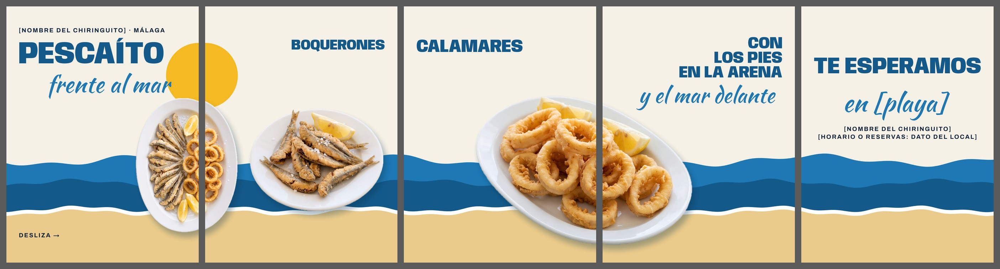

# Carrusel del chiringuito · entrega de prueba (08/11/2026)

**Estado: pieza de prueba, no publicable.** Las fotos se generaron solo con texto, sin foto del local, así que el pescado es genérico. Faltan los datos del chiringuito, que siguen entre corchetes.

## Qué es

Es un carrusel continuo de 5 diapositivas, con el diseño sacado de un pin de Pinterest (`referencias/`). El fondo es una sola playa ilustrada partida en 5. Dos platos cruzan de una diapositiva a la siguiente para invitar a deslizar.

| # | Texto | Foto |
|---|---|---|
| 1 | [Nombre] · Málaga / Pescaíto / *frente al mar* / Desliza → | La fuente mixta empieza aquí, delante del sol |
| 2 | Boquerones | Sigue la fuente; plato de boquerones |
| 3 | Calamares | El plato de calamares empieza aquí |
| 4 | Con los pies en la arena / *y el mar delante* | Sigue el plato de calamares |
| 5 | Te esperamos / *en [playa]* / [Nombre] · [Horario o reservas] | — |

Exportado en 3:4 (1080 × 1440) y 4:5 (1080 × 1350): `datos/disenos/chiringuito-carrusel/chiringuito-N/vNNN/exportadas/`. Versiones vigentes: diapositiva 1 en v004 y el resto en v003.

**08/11, revisión de María** (`diseno/f1_6/POSTS-F1-6.md` §10): los textos de 24–28 px pasan a 34 px. En la diapositiva 4, «y el mar delante» se separa del titular; en la 1, el titular baja un poco para separarse de la marca.

## Fotos

| Activo | Pedido | Cámara | Revisión a tamaño real |
|---|---|---|---|
| `chiringuito-foto-1-mcp-1` | Fuente mixta, 3 limones | Cenital | Bien: 3 limones, boquerones con cabeza y cola, nada añadido |
| `chiringuito-foto-2-mcp-1` | Boquerones, 1 limón | ¾ a 35° | Bien: unos 10 boquerones (algunos abiertos, como limpios), nada añadido |
| `chiringuito-foto-3-mcp-1` | Calamares, 2 limones | ¾ bajo a 20° | Bien de contenido; la cámara quedó a unos 35°, no a 20° |

- Las tres fotos van sobre fondo liso y se recortan con Apple Vision. El plato sale entero, sin restos de fondo.
- Cada plato lleva una sombra hacia abajo a la derecha, como la luz de las fotos.
- Los prompts están en `foto/` y las recetas en `recetas/`.

## Coste

| Concepto | Créditos | USD aprox. |
|---|---|---|
| 3 fotos, 1 intento cada una (`get_cost` = 2 en cada una) | 6 de 12 | 0,38 |

- Se pidió `nano_banana_pro` y sirvieron `nano_banana_2`; consta en la procedencia.
- El saldo pasó de 22,81 a 16,81 créditos.
- Registro: `datos/gasto/higgsfield.jsonl`, con `encargo: chiringuito-carrusel`.

## Para que sea publicable

1. **Los datos del local:** nombre, playa, horario o forma de reservar, y qué fritura sirve de verdad.
2. **Fotos de sus platos, aunque sean del móvil.** Con ellas se rehacen las tres con la plantilla de foto nueva, para que el plato sea el suyo.
3. **El titular de las diapositivas 2 y 3** («Boquerones», «Calamares»), que depende de su carta.
