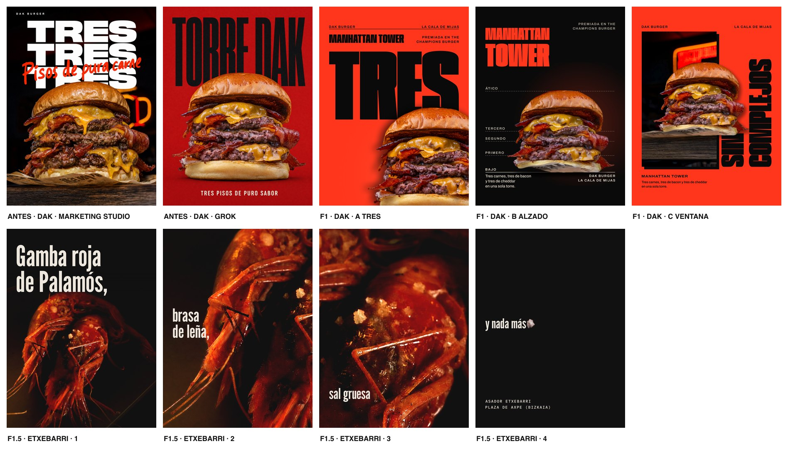

# Revisión · «Y nada más»

Revisión del 2026-11-07 con `conocimiento/rubrica.md`, sobre los renders finales: diapositiva 1 en v002, 2 en v001, 3 en v001 y 4 en v002. La hice con mis propias vistas: la serie (`datos/disenos/etxebarri-gamba-carrusel/revision/final/carrusel.jpg`), el móvil a 390 px (`movil.jpg`), miniaturas borrosas, la exportación 4:5 y recortes al 100 %. Es la revisión del crítico del estudio: una pista, no el gusto del dueño. **La valoración que cuenta es la tuya.**

## Filtros previos

- **Veracidad:** pasa. Todas las palabras están en el registro del `BRIEF.md`:
  - gamba roja de Palamós;
  - brasa de leña;
  - sal gruesa;
  - y nada más;
  - Asador Etxebarri;
  - plaza de Axpe;
  - Bizkaia.

  El pie añade «Producto y fuego, sin artificios», que está documentado.
- **Fidelidad:** pasa. Los tres activos son PUBLICABLE. La foto de campaña tiene el veredicto CONSERVA y las dos imágenes que alteraban el producto están descartadas.
- **Comprobaciones deterministas:** pasan.
  - Sin errores.
  - Contraste de la frase de 13,7:1 a 16,1:1 en su peor zona.
  - Ampliación máxima de 1,5× (diapositiva 3).
  - Todo el texto dentro de la zona 4:5.

## Diapositiva a diapositiva

| | 1 · Gamba roja de Palamós, | 2 · brasa de leña, | 3 · sal gruesa | 4 · y nada más |
|---|---|---|---|---|
| Idea | **4.** La frase empieza y la coma pide pasar; el producto, monumental. Sola, es «producto y frase»: fuerte pero conocida | **4.** El fuego contado por su huella: la frase está junto a las puntas tostadas | **4.** La sal a escala de paisaje, casi abstracta | **5.** El vacío es el mensaje y el único punto del carrusel es un grano de sal real |
| Composición | **4.** A sangre por tres lados y la frase pegada al borde de la gamba; sigue siendo un reparto arriba/abajo | **4.** La frase en la penumbra señala la prueba; el resto es una masa de patas algo confusa | **4.** La diagonal de una pata cruza los cristales; el texto, abajo, en su sombra | **4.** Muchísimo aire; fuera de la serie podría leerse como una tarjeta final sin más |
| Tipografía | **5.** League Gothic en bandera, interlineado de 0,9 y la coma con intención | **4.** Dos líneas cortas bien partidas; la coma | **4.** Correcta y discreta | **4.** El grano como punto funciona; la firma en mono, a 28 px |
| Fotografía | **4.** Claroscuro con volumen y brillo en el caparazón. El centro de las gambas queda oscuro y algo turbio en el móvil | **4.** A 1,05×, nítida; las puntas negras se ven | **3.** A 1,5×: blanda al 100 %, y el detalle a esa escala lo ha dibujado el modelo (comprobado: mismos cristales y en el mismo sitio) | — (el grano es real, algo desenfocado) |
| Fidelidad | **5** | **5** | **5** | **5** |
| Personalización | **4.** Carbón, hueso y una grotesca de madera: sobria y artesana. Sin logotipo (no hay archivo) | **4** | **3.** Un macro rojo podría ser de otro local | **4.** La firma y el lugar |
| Coherencia | **5** | **4** | **4.** Se parece a la 2: dos primeros planos rojos seguidos | **5.** Cierra la frase y la serie |

## El carrusel entero

- **Historia:** sí. Se puede contar en una frase: la receta es tan corta que cabe en un carrusel y la última diapositiva está casi vacía.
- **Principio y final:**
  - la portada abre y la coma invita a seguir;
  - la 4 cierra con el único punto;
  - el pie repite la frase entera.
- **Ritmo:**
  - la cámara se acerca: plato, cabezas, sal, grano;
  - la frase baja: arriba, en medio, abajo y, al final, sola;
  - el cuerpo de la letra decrece: 207, 130, 108 y 98 px;
  - la densidad se vacía.
- **Repetición:** la 2 y la 3 son dos primeros planos rojos seguidos. Las separan la escala y la idea (patas y fuego frente a cristales), pero en el móvil se parecen más de lo ideal.
- **Identidad:** ninguna diapositiva la rompe. Los cuatro negros son el mismo carbón, gracias al punto negro.
- **La portada sola**, en la cuadrícula del perfil, funciona: el producto es potente y la frase se lee a 390 px.

**Veredicto del crítico: corregir y publicar.** No hay nada por debajo de 3 ni ningún defecto bloqueante. Las mejoras que quedan dependen sobre todo de tener más fotografía real. **No se publica nada:** esta pieza es una propuesta del estudio y Etxebarri no la ha encargado ni aprobado.

## Notas, por impacto

1. **MEJORA · Diapositiva 3.** La ampliación de 1,5× y el detalle generado a esa escala la hacen la más débil. *Arreglo:* una foto macro real de la sal sobre el caparazón (guía al restaurante: luz lateral, a 15 cm, con el diafragma abierto). Con ella, la 3 sería la más fuerte.
2. **MEJORA · Diapositivas 2 y 3, demasiado parecidas en el móvil.** *Arreglo:* sin fotos nuevas, invertir el valor de la 3 (más aire oscuro y cristales más pequeños en el cuadro). Con fotos nuevas, otra superficie u otro ángulo real.
3. **MEJORA · Diapositiva 1, el centro turbio en el móvil.** *Arreglo:* una foto real con luz lateral de verdad. En el compositor ya se ha hecho lo razonable sin que parezca un efecto: el aclarado suave.
4. **MEJORA · Marca.**
   - Sin logotipo: la firma va compuesta. *Arreglo:* el archivo real del logotipo y dónde se puede usar.
   - League Gothic e IBM Plex Mono son una propuesta del estudio que cumple la descripción de `marca.json`. *Arreglo:* confirmarlas con el local.
5. **MEJORA · Diapositiva 4, poco evidente fuera de contexto.** Si alguien entra directamente en ella, puede leerla como una tarjeta vacía. Es aceptable: el carrusel se ve desde la portada.

## Aciertos que hay que proteger

- **La frase única con comas, minúsculas y un solo punto.** Es la idea del carrusel y no depende de ningún recurso decorativo.
- **El grano de sal como punto final:** sale del producto, no de un catálogo.
- **El mismo carbón en foto y fondo** (punto negro).
- **La frase en la penumbra señalando la prueba** (diapositiva 2).
- **Fidelidad comprobada imagen a imagen.**

## Cómo se llegó aquí (pintar, mirar y corregir)

| Iteración | Lo que vi | Lo que cambié |
|---|---|---|
| Borrador 1 | Portada con «título arriba y producto pequeño abajo» (plantilla); la 2 repetía estructura; la 3, ampliada 2,3×, blanda; grano invisible | Producto monumental a sangre; encuadres de 1,05× y 1,5×; grano mayor |
| Borrador 2 | La frase de la 2 encima de una pata brillante; en el móvil, muy oscuro; firmas a 9 px en pantalla | Frase a la penumbra; retoque común; firmas a 28 px |
| Borrador 3 | Cada diapositiva cerraba con punto: no pedía deslizar | **Una sola frase** con comas, minúsculas desde la 2 y un punto final de sal |
| Borrador 4 | Escalón de color en la portada: el negro de la foto era más oscuro que el carbón del fondo | Capacidad nueva: `puntoNegro`. Encontré y corregí un fallo (el contraste se comía el punto negro) y añadí un test |
| v1 | En el móvil el grano se veía como una mota gris | Diapositiva 4 v2: grano casi tan alto como las mayúsculas |
| v1 → v2 portada | Centro de las gambas turbio | Aclarado suave sobre el producto |

## Frente a DAK Burger (F1) y a los posts antiguos

**Qué ha mejorado:**
- **Primero la idea y después la composición.** En la F1 elegí un recurso (palabra detrás, alzado, ventana) y lo coloqué. Aquí la idea (una receta que se vacía) decide la escala, el texto y el ritmo, y el compositor solo la ejecuta.
- **No es una plantilla de DAK:** otra paleta, otra tipografía, otra luz, otra estructura y otra voz con el mismo motor.
- **Fotografía:** por primera vez hay una dirección fotográfica (luz de brasa) producida con IA sin alterar el plato, y con prueba de que no lo altera.
- **Texto exacto y editable**, frente al texto rasterizado de los posts de Marketing Studio y Grok.

**Qué sigue siendo insuficiente:**
- **Menos energía publicitaria** que los posts antiguos de DAK. Es en parte buscado (el local es sobrio) y en parte un límite: la foto real es un único plano de mesa con luz de día.
- **Una sola foto real** sostiene cuatro diapositivas. El carrusel se apoya en encuadrar cada vez más cerca y una buena producción necesita más material.
- **El director automático todavía no hace esto.** Las intenciones las he escrito yo siguiendo los oficios. Que lo haga Gemini con el mismo criterio es trabajo de la F2.
