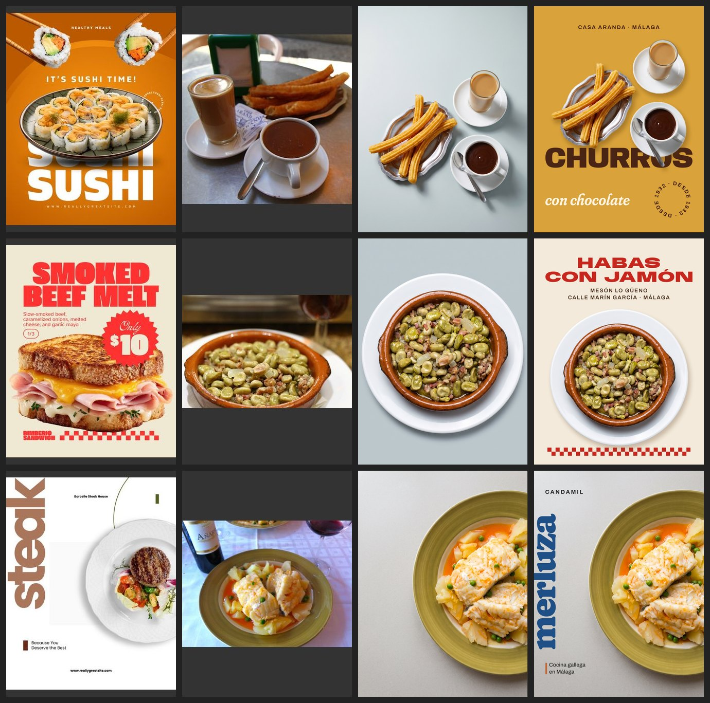

# Tres posts para tres locales nuevos · entrega de prueba (08/11/2026)

**Estado: piezas de prueba, no publicables.**
- Las fotos de partida son de Wikimedia Commons (CC BY-SA 2.0), no de los dueños.
- Los colores los propone el estudio y no están confirmados.
- Ningún local ha encargado nada.

Por filas: referencia de Canva → foto de internet → foto nueva → post. En 4:5: `diseno/f1_6/img/tres-locales-4x5.jpg`.

## Cómo se ha hecho (como un usuario normal)

1. **Local y datos.** Solo lo que consta en la web: nombre, calle, tipo de cocina y año de fundación. Va en `datos/locales/<slug>/marca.json`.
2. **Foto del plato.** La busqué en internet. Las tres son fotos reales hechas en el propio local, con licencia libre. Están en `fotos-web/`.
3. **Referencia.** Un post de Canva de `biblioteca/referencias`, de una familia que aún no se había usado.
4. **Director (Gemini, gratis).** Describe la foto, propone una cámara a más de 30° y rellena la plantilla de foto nueva.
   - Lo que corregí a mano está en `foto/<slug>.final.json`, con su motivo.
5. **Generación (Higgsfield).** `get_cost` antes de cada petición y la foto de internet como @image1.
6. **Recorte, composición y revisión.** Revisé con las reglas de María: espacio, textos de 34 px o más, el nombre del plato legible y el recorte nítido.

## Las tres piezas

| Local | Plato | Referencia | Foto nueva | Versión |
|---|---|---|---|---|
| Casa Aranda (churrería, 1932, calle Herrería del Rey) | Churros con chocolate | post-03 · F1, color plano y palabra detrás | Casi cenital (intento 2) | `datos/disenos/casa-aranda/casa-aranda-post/v001` |
| Mesón Lo Güeno (tapas, calle Marín García) | Habas con jamón | post-05 · F3, crema, titular rojo y tira de cuadros | Casi cenital | `datos/disenos/meson-lo-gueno/lo-gueno-post/v001` |
| Candamil (cocina gallega, centro de Málaga) | Merluza | post-29 · F6, blanco editorial y palabra girada | Cenital, plato cortado por la derecha | `datos/disenos/candamil/candamil-post/v001` |

**De cada referencia se toma la receta, no el contenido.** No se copian SUSHI, el precio en estrella, «steak» ni las marcas de las plantillas.

## Correcciones al director

**Churros:**
- El director contó 4 churros y yo 5, así que puse 5.
- Quité el sobre de azúcar: lleva impreso «Casa Aranda» y sería texto en la foto.
- f/4 → f/11, para que el recorte salga nítido.
- Fondo liso gris azulado: el terracota que proponía se confundiría con los churros al recortar.

**Habas:**
- Quité el «sello de precio»: no hay precio y no se inventa.
- Quité la mención a la familia y el código de color.
- f/5,6 → f/11 y fondo liso para la máscara.

**Merluza:**
- Quité «a la gallega». Que tienen merluza consta en las reseñas; el estilo no consta.

## Fotos generadas

| Foto | Veredicto |
|---|---|
| Churros, intento 1 | **Descartada.** Cámara a unos 25–30°, a menos de 30° de la original (45°), y seis churros |
| Churros, intento 2 | **Aceptada.** Casi cenital |
| Habas | **Aceptada.** Una cazuela con asas sobre plato blanco; habas, jamón y cebolla; nítida |
| Merluza | **Aceptada.** Dos piezas, patata, guisantes y aceite de pimentón |

Detalles de las aceptadas:
- **Churros:** salen cuatro. El recuento de la foto original es dudoso (el director contó cuatro y yo cinco), y aquí el número no es información del plato, como sí lo era en las gambas.
- **Merluza:** el pescado sale algo más liso que en la foto original.

## Coste

| Concepto | Créditos | USD aprox. |
|---|---|---|
| 4 fotos (3 más 1 reintento), `get_cost` = 2 en cada una | 8 de 12 | 0,50 |

- Se pidió `nano_banana_pro` y sirvieron `nano_banana_2`; consta en la procedencia.
- El saldo pasó de 16,81 a 8,81 créditos.
- Registro: `datos/gasto/higgsfield.jsonl`, con `encargo: posts-tres-locales`.
- Gemini, el director, se usó en el plan gratuito: 0 €.

## Fuentes

- Datos de Casa Aranda: salir.com (fundada en 1932, calle Herrería del Rey) y roadsandkingdoms.com.
- Datos de Mesón Lo Güeno: andalucia.org y tablejourney.com (calle Marín García; las fuentes dan el número 9 y el 12, así que solo se usa la calle).
- Datos de Candamil: gastroranking.es («Cuarteles, Málaga»; reseñas de pulpo, bacalao y merluza) y atly.com (calle Cuarteles 15).
  - Una reseña dice que se ha mudado, así que solo se usa «Málaga».
- Fotos en Wikimedia Commons, CC BY-SA 2.0, y no publicables sin el permiso del local y la atribución:
  - «Café con leche, churros y chocolate, Casa Aranda, Malaga» (autor: Jun);
  - «Broad beans and ham with Malaga wine, Bar Lo Gueno, Malaga» (autor: Jun);
  - «Málaga Candamil (7057366597)» (autor: Andrew Nash).
- Descarté «Campero Malagueño - La Reola» (Commons) porque no encontré ningún local llamado La Reola.
